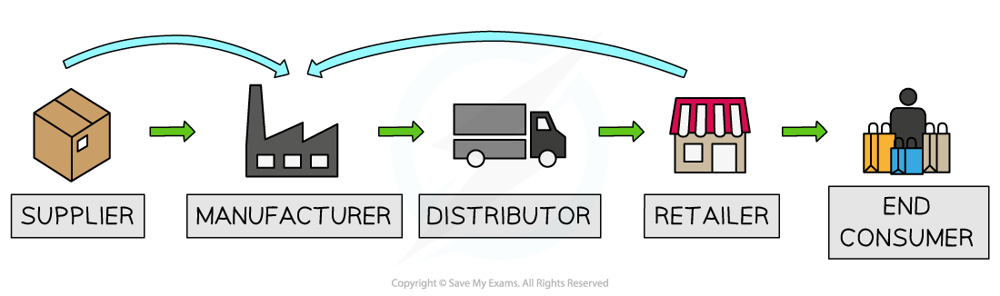

# Business Growth

## Why do businesses grow?

> **Spec point** — `spcpt_4CQtmWJVnTVXSpmP`

## Why do businesses grow?

- Business growth involves a business** increasing its size, scope, or scale**
- Their leaders or owners may have **ambitions **for growth for a range of reasons

| Reason | Explanation | Example |
|---|---|---|
| Rising customer demand | - When more people want a company’s products, it can open new stores or hire extra staff to meet that need | - **Deliveroo **expanded into new cities when food-delivery orders surged during lockdown |
| Economies of scale | - As firms get bigger, they spread fixed costs over more units, cutting the *unit cost *and boosting profits | - A carmaker that builds 1 million vehicles each year pays less per car for parts and factory costs than a business that builds 100,000 cars |
| Entering new markets or products | - By selling to new customer groups or introducing related products, a business can find extra sources of revenue | - **Netflix **moved from DVD rentals to streaming and then launched in dozens of countries worldwide |

## Internal (organic) growth

> **Spec point** — `spcpt_frGPB2CPDrcyf5ZK`

## Internal (organic) growth

- **Organic growth (internal)** is usually generated by

  - Gaining greater **market share**
  - Product *diversification*
  - Opening a new store
  - International expansion
  - Investing in** new technology** or production machinery
- Firms will often **grow organically** to the point where they are in a financial position to** integrate** with others

  - Integration speeds up growth but also creates new challenges

#### Evaluating organic growth

| **Advantages** | **Disadvantages** |
|---|---|
| - The **pace of growth** is manageable - **Less risky**,** **as growth is financed by profits and there is industry expertise - Avoids ***diseconomies of scale*** - The management knows & understands every part of the business | - The pace of growth can be slow and frustrating - Not necessarily able to benefit from ***economies of scale*** - Access to **finance** may be limited |

## External growth

> **Spec point** — `spcpt_CHs3b5pwWNzNYzFB`

## External growth

- Integration in the form of mergers, takeovers, and joint ventures results in rapid business growth and is referred to as **external (or inorganic) growth**

#### Methods of external growth

*Methods of external growth include mergers, takeovers and joint ventures*

- **A merger **occurs when two or more companies combine **to form a new company, **usually on a **friendly **basis

  - The original companies cease to exist, and their *assets *and *liabilities *are transferred to the newly created entity
  - Firms merge to become **stronger together** than they would be apart
  
    - That strength comes from lower costs, more customers, new capabilities or less competition
- **A takeover **occurs when **one company purchases another company**, often against its will (**hostile takeover**)

  - The acquiring company **buys a controlling stake (more than 50% of *****shares*****) i**n the target company's shares and gains control of its operations
- A **joint venture **occurs when two businesses join together to share their knowledge, resources, and skills to form a separate business entity, usually for a** limited period of time **

  - E.g., the mobile network **EE **is in a joint venture formed by the French mobile network, Orange, and the German mobile network, T-Mobile
- There are several reasons why companies may choose to pursue external growth

#### Reasons for external growth

| Reason | Explanation | Example |
|---|---|---|
| **Strategic fit** | - Acquiring another company to enter new markets, offer new products, or gain new technology | - In 2010, **Kraft Foods** bought Cadbury to expand its product range and boost sales in the UK |
| **Economies of scale** | - Growing larger lets companies cut costs and work more efficiently by combining operations and spreading fixed costs over more output | - When a factory doubles output, its cost per unit falls because *overheads *are spread across more items |
| **Synergies** | - Benefits that arise when two companies combine, such as higher revenue, lower costs, or better products | - Two merged airlines share routes and staff, reducing costs and offering more flight options |
| **Elimination of competition** | - Buying rivals removes competition and increases the buyer’s *market share* | - **Meta **(Facebook’s parent company) acquired WhatsApp in 2014, adding its users to Facebook’s network |
| **Shareholder value** | - Mergers and takeovers can boost profits, *dividends*, and *share prices*, creating higher returns for investors | - After a merger, a company’s combined profits rise, leading to a higher dividend and a stronger share price |

## Types of integration

> **Spec point** — `spcpt_74z5jB2SFCFGJxGp`

## Types of integration

- **External growth** usually takes place when firms join in one of three broad ways

### 1. Vertical integration

- This is a merger or takeover of another firm in the supply chain or different stage of the production process

  - E.g. An ice cream manufacturer merges with a dairy farm or an ice cream cafe chain

#### Examples of vertical integration

*A diagram that illustrates how a firm can grow through forward or backward vertical integration*

- **Forward** **vertical integration** involves a ***merger*** or ***takeover*** with a firm further forward in the supply chain

  - E.g. A dairy farmer merges with an ice cream manufacturer
- **Backward vertical integration** involves a merger/takeover with a firm further backwards in the supply chain

  - E.g. An ice cream retailer takes over an ice cream manufacturer

#### Evaluating vertical integration

| **Advantages** | **Disadvantages** |
|---|---|
| - Reduces the **cost of production** as middleman profits are eliminated - Lower costs make the firm more **competitive** - Greater control over the supply chain **reduces risk **as access to raw materials is more certain - **The quality** of raw materials can be controlled - Forward integration adds **additional profit** as the profits from the next stage of production are assimilated - Forward integration can increase **brand visibility** | - **Diseconomies of scale** occur as costs increase, e.g. unnecessary duplication of management roles - There can be a ***culture clash*** between the two firms that have merged - Possibly **little expertise** in running the new firm results in **inefficiencies** - The price paid for the new firm may take a long time to recoup |

### 2. Horizontal integration

- This is a merger or takeover of a firm at the same stage of the production process

  - E.g. An ice cream manufacturer buys another ice cream manufacturer

#### Evaluating horizontal integration

| **Advantages** | **Disadvantages** |
|---|---|
| - A rapid increase of **market share** - Reductions in the cost per unit due to ***economies of scale*** - Reduces competition - Existing knowledge of the industry means the merger is more likely to be successful - The firm may gain new** knowledge or expertise** | - **Diseconomies of scale** may occur as costs increase, e.g. unnecessary duplication of management roles - There can be a ***culture clash*** between the two firms that have merged |

### 3. Conglomerate integration

- This is a merger or takeover between firms in entirely different industries

  - E.g., An ice cream manufacturer buys a clothing company

#### Evaluating conglomerate integration

| **Advantages** | **Disadvantages** |
|---|---|
| - **Spreads risk** across industries - Uses **surplus cash** and skills elsewhere - **Key expertise**, such as strong financial management or marketing know-how, can be shared with all part of the business | - Limited** management know-how** in unfamiliar sectors - **Research** may be required to understand trends and customer needs - Greater organisational **complexity** |
