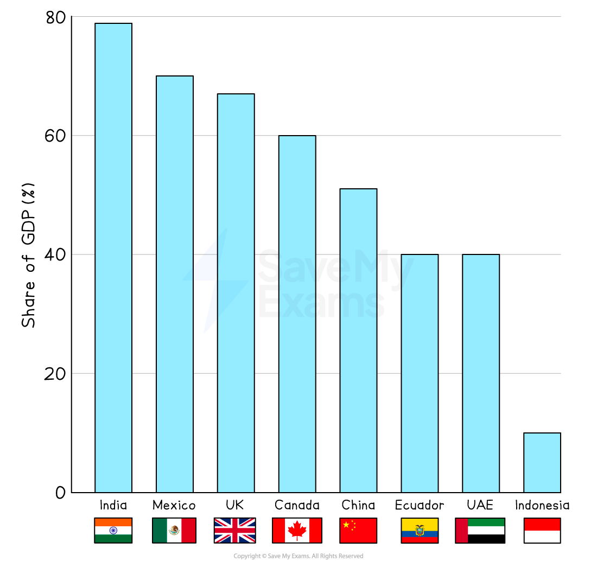
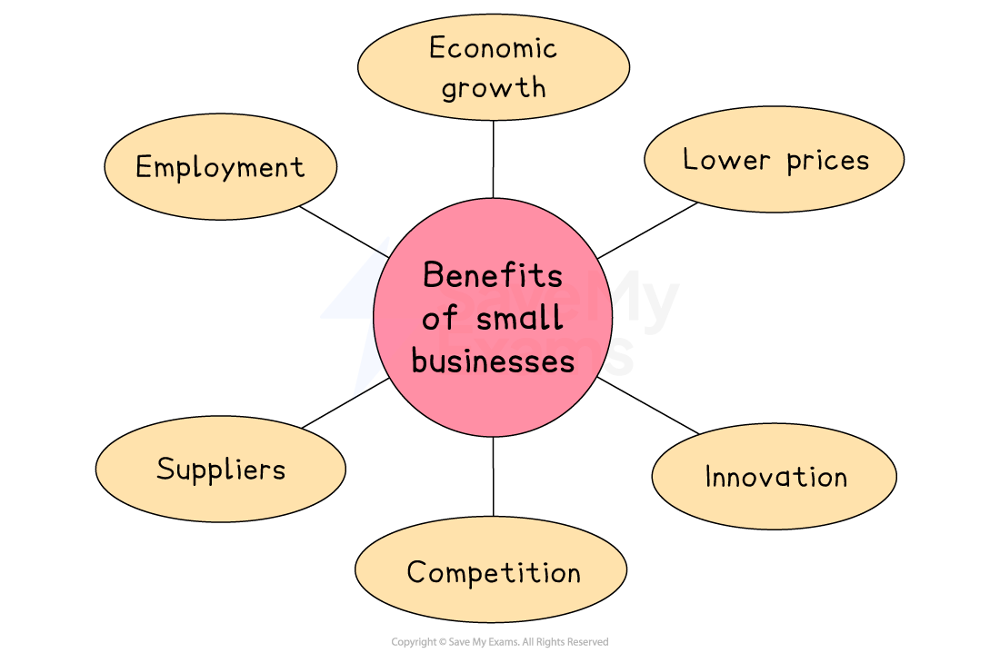

# Measurements of Business Size

## Methods of Measuring Business Size

> **Spec point** — `spcpt_mpWXTKq4R7rzypBm`

## Methods used to measure business size

- A range of stakeholders have an interest in understanding business size

  - Some **suppliers** prefer to deal with larger businesses as they are seen as less risky than small businesses
  - **Governments** can determine which businesses may need support to grow
  - **Investors** may want to compare businesses to determine which offers the best ***return***
- In some sectors, **specific variables** are used to measure business size

  - Hotels and guesthouses measure the **number of rooms or beds**
  - Restaurants measure the **number of 'covers'** they can cater for
  - Retailers measure the **number of outlets** they operate
  - Logistics businesses measure the **number of vehicles** they employ

### Ways to measure business size

### 1. Size of the workforce

- A measure of how many workers are in the business
- Small and medium-sized businesses (**SME**s) employ less than 250 workers
- Large businesses have 250 or more workers
- The **method of production** can influence this metric

  - Large ***capital-intensive*** businesses employ few workers
  - Smaller ***labour intensive*** businesses have many employees
- Different workers' contracts make this measure unreliable

  - Some firms hire many **part-time **workers, while others have fewer** full-time** workers
  - Short-term, ***zero hours*** or ***agency worker*** contracts may not be included

### 2. Value of capital employed

- A measure of all the capital (money, equipment, and buildings) invested in a business at a specific time
- It is difficult to compare businesses with **labour-intensive **and **capital-intensive** production methods

  - European manufacturing businesses tend to have high levels of **capital, such as robots, **compared to firms in countries such as Vietnam and Indonesia
  - **Property values** differ across the world and between regions
  
    - E.g. The value of property in Singapore is significantly greater than property in mainland China

### Value of business sales

- The **total *****sales revenue*** achieved during a trading period
- It is calculated using the formula

Price x Quantity sold

- Businesses sell very **different products**

  - Comparing a market stall selling sweets with a retailer of luxury handbags would be unrealistic, as their prices and volumes sold are very different
- Selling **prices vary** between markets

  - Businesses may sell products to customers in low-income markets at a lower price than in a higher-income market

#### 3. Value of business output

- The **financial worth of goods produced,** even though they may not all be sold
- It is calculated using the formula

Total costs x Quantity

- High value output can be produced by businesses with **very few employees** or with** limited capital employed**

  - E.g. A bespoke jewellery maker may produce only a few expensive items each year
- The value of output does not measure how successful a business has been at selling goods produced

  - If goods are** left unsold,** they are a poor measure of business size

#### 4. Market capitalisation

- The value of a company's** issued shares**
- It is calculated using the formula

Share price x Number of shares

**Share prices fluctuate** so market capitalisation is a relatively **unstable method** of measuring business size

- Sharp **increases in share price** can make it appear that a relatively small business has grown very quickly
- A rapid **decrease in the share price** may make a business appear smaller whilst employing the same number of employees

#### 5. Market share

- The portion of a market controlled by a particular company, brand or product
- It is calculated using the formula

(Business Sales ÷ Market Sales) x 100

In some cases, a large business may maintain a presence in a market dominated by smaller rivals to spread risk

- E.g. **Dunlop **continues to manufacture and sell sportwear in a market dominated by brands such as **Nike **and **Adidas**

> **Exam Hint**
> Profit is not a measure of business size, though it can be used to measure business success.
> 
> A business with many employees may make a loss whilst a business with just one employee may make a profit. This does not mean that the business with one employee is the larger of the two.

## Evaluating Small Businesses

> **Spec point** — `spcpt_Pff3w5ZZqNCq6tJ2`

## Evaluating small businesses

- In the European Union (EU) small businesses are classified as those **employing 50 or fewer workers**

  - In 2022, small businesses were responsible for approximately 49 percent of employment in the EU's economy
  - Italy, France, Spain and Germany had the highest number of small businesses in the ***trade bloc***, concentrated in the ***retail sector***

#### Reasons why small firms succeed

| **Personalised Service** | **Agile** | **Operate in Nice Markets** |
|---|---|---|
| - They offer a **personalised service **and focus on building excellent relationships with customers | - By remaining small, they are able to **respond quickly** to changing customer needs/preferences | - They provide a product that is in a **niche market** - a relatively small market with potential for **high profits** |

- Operating as a small business has a number of **advantages:**

  1. They are **easy to set up** and, in many cases, require **little** **start-up** ***capital***
  2. They are **managed by their owners,** who **maintain control** of the business and determine its ***strategic*** direction
  3. Owners are likely to have **close working relationships** with workers, encouraging loyalty
- However, remaining as a small business can have some **disadvantages:**

  1. **Few sources of finance** may be available, as owners are keen to retain full control and lenders consider them higher risk than larger firms
  2. The business owner typically takes on all of the **responsibility for decision-making,** which can put them under significant pressure
  3. There is little opportunity to achieve benefits of ***economies of scale***

## Strengths & Weaknesses of Family Businesses

> **Spec point** — `spcpt_qtmT5zzCSPf27zm6`

## Strengths and weaknesses of family businesses

- Many businesses are owned by **more than one member of the same family**
- Some family businesses have traded for a very long time

  - **Berenberg Bank** was founded in 1590 and is one of the few remaining independently owned banks in Germany
  - **Akerblads** is a hotel in Tällberg, Sweden that is currently run by members of the 21st generation of the family after which it is named
  - The Neame family remains in control of **Shepherd Neame, **Britain’s oldest brewery, which was founded in 1664
- In some countries, family-owned businesses make up a significant proportion of enterprises

  - Globally, **90% of businesses are family-owned**, contributing significantly to ***GDP*** and employing many millions of workers
  
    - In India more than 79% of GDP is generated by family-owned businesses
    - Its largest example is **Reliance Industries**, founded in 1973 and run by the Ambani family

#### GDP contribution of family businesses

*In countries such as India, Mexico and Canada, family businesses make a significant contribution to GDP*

#### Strengths and weaknesses of family-owned businesses

| **Strengths** | **Weaknesses** |
|---|---|
| - They often have a **long-term perspective** that prioritises business sustainability over profit    - This is likely to preserve the business for future generations - They have **strong cultures**, rooted in the family's ***ethos*** and traditions    - This can encourage loyalty and a sense of belonging among employees - Family owners demonstrate a **high level of commitment** to the business    - Their personal reputation and ***livelihoods*** are tied to the success of the enterprise - They develop **close relationships with customers** and build **long-lasting links with suppliers**    - This is likely to lead to an excellent reputation for customer service and high levels of flexibility | - **Conflicts **and** tensions** can arise within the family    - Disputes over business decisions and roles within the company can disrupt business operations - They may **lack professional management**    - Family members are often promoted to leadership positions regardless of qualifications or experience, resulting in poor decision-making - They may **struggle to access external finance **to fund growth    - Family owners are often reluctant to dilute family ownership by selling new ***shares*** to raise finance - Planning for ***succession*** **can be complex and emotional** in family-owned businesses    - Choosing the next leader and the fair distribution of shares among family members can cause conflict |

## The Role of Small Businesses in the Economy

> **Spec point** — `spcpt_yRtFQnJhqq76gRXG`

## The role of small businesses in the economy

- Small businesses bring a range of benefits to an economy

*Small businesses create employment, increase competition and encourage innovation within an economy*

#### Employment

- Small businesses employ a large proportion of the workforce in most economies

  - They account for 60 to 70 per cent of jobs in most ***OECD*** countries, with a particularly large share in Italy and Japan
  - In developing economies, small businesses create around 80% of new jobs

#### Economic growth

- Growth in countries or regions with few large businesses is fuelled by small and growing businesses

  - UK government policies, including ***enterprise zones***, encourage small businesses to set up in areas of industrial decline, such as South Wales and the North East

#### Lower prices

- Small businesses often have lower wage and administration costs than large businesses

  - This may lead to lower prices for customers

#### Innovation and competition

- Small businesses are often set up and run by creative entrepreneurs, whose ideas and problem-solving abilities bring new products and services to the market

  - This increases choice for customers and creates competition for larger firms

#### Suppliers

- Small businesses can be important suppliers to large firms, offering innovative components, flexibility and adaptability, which can help them develop a strong ***unique selling point***

  - E.g. Mark Levison supplies tailored audio equipment to luxury car manufacturer Lexus

## The Role of Small Businesses in Different Industrial Sectors

> **Spec point** — `spcpt_J2mtNTH3pyB2mxH5`

## The role of small businesses in different industrial sectors

- Small businesses are particularly important in some industries
- In the **USA**, small businesses make up a large proportion of firms operating in

  - **Accommodation and food services,** including hotels, restaurants and catering
  - **Beauty and hairdressing** services
  - **EdTech,** including online tuition and learning platforms
  - **Retail,** including small scale shops and online stores
  - **Construction,** including builders and services such as plumbers and electricians
- Some industries, such as power generation and shipping, are dominated by larger businesses

  - Significant ***barriers to entry*** such as the level of **capital investment** or technical expertise, exclude small businesses
  - However, small businesses often **provide tertiary functions for large businesses**, such as accounting, property maintenance and market research
