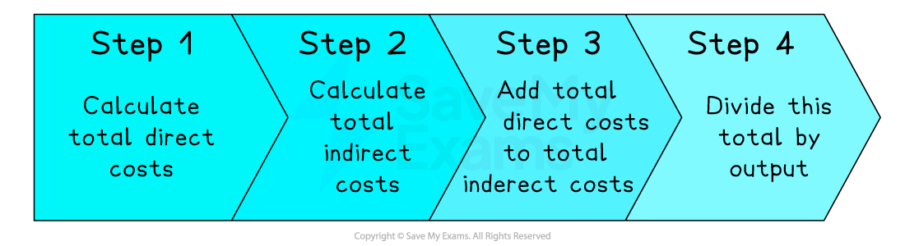
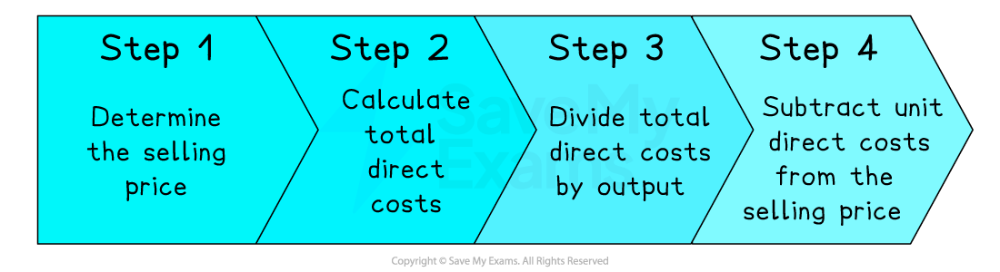
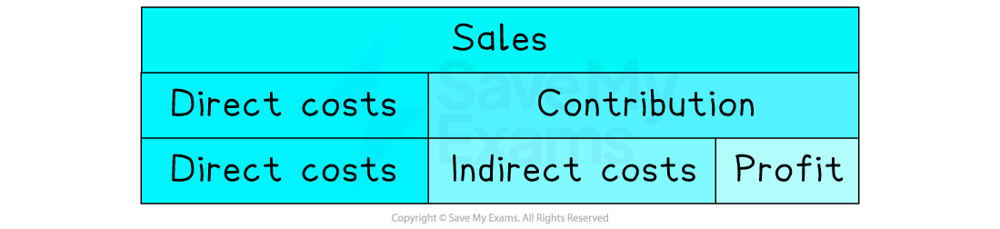

# Approaches to Costing

## An introduction to costing

> **Spec point** — `spcpt_6xS4qWQmR4BgNVYH`

## An introduction to costing

- Businesses can choose how to calculate the costs of manufacturing products, accounting for

  - ***Direct costs***, such as raw materials, components and direct labour
  - ***Indirect costs***, including overheads such as rent, rates, selling costs and administration expenses
- Two of the most commonly used methods are

  - **Full costing**
  
    - This method **allocates all costs**, direct and indirect, **equally across all products **a business manufactures
  - **Contribution costing**
  
    - This method allocates only **direct costs** to products manufactured by a business
    - **Indirect costs** are covered and profits generated by ***contribution***

## The principles of full costing

> **Spec point** — `spcpt_g3PV7bHZ8fDgwn4V`

## The principles of full costing

- If a business manufactures one type of product, full costing can be used to **allocate all costs**, direct and indirect, **equally across all products**

#### Stages in full Costing

*Full costing involves dividing the total costs by the volume of output*

> **Worked Example**
> Luftig Soft Drinks Gmbh uses full costing to determine the cost of manufacturing each bottle it produces.
> 
> In 2023 it manufactured 455,000 bottles of soft drink, and recorded the following costs:
> 
> Total Direct Costs  €52,300
> 
> Total Indirect Costs €120,600
> 
> **Calculate **the full cost of producing each bottle of soft drink.** **
> 
> (2)
> 
> **Step 1: Add total direct costs to total indirect costs**
> 
> $= \text{€} 52 , 300 + \text{€} 120 , 600$
> 
> $= \text{€} 172 , 900$   **(1)**
> 
> **Step 2: Divide total costs by output**
> 
> $= \frac{\text{€} 172 , 900}{455 , 000 bottles}$
> 
> $= \text{€} 0.38$**   ****(1)**

- When a business manufactures** more than one product**, it needs to decide how to **allocate indirect costs **across the range of products

  - Each product may i**ncur a different proportion **of indirect costs
  
    - E.g. they may require more workers, machinery or factory space, or may be manufactured in greater volumes
  - These decisions are **unlikely to be straightforward** and should **remain constant** over time
  
    - Inappropriate allocation of costs can lead to** incorrect pricing decisions**
    - Using different methods makes **comparison over time** difficult
  - Allocations of indirect costs **must be calculated first**, before the full cost can be determined

> **Worked Example**
> Luftig Soft Drinks Gmbh manufactures three different types of soft drink.
> 
> In 2023 each product incurred the following direct costs as well as a proportion of the business's €120,600 indirect costs, broadly based on the level of output.
> 
> | **Product** | **Output** | **Direct Costs** | **Allocation of Indirect Costs (%)** |
> |---|---|---|---|
> | **KirschKick** | 116,500 | €14,550 | 25 |
> | **HimbeerLeck** | 136,000 | €18,220 | 30 |
> | **Apfana** | 202,500 | €19,530 | 45 |
> 
> **Calculate **the full cost of manufacturing each bottle of HimbeerLeck.
> 
> (3)
> 
> **Step 1: Calculate the value of indirect costs allocated to the product**
> 
> $= 30 \% \times \text{€} 120 , 600$
> 
> $= \text{€} 36 , 180$**  **** ****(1)**
> 
> **Step 2: Add total direct costs to allocated indirect costs**
> 
> $= \text{€} 18 , 220 + \text{€} 36 , 180$
> 
> $= \text{€} 54 , 400$   **(1)**
> 
> **Step 3: Divide total costs by output**
> 
> $= \frac{\text{€} 54 , 400}{136 , 000 bottles}$
> 
> $= \text{€} 0.40$**  ****(1)**

## Uses and limitations of full costing

> **Spec point** — `spcpt_xb35MYtvfsXx5Zjn`

## Uses and limitations of full costing

### Uses of full Costing

- Full costing is a **simple method **that is particularly useful when a business manufactures just **one type of product** or where determining the **allocation of indirect costs across more than one product is straightforward**
- **All costs are allocated** to manufactured products, meaning managers can plan for a **guaranteed** **profit **if prices are set higher than the full cost
- **Decision-making **and **performance can be measured and assessed over time**, as long as the method of allocating indirect costs remains the same

### Limitations of full costing

- Determining the allocation of** indirect costs** can be difficult

  - A** decision has to made** about whether indirect costs should be allocated according to **labour used, factory space used, machinery **or **storage space used**, or whether other factors such as the **level of output** would be more appropriate
  - The method used should **remain consistent** to allow for comparisons over time
- Full costing is often used to **predict costs**

  - If actual output levels differ to those used in full costing calculations, calculations will be inaccurate
  - Inappropriate pricing decisions made using these predicted costs could affect the level of profit made on sales

## The nature of contribution costing

> **Spec point** — `spcpt_FqXDSN5zGRyMrCRZ`

## The nature of contribution costing

- Contribution costing is a method of costing where ***direct costs*** **are allocated to products or departments** of a business

  - It assumes that** *****indirect costs*** **must be paid** during a particular time period, regardless of the level of production for each product
  - **Each profitable product contributes** towards paying these overheads
- These products or departments are often referred to as ***cost centres*** or ***profit centres***

#### Calculating contribution

*Contribution is calculated by subtracting the average direct costs of production from the intended selling price*

- Contribution costing can help a business determine the **most worthwhile **products to sell

  - Those which make the **greatest contribution **to fixed costs and profit should be retained
  - Those making a **small contribution** to fixed costs and profit may also be retained, as long as continuing to do so meets business objectives, as phasing them out would **reduce profit**
  - Those with **negative contribution** to fixed costs and profit should be phased out, leading to** increased profit**

> **Case Study**
> **Lickety Split Desserts**
> 
> - Lickety Split Desserts is a seaside ice cream café
> - It sells a range of ice cream and sorbet-based desserts
> - The table below shows a contribution analysis for its top-selling products
> 
> #### Contribution analysis for Lickety Split's top-selling desserts
> 
> | **Product** | **Average selling price (\$)** | **Average indirect cost (\$)** | **Unit contribution to indirect costs (\$)** |
> |---|---|---|---|
> | **Super Sundae** | 8.95 | 3.45 | 5.50 |
> | **Nutty Surprise** | 9.95 | 4.25 | 5.70 |
> | **Fruit Supreme** | 8.95 | 4.30 | 4.65 |
> | **Ice Magic** | 8.95 | 2.25 | 6.70 |
> | **ChocoLick** | 9.95 | 6.60 | 3.35 |
> 
> - Nutty Surprise is the **strongest product**
> 
>   - It earns the** highest contribution** (\$5.70) to indirect costs per product sold
> - ChocoLick is the **weakest** product
> 
>   - It earns the** lowest contribution** (\$3.35) to indirect costs per product sold
>   - Twice as many ChocoLick as Ice Magic desserts would need to be sold to generate the **same level of contribution**
> - This **positive contribution** from all of Lickety Split's **profitable** products can **go towards **paying the** indirect costs** of operating the café
> - Once these indirect costs are covered in full, Lickety Split will **make a profit**

## The difference between contribution and profit

> **Spec point** — `spcpt_ngFdrs4bRjFYFQFS`

## The difference between contribution and profit

- Contribution and profit are** related concepts**, but there is an important difference

#### Contribution and profit

*Contribution is the difference between selling price and direct costs that can be used to cover the payment of indirect costs and contribute to profit*

- **Contribution** shows the **difference between the sales price and direct costs** for specific products

  - This contributes to the payment of indirect costs
  - Once indirect costs are fully covered, contribution goes towards the **profit **of the business
- **Profit **takes into account **all direct and indirect costs** incurred during production

## Limitations of contribution costing

> **Spec point** — `spcpt_FXwsZ8SHhD6Shzyn`

## Limitations of contribution costing

- As **indirect costs are not considered** in calculations, there is **no guarantee that a business will make a profit**

  - It ignores the fact that **some products may incur higher indirect costs** than others
- The **potential** of products that make a small or **negative contribution now but may be more successful in the future** is often ignored

  - Qualitative factors such as the ability of a business to maintain a **full product range**, or the **image** a product contributes to the business are overlooked
  
    - E.g. As one of its heritage products, **Cadbury's Turkish Delight** is retained in the company's product range, despite making a minimal contribution to fixed costs and profit

## Contribution costing and special order decisions

> **Spec point** — `spcpt_fxHzB4RBbYtTHMK4`

## Contribution costing and special order decisions

- Managers often have to decide whether to accept a **special order **at a lower price than it would normally charge

  - If **spare capacity** exists, it may be tempting to accept the order
  - As long as the special order details are **not shared with existing customers**, it could be an effective way to attract a new customer
  - However, if **indirect costs are increased** by accepting the order, it may be more difficult to justify
- **Contribution costing** can determine whether accepting the order will make a **positive contribution to indirect** **costs **and whether it will** increase profit**

  - In many cases, **unprofitable special orders may be worthwhile** as they can make a positive contribution to indirect costs

> **Worked Example**
> Sunrise Hotel and Spa in Sri Lanka offers luxury adult breaks through exclusive travel agencies.
> 
> It has been approached by a specialist business travel agency to host a large party of guests for one night, at a price of \$400 per person. This price is significantly lower than that charged to its usual guests.
> 
> The manager is considering whether to agree to this special order and is considering the hotel's cost data.
> 
> | **Hotel stays: full cost data** |   |
> |---|---|
> | **Direct labour** | \$84 |
> | **Direct materials** | \$72 |
> | **Overheads Apportion** | \$316 |
> | **Full unit cost** | \$472 |
> 
> Should the manager accept the special order? **Explain **your answer.
> 
> (4)
> 
> **Step 1: Total direct costs and subtract from the selling price**
> 
> $= \$ 400 - ( \$ 84 + \$ 72 )
> 
> = \$ 400 - \$ 156
> 
> = \$ 244$**       ****(1)**
> **         **
> 
> **Step 2: State your answer and explain your reasoning**
> 
> - The manager **should **accept the special order** ****(1)**
> - It would make a positive contribution of \$244 to indirect costs, though it would not contribute to increased profit, as the full unit cost is \$472, some \$72 higher than the selling price of \$400** ****(1)**
> - Given that the normal selling price is 'significantly higher,' the hotel would be likely to be making a significant profit on hotel stays at other times** ****(1)**
