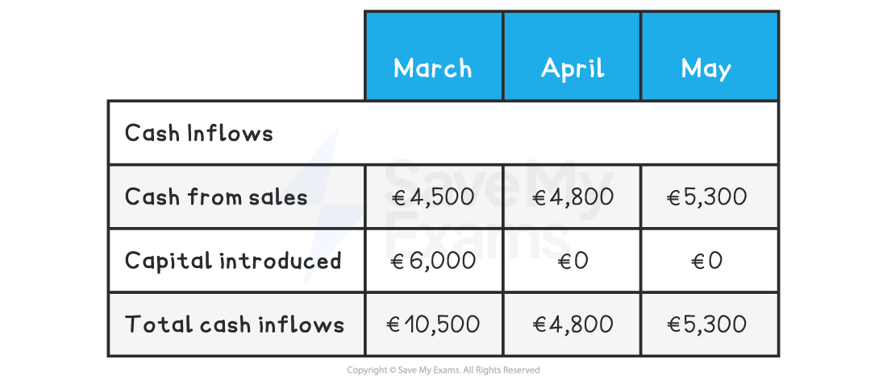
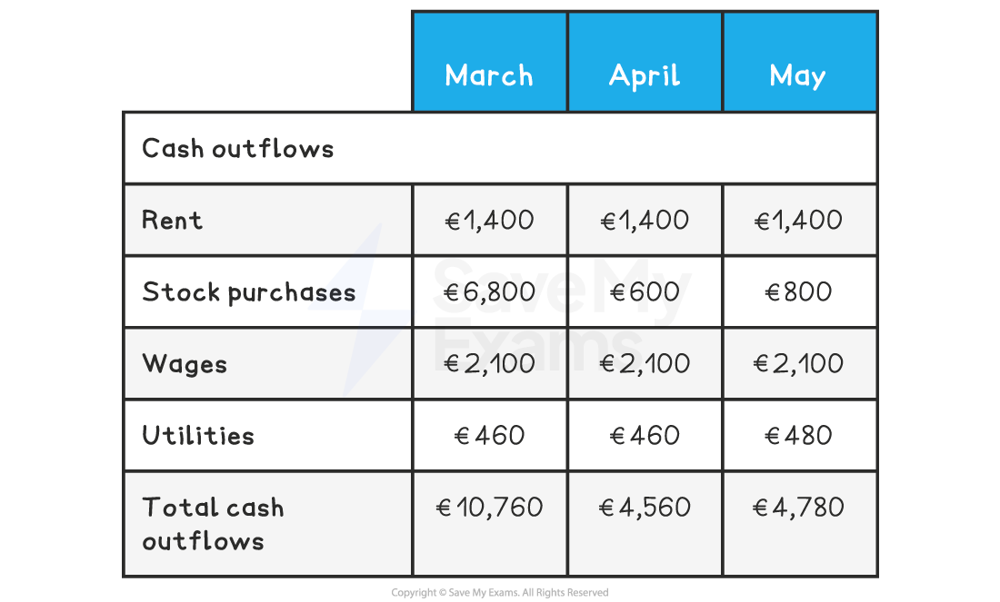
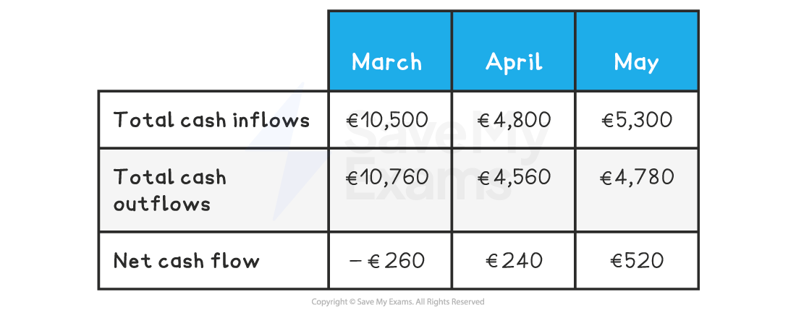
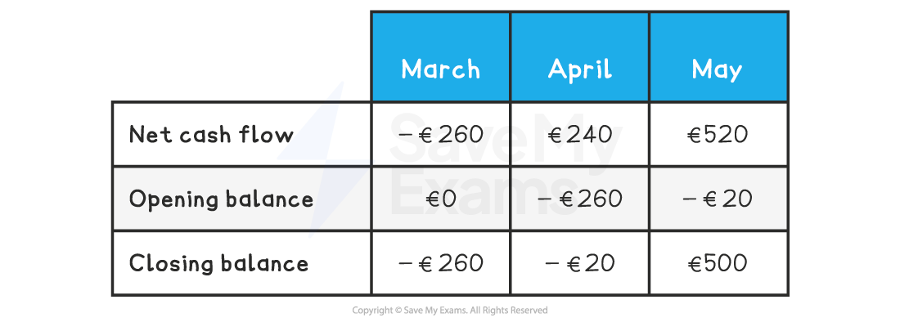
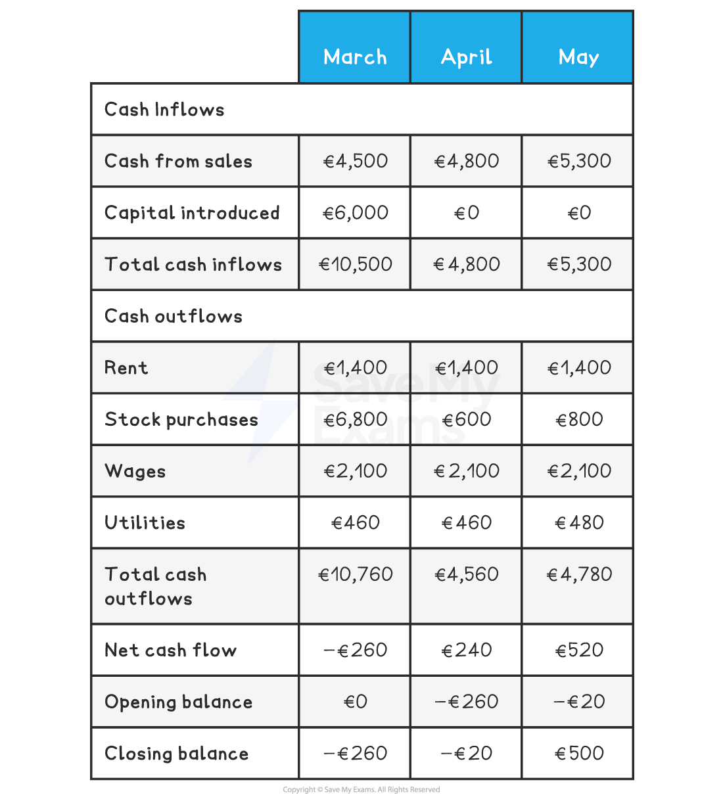

# Cash Flow Forecasts

## The meaning and purpose of cash flow forecasts

> **Spec point** — `spcpt_VJjK6rKzSqr9b7wP`

## The meaning and purpose of cash flow forecasts

- A **cash flow forecast** is a prediction of the anticipated **cash inflows** and **outflows,** usually for a** **six- to twelve-month period

  - **Cash inflows** include income from sales, loan sums received from the bank, interest received or capital injected into a business by owners
  - **Cash outflows** include payments for stock, staff wages and salaries, rent and ***utility*** bills and repayments of bank loans

> **Exam Hint**
> You may be asked to identify an example of a cash inflow or a cash outflow from a list
> 
> Inflows can be remembered using the acronym **SLIC** (Sales, Loans, Interest, Capital) while outflows can be remembered using the acronym **SWURRS** (Stock, Wages, Utilities, Rent, Repayments Salaries)

- A detailed ***business plan*** usually includes a **cash flow forecast**

  - It provides evidence for **investors or lenders** that finance is required
  - It allows owners or managers to make **plans to cover cash shortfalls**
- Cash flow forecasts** are particularly useful **in the following situations:

  - **Starting up a business**
  
    - Identifying how much cash is needed in the first few months
  - **Running an existing business**
  
    - Recognising where a fall in sales may require use of an overdraft facility
  - **Supporting applications for borrowing**
  
    - Determining the size of loan or overdraft needed, when and for how long it is needed and by when it is likely to be fully repaid
  - **Managing transactions**
  
    - Identifying how much or how little cash is deposited at the bank can determine when bills should be paid

## Interpreting cash flow forecasts

> **Spec point** — `spcpt_2Z63rXk8wM62P8P9`

## Interpreting cash flow forecasts

- The cash flow forecast structure

  - Compiles **expected cash inflows and cash outflows**, month by month,
  - Takes into account **cash present at the beginning** of the period
  - Determines the **cash flow position at the end of each month** over a period of time

- Although the **layout can vary**, a typical cash flow forecast includes each of the key elements

#### Example three-month cash flow forecast

*The three-month cash flow forecast shows expected inflows and outflows of cash, net cash flow, opening and closing balances*

### Key terminology

- The **opening balance** is the cash position at the beginning of each month

  - In the first month, this is usually
  
    - Cash carried forward from any earlier trading
    - Cash introduced by the owner or from loans received
  - In later months, the **opening balance is the closing balance carried forward** from the previous month
- **Net cash** flow is the **difference** between cash inflows and cash outflows during a month

#### Calculating net cash flow

*Net cash flow is calculated by subtracting cash outflows from cash inflows during a given period of time*

- The **closing balance** is the sum of the month's net cash flow and the opening balance

  - The closing balance is calculated using the formula

$\mathrm{Closing} \mathrm{balance}=\mathrm{Net} \mathrm{cash} \mathrm{flow}+\mathrm{Opening} \mathrm{balance}$

## Calculating and amending cash flow forecasts

> **Spec point** — `spcpt_yS3VScpS35RVQf9m`

## Calculating and amending cash flow forecasts

- A business must first **gather information** about **all cash inflows and cash outflows** it expects to encounter over the period
- The following steps should then be taken to **construct the cash flow forecast**

### Step 1: Calculate total cash inflows

- In this instance, the business expects to receive cash inflows from sales in March, April and May
- Owners' capital of €6,000 will be introduced in March
- The total for each month is calculated by adding cash from sales to capital introduced

### Step 2: Calculate total cash outflows

- In this instance, the business expects to pay rent of €1,400 in March, April and May
- It will purchase a significant amount of stock in March, with smaller amounts in April and May
- Wages are expected to be €2,100 in each month
- Utilities of €460 will be paid in March and April, increasing to €480 in May
- Total cash outflows each month is calculated by adding these together

### Step 3: Calculate net cash flows

- **Net cash flow** is calculated by subtracting total cash outflows from total cash inflows

- In March the net cash flow is €10,500 - €10,760 = €(260)

  - Net cash flow is negative as cash outflows are greater than cash inflows
- In April the net cash flow is €4,800 - €4,560 = €240
- In May the net cash flow is €5,300 - €4,780 = €520

  - In both months, net cash flow is positive as cash inflows are greater than cash outflows

### Step 4: Calculate opening and closing balances

- The **opening balance** is the previous month’s closing balance carried forward
- The** closing balance** is calculated by adding the net cash flow to the opening balance

- In March the opening balance of €0 is added to the net cash flow of €(260) to leave a closing balance of €(260)
- In April the closing balance from March is carried forward to become its opening balance of €(260)
- This opening balance is added to April's net cash flow of €240 to leave a closing balance of €(20)
- In May the closing balance from April is carried forward to become its opening balance of €(20)
- This opening balance is added to May's net cash flow of €520 to leave a closing balance of €500

#### The complete cash flow forecast

- Overall, this cash flow forecast **shows** low cash inflows and  significant outflows initially, which lead to **negative net cash flow** in March and April
- Healthy sales mean that from April, **inflows are greater than outflows** and the business **has a positive net cash flow**

### Amending cash flow forecasts

- Cash flow forecasts can be amended if cash inflows or outflows are predicted to change

  - Each change will have an impact on the period's total inflows or outflows, net cash flow, closing balance and the subsequent opening balance

> **Worked Example**
> Rêve d'Or is a start-up gift shop in Lille. Its owner, Elodie, has constructed a 4-month cash flow forecast that highlights a potential cash flow problem in August.
> 
> Elodie has approached an investor, who has committed to invest £5,000 in the business in October. However, she fears this may be too late to prevent the failure of Rêve d'Or. She is therefore considering persuading the investor to inject this cash in August instead.
> 
> #### Rêve d'Or 4-month cash flow forecast
> 
> 
> 
> **Explain **the impact of receiving the investment in August, rather than in October.
> 
> (4)
> 
> **Step 1 - Recalculate cash inflows for August**
> 
> $= \text{€} 15 , 220 + \text{€} 5 , 000
> 
> = \text{€} 20 , 220$        **(1)**
> 
> 
> 
> **Step 2 - Recalculate net cash flow for August**
> 
> $= \text{€} 20 , 220 - \text{€} 17 , 620
> 
> = \text{€} 2 , 600$
> 
> 
> 
> **Step 3 - Recalculate closing balance for August**
> 
> $= \text{€} 2 , 600 + \text{€} 430
> 
> = \text{€} 3 , 030$
> 
> 
> 
> **Step 4 - Change the September opening balance and recalculate the closing balance**
> 
> $= \text{€} 2 , 560 + \text{€} 3 , 030
> 
> = \text{€} 5 , 590$
> 
> 
> 
> **Step 5 - Change the October total cash inflows and opening balance, then recalculate the closing balance**
> 
> $= \text{€} 815 + \text{€} 5 , 590
> 
> = \text{€} 6 , 405$      **(1)**
> 
> 
> 
> **Step 6 - Explain the impact**
> 
> - If the £5,000 investment is made in August rather than October, Rêve d'Or will avoid its cash flow problems **(1)**, with all closing balances for the period remaining positive** (1)**

## Methods of improving cash flow

> **Spec point** — `spcpt_m3JpkNyTH9zk2cFy`

## Methods of improving cash flow

- The best way to improve cash flow is to **manage the business better**

  - Identify potential cash flow issues before they arise and take appropriate action
  - **Budget** effectively and consider adopting ***zero budgeting*** to carefully control spending
  - Set clear **financial objectives** and look for ways to **reduce outflows** and **increase inflows** wherever possible
  
    - E.g. global ***conglomerate*** **3M**, maker of *Post-it* notes, announced in early 2023 that it intends to raise prices and cut about 6,000 jobs to improve its profits and cash flow position
- A business can also have **too much cash**

  - If a business is **holding large amounts of cash**, it is likely to be **missing out** on the benefits of investing it in fixed *assets* or investments
  - This may represent a significant ***opportunity cost***, especially when interest rates are high

#### Methods to improve cash flow

| **Method** | **Explanation** |
|---|---|
| **Reduce the credit period offered to customers** | - Collecting money owed from customers more quickly will **increase the level of current assets **in the business    - However, **customers may move to competing businesses** that offer better ***credit terms*** |
| **Ask suppliers for an extended repayment period, e.g. an extension from 60 to 90 days** | - *Current liabilities* **will not be reduced** - The business can use the cash it would have paid to suppliers for other purposes - Suppliers may be **unwilling** to extend credit terms |
| **Make use of *****overdraft***** facilities or short-term loans** | - Current liabilities will** increase** - The business can spend **more money than it has in its bank account** - Banks may be reluctant to lend to businesses with cash flow problems |
| **Sell off excess inventory** | - Less ***liquid*** current assets will be reduced and **converted into more liquid forms of current assets **(e.g. cash) - Storage and security **costs may also be reduced** - Inventory may need to be **sold at a low price** to attract sales |
| **Sell assets and lease fixed assets instead (e.g. *****sale and leaseback***** )** | - Both **current assets and current liabilities will increase** - The business will continue to **have the use of the assets** but must make regular payments to the *leasing* company |
| **Introduce new capital and reduce drawings from the business** | - Current assets will be **increased** - New capital may be **introduced by the owner **or from **additional investors** - This may result in the business's ***dilution of control*** |
