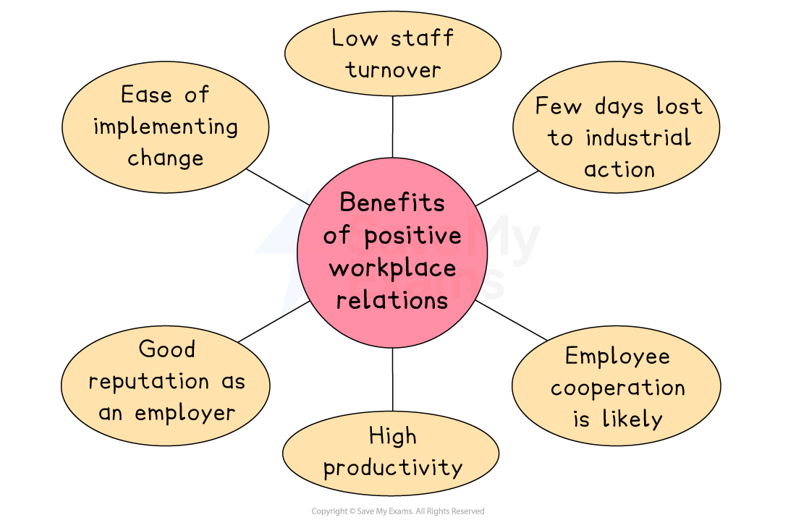
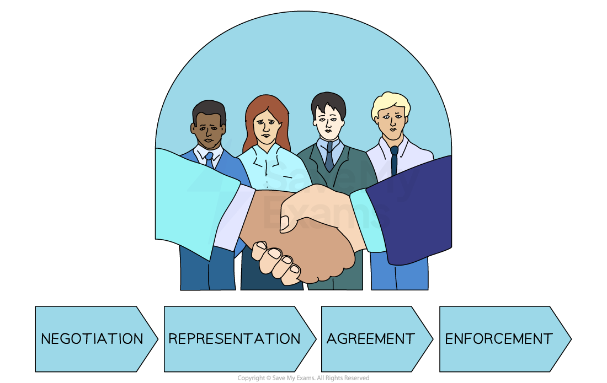

# Management and Workforce Relations

## Cooperation between management and the workforce

> **Spec point** — `spcpt_rMJ4DwHMjsPgvKnk`

## Cooperation between management and the workforce

- Workplace relations refers to the** interactions** **between managers and workers** in a business, including

  - How change is communicated and implemented
  - How ***grievances*** and ***disciplinary action*** are pursued
  - The level of ***consultation*** on key decisions
  - Fairness and effectiveness of business processes
- Positive workplace **relations between management and workers** brings a range of benefits

#### Benefits of positive workplace relations

*Good relationships between managers and workers leads to benefits including increased productivity, low levels of staff turnover, improved cooperation and fewer days lost due to industrial action*

1. **Low staff turnover**

  - When workers have a positive relationship with their managers, they are **less likely to leave ** or **face** ***dismissal***
2. **Few days lost to industrial action**

  - Industrial action is where trade union members, in dispute with management, protest or take action, such as ***strikes***, to achieve their aims
  - Effective workplace relations mean that disruption as a result of industrial action is unlikely
3. **Employee cooperation**

  - Employees may **'go the extra mile'** for the business if they feel valued
  - Support from employees for key decisions means that objectives are more likely to be met
4. **High productivity**

  - Good working relationships mean workers are** less likely to be absent from work** and more likely to be **focused on maximising output**
  - Workers are more likely to **contribute ideas** that lead to improved performance
5. **Good reputation as an employer**

  - Businesses with good relationships avoid negative publicity
  - These businesses **attract **and **retain the best staff**
6. **Ease of implementing change**

  - Significant **change is more likely to be welcomed** rather than feared
  - Employees look to **play their part in implementing change**

### Employee morale and welfare

- Some businesses make great efforts to improve employees' welfare

  - Looking after workers is likely to lead to long-term loyalty and high levels of motivation, which can have a positive impact on ***labour productivity***

#### Strategies to improve welfare

| **Strategy** | **Explanation** |
|---|---|
| **Equality and diversity** | - Ensuring fair recruitment, pay, and promotion helps build a skilled, productive workforce - A diverse team can also attract a wider range of customers |
| **Provision of facilities** | - Providing rest areas, worship spaces, refreshments, and access to guidance supports employee wellbeing |
| **Wellbeing policies** | - Policies such as leave and limiting out-of-hours communication help improve work–life balance. |
| **Perks** | - Offering extras like social events, staff discounts, or gym memberships can boost morale and motivation |

### Work-life balance

- Ensuring employees have a **healthy work-life balance **can lead to several advantages

  - Less stress-related absence lowers business costs and reduces disruption to production
  - Increased employee output, as when they are at work, their focus is likely to be improved
  - A more diverse workforce that has time to enjoy leisure and creative activities outside of working hours

#### Ways to improve work-life balance

| **Teleworking** | **Flexible working** |
|---|---|
| - Teleworking has become **increasingly popular** since the Covid-19 pandemic, when many workplaces were required to close - Some businesses offer workers the option to **work from home** for some or all of the working week - Online tools, such as ***virtual meeting***** spaces **and  **messaging apps,** have made teleworking possible - Significant **cost savings** can be made as businesses no longer require large premises to accommodate staff - Businesses often need to provide equipment, such as computers, to ensure workers can work effectively from home | - Flexible working removes some of the rigidity of contracts of employment - Employees can fit their working commitments around family responsibilities or interests - Forms of flexible work include    - **Flexitime**, where workers to arrange their weekly working hours according to their own needs   - **Annualised hours**, where workers determine how and when they allocate working hours over a whole year   - **Compressed hours**, where workers complete the hours in a standard working week in fewer days |
| **Job sharing** | **Sabbaticals** |
| - Job sharing is where two people share the work and pay of a single full-time job - This approach is popular where workers have** care responsibilities** and wish to continue to work alongside these - Businesses can benefit from the** input of two individuals** whilst incurring the cost of one employee - Careful **coordination and communication** between job-sharers are required to avoid duplication or omission of tasks | - Some businesses grant workers the right to take an **extended period of leave**, often after a determined period of service - The businesses promises to **keep the employee's job open** until their arranged return to work - Sabbaticals are **generally unpaid,** though paid sabbaticals are sometimes used to attract the best talent to hard-to-fill positions |

> **Exam Hint**
> Flexible working may appear to offer benefits that are largely focused on the employee
> 
> In the exam, you could be asked to analyse the impact on a business of flexible working
> 
> You should focus your answer on improved employee motivation and productivity, as well as the ability to attract a larger number of candidates to advertised job roles

## The impact on employers and employees of trade union involvement in the workplace

> **Spec point** — `spcpt_dprjrYpYhXHhRSvs`

## The impact on employers and employees of trade union involvement in the workplace

- A trade union is an organisation whose **members come together to achieve common goals**

  - Union members pay a **membership fee** and **elect representatives** in the workplace
- They **negotiate with employers **to **improve terms and conditions** of employment for workers

  - Improved pay
  - Increases in paid holidays
  - Reduced hours of work
  - Sufficient rest breaks
  - Improved training and development
  - Better facilities
- Trade unions can also give individual **advice** when employees have a problem at work

  - They also ***lobby *****governments** to pass laws that favour employees, such as improved health and safety regulations

#### Examples of trade unions

|  | **Communication Workers Union (CWU)**  - For people working for telephone, cable, digital subscriber line and postal delivery companies in the UK |
|---|---|
|  | **IG Metall**  - The dominant metalworkers' union in Germany, making it the country's largest union as well as Europe's largest industrial union |
|  | **Unión General de Trabajadores (UGT)**  - Spain's major general trade union, representing production workers in a variety of industries |

- Trade unions can use a range of **approaches to resolve conflict in the workplace. **These include:

  - ***Collective bargaining***
  - ***Work-to-rule***
  - ***Strike*** action

### Collective bargaining

- A process where **trade unions negotiate with employers** to reach agreements on terms and conditions of employment

  - It is a structured way for employers and employees to come to a **mutually acceptable agreement**
  - Trade unions have **greater negotiating power** than individual employees
  - Negotiations typically cover a range of issues, including wages, working hours, benefits and workplace conditions

#### The collective bargaining process

*This process leads to conflict resolution and collective agreement*

- The goal of collective bargaining is to reach a **collective bargaining agreement**

  - This is a **legally binding** document that determines the employment relationship for a specified period
  
    - Both parties** must adhere **to the terms of the agreement
    - If further disputes arise, tools such as ***mediation*** and ***arbitration*** can be used

### Other forms of industrial action

| **Industrial action** | **Explanation** | **Example** |
|---|---|---|
| **Work-to-rule** | - Workers **complete only tasks explicitly stated** in the contract of employment    - Work begins and ends at times stated in the contract   - Staff refuse to cover for absent colleagues | - The UK's NASUWT union instructed its members in schools and colleges to work to rule - This included refusing to carry out extracurricular activities, midday supervision and work during lunch breaks |
| **Strike action** | - Workers collectively **refuse to work** - They are **not paid** when taking strike action - Action may take place **continuously** or on **specified days** of work - A ***ballot*** of trade union members must find a **majority in favour** of taking such action | - Two of the biggest unions representing French ski resort workers called for strike action during the 2023 ski season - The intention was to disrupt operations during the peak tourist season to achieve pension reforms, better pay and improved working conditions |
