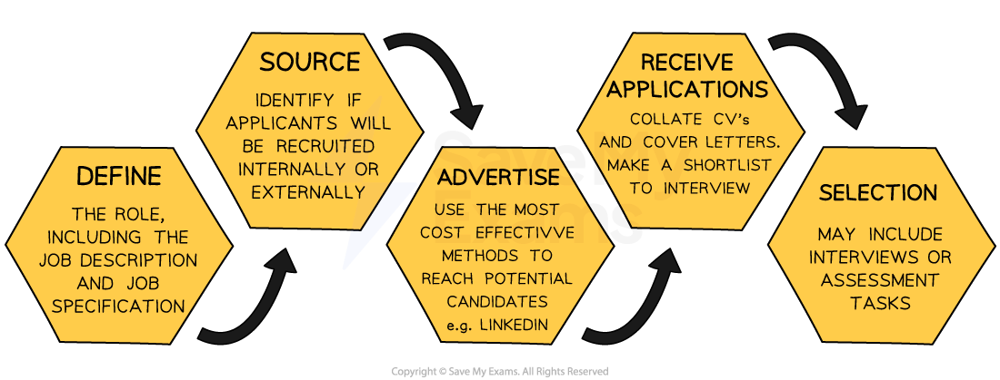

# Recruitment

## The recruitment process

> **Spec point** — `spcpt_wTd7c6JPXzWDW2tt` · The recruitment process

## The recruitment process

- **Recruitment **is the process of attracting and identifying potential job candidates who are suitable for a particular role

  - Recruitment activities include **job advertising, job fairs, social media outreach, and referrals** from current employees
- **Selection **is the process of choosing the best candidate

  - Selection activities often involve **reviewing CVs** and **conducting interviews** or assessment tasks

#### The recruitment and selection process

*The recruitment and selection process involves defining, sourcing, advertising roles and selecting a suitable candidate*

1. **Define the role**

- This involves determining exactly what is required in a job and of suitable candidates

  - A** job specification **outlines the qualifications, skills, experience and personal qualities required **from a candidate** for a specific job, e.g. problem-solving, good communication, able to code in Java
  - A** job description **outlines the duties, responsibilities and requirements of a particular job

2. **Determine the best source of candidates**

- This involves deciding whether to advertise the role internally, externally or using a combination of both

  - **Internal recruitment i**s the process of hiring employees from within the organisation
  
    - Internal recruitment can be beneficial as it encourages employee development, builds ***morale*** and can save time and money on training
  - **External recruitment** is the process of hiring employees from outside the organisation
  
    - External recruitment can bring fresh ideas, experiences and perspectives to the organisation

3. **Advertise**

- Businesses with a strong social media presence can use platforms such as Facebook, LinkedIn or TikTok to advertise cost-effectively
- Adverts can be placed on specialist **recruitment portals,** such as the **Times Educational Supplement (TES)**, one of the main publications used to recruit teachers

4. **Receive applications**

- This stage involves **collecting information** from potential candidates
- Someone within the business manages this application process

  - A ***shortlist*** of candidates from the many applications received is drawn up
  
    - The shortlist contains candidates whose applications closely match the job description and job specification
  - A selection of candidates on the shortlist are** invited to *****interview**** *or take part in the next round of selection activities

5. **The selection process**

- This process varies significantly between organisations
- Common methods of selection include interviews, testing and presentations

## Internal and external recruitment

> **Spec point** — `spcpt_8sbFsNwHRd4WsksC`

## Internal and external recruitment

- **Internal recruitment i**s the process of hiring employees from within the organisation

  - It can involve the **promotion** or ***redeployment**** *of staff to fill a vacant post
  - Vacancies are advertised internally on **staff notice boards**, in **newsletters** or via **in-house electronic communications**

#### Evaluating internal recruitment

| **Advantages** | **Disadvantages** |
|---|---|
| - Internal candidates are **already familiar** **with business culture and processes**    - Can adapt to the role quickly   - Little need for *induction training* - Business has a good **understanding of the candidate's strengths, weaknesses, skills and *****aptitudes*** - **Opportunities to progress** can be **motivating** for existing employees - **Cheaper** and **quicker **to promote or redeploy existing staff rather than recruit externally | - Can lead to **conflict **or **resentment** - May affect **motivation **and** working relationships **between successful and rejected internal candidates - A **further vacancy is created** when an employee is promoted/redeployed - A** limited number of suitable applicants** may be available internally - Missed opportunity to inject **new ideas, experience **or** skills** into the business |

- **External recruitment** is the process of hiring employees from outside the organisation

  - External recruitment can bring fresh ideas, experiences and perspectives to the organisation
  - However, it is often **more expensive** than internal recruitment
  - There is also a **greater degree of uncertainty** as external candidates are unknown to the business

## Recruitment methods

> **Spec point** — `spcpt_qRqtP9RTprcZSPgw`

## Recruitment methods

- Recruiting the right employees is crucial for any business aiming to achieve its *objectives *effectively
- Recruitment methods include traditional newspaper advertisements to modern online platforms, as well as specialist recruitment agencies

#### 1. Job advertisements

- Publishing job openings through newspapers, magazines or noticeboards

| Advantages | Disadvantages |
|---|---|
| - Many potential applicants - Can target specific audiences (local, regional, or national) - Relatively low cost | - May attract a high volume of unsuitable applicants - Time-consuming to sort through many responses - Limited engagement compared to interactive methods |

#### 2. Employment agencies

- External firms specialising in recruiting staff for other businesses

| Advantages | Disadvantages |
|---|---|
| - Expertise in matching candidates to roles - Saves time and resources in the recruitment process - Useful for filling specialist or senior positions | - Can be expensive due to agency fees - Limited control over the initial selection process - Potential mismatch if the agency lacks understanding of business needs |

#### 3. Online recruitment

- Advertising job openings on the internet via company websites or recruitment platforms

| Advantages | Disadvantages |
|---|---|
| - Cost-effective and fast distribution - Access to a large and diverse applicant pool of applicants - Easy to manage applications electronically | - Risk of receiving large numbers of irrelevant applications - Might exclude applicants with limited internet access - Potential security and privacy concerns over online data handling |
