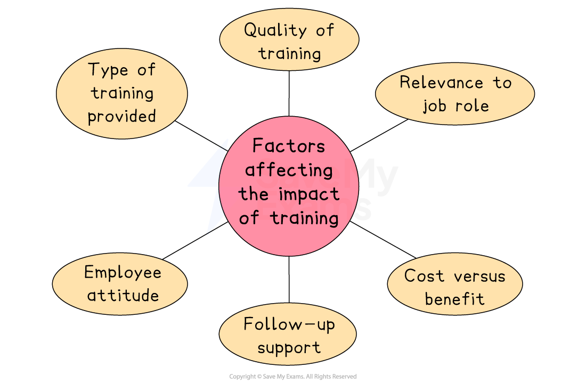

# Training and Development

## Different types of training

> **Spec point** — `spcpt_5Q6YtDNBQPynwrt5`

## Different types of training

- Businesses need to make sure that new and existing staff are trained and developed appropriately

  - Training is the teaching of **new skills**
  - Development is the **improvement** of **existing skills**

### 1. Induction training

- Induction training is a type of training that **new employees receive** when they start working for a business

#### Components of induction training

*Common elements of induction training*

- Induction trtaining introduces employees to the business, its ***culture***, policies, procedures, and their job roles and responsibilities

  - E.g.New employees at **Marks & Spencer** receive induction training that covers customer service, product knowledge, store policies and safety procedures

#### Evaluating induction training

| **Advantages** | **Disadvantages** |
|---|---|
| - Helps new employees to **understand their job roles** and responsibilities - Introduces employees to the company culture, policies and procedures - Improves employee confidence and motivation - **Reduces the time** taken for new employees to become **productive** | - Can be time-consuming and **expensive to organise** - May not cover all aspects of the job role - May not be effective in all cases, **leading to employee dissatisfaction** and higher turnover rates |

### 2. On the job training

- A type of training that takes place **while employees are working** in their job roles
- Employees **learn new skills and knowledge** from colleagues while performing their job duties

  - E.g. A sous chef at **The Ivy Restaurant** in York may receive **on-the-job training from the Chef** to learn how to prepare new dishes, use new equipment, or improve their cooking techniques

#### Evaluating on the job training

| **Advantages** | **Disadvantages** |
|---|---|
| - **Training is tailored** to the employee's specific job role and responsibilities - Training is often **more practical and relevant** to the employee's job duties - **Can be cost-effective**, as it takes place during working hours | - Employees may make mistakes while learning, which can **impact productivity and quality** - Can be disruptive to the workplace, as it **requires the trainer to devote time** to training the employee - May not be effective in all cases, leading to **employee dissatisfaction** and higher ***staff turnover ***rates |

### 3. Off the job training

- A type of training that takes place **outside of the workplace**
- It can be in the form of workshops, seminars, conferences, or online courses

  - E.g. Teachers can attend exam board training days at which they learn how to better teach the syllabus and help their students to prepare for their exams

#### Evaluating off the job training

| **Advantages** | **Disadvantages** |
|---|---|
| - Employees learn new skills and knowledge outside of the workplace, which can **bring fresh ideas and perspectives** to the workplace - **Training can be tailored** to the employee's specific needs and interests - Training can be **used as a reward** or incentive for high-performing employees - **It can be cost-effective** if training is provided online or through ***webinars*** | - It can be expensive to organise, especially if** travel and accommodation** are required - Employees may** miss work** while attending training, which can impact ***productivity*** - The training **may not be directly applicable** to the employee's job role or the needs of the firm |

## The impact of training and development

> **Spec point** — `spcpt_yYPJT3ZYn6cChSfd`

## The impact of training and development

- Effective training can improve employees' performance, as well as their confidence and motivation in the workplace

#### Factors affecting the impact of training

*The impact of training is affected by factors including its quality, the attitudes of employees and its relevance to the job role*

**1. Type of training provided**

- **On-the-job training** is practical and inexpensive, and allows learning in a real work environment

  - However, it may be rushed or poorly structured if the trainer is not experienced, which can reduce how useful the training is
- **Off-the-job training** is often delivered by professional trainers and may include detailed or specialist content

  - However, it can be costly and time-consuming, and employees are not working during this time, reducing *productivity*

**2. Quality of training**

- Training that is well-planned, clearly delivered and engaging helps employees understand and remember the information, and is more likely to improve performance and confidence
- If the training is badly organised, unclear or not suited to the employee's needs, it may waste time and money without improving skills or results

**3. Relevance to job role**

- Training must be directly linked to the employee’s daily tasks and responsibilities

  - If the training is too general or unrelated, the employee may struggle to apply what they’ve learned to their actual job

**4. Employee attitude**

- Training works best when employees are willing to learn and see it as an opportunity for personal growth

  - Positive and motivated employees are more likely to engage with training and apply what they learn.
  - If employees are not interested or see training as a waste of time, its impact will be much smaller

**5. Follow-up support**

- After the initial training, it is important to give employees continued support, such as *coaching*, *mentoring*, or feedback

  - This helps them practise new skills and feel confident using them over time
- However, without follow-up, employees may forget what they learnt or not know how to apply it properly in real work situations

**6. Cost versus benefit**

- Training often requires money, time, and resources

  - Businesses must decide if the potential benefits, such as higher productivity, better customer service, or lower staff turnover, are worth the cost
- Well-targeted training that leads to noticeable improvements is usually worth the investment

#### Advantages and disadvantages of training to a business

| **Advantages** | **Disadvantages** |
|---|---|
| - Can improve employee performance, leading to higher productivity and *efficiency* | - Training can be expensive, especially off-the-job or specialist courses |
| - Increases motivation and job satisfaction, reducing staff turnover | - Takes time away from daily work, which can affect short-term *output* |
| - Helps employees adapt to new technology or changes in the business | - Some employees may leave after receiving training, taking skills elsewhere |
| - Builds a stronger, more flexible workforce ready to take on new roles | - Not all training is effective – poor-quality programmes may have little impact |
| - Enhances business reputation as a good employer, attracting new talent | - Planning and organising training takes time and resources |

## Employee development to encourage intrapreneurship

> **Spec point** — `spcpt_fG3mzbrMp4YXrDbT`

## Employee development to encourage intrapreneurship

- **Intrapreneurship** is when employees act like entrepreneurs **within **a business

  - They take initiative, develop new ideas, and look for better ways to do things while still being employed by the company
  - They help a business grow by driving innovation, improving processes or creating new products

### Approaches businesses may take to encourage intrapreneurship

| **Approach** | **Explanation** |
|---|---|
| **Training in creativity and problem-solving** | - Helps employees think in new ways, question current methods, and solve challenges independently |
| **Encouraging idea sharing** | - Creates space for employees to pitch ideas and be heard, with rewards for good suggestions |
| **Job rotation and project work** | - Increases employee knowledge across departments, giving them a broader view and more confidence to suggest improvements |
| **Leadership and personal development programmes** | - Builds confidence and skills needed for independent thinking and decision-making. |
| **Creating a culture of trust and experimentation** | - Encourages employees to try new things without fear of failure, which helps ideas grow |

## Employee development to encourage multi-skilling and flexibility

> **Spec point** — `spcpt_tp5wzqCxZh8swXZm`

## Employee development to encourage multi-skilling and flexibility

- **Multi-skilling** means employees are trained to carry out a variety of tasks, not just one specific job
- **Flexibility** means employees can adapt to different roles, work patterns, or changing business needs

  - This might include flexible working hours, remote working or being able to switch between tasks and teams

### Benefits of multi-skilling and flexibility

- **Reduces reliance on specific individuals**

  - When more employees are trained to do the same task, the business can continue running smoothly even if someone is absent
  - This avoids delays and reduces pressure on individual workers
  
    - E.g.** **If a chef is off sick, a multi-skilled kitchen assistant who has been trained in cooking can step in and keep a restaurant's service running
- **Helps the business respond quickly to changes in demand or workload**

  - Flexible and multi-skilled employees can be moved to busier departments or roles when needed
  - This allows the business to handle busy periods or sudden changes without hiring more staff
  
    - E.g.** **In a retail store, staff trained in both stocking shelves and working on the tills can be moved to the checkout area during peak shopping hours
- **Increases employee satisfaction**

  - Doing different tasks keeps work engaging and helps employees feel more skilled and confident
  - Varied work can reduce boredom and increase motivation
  
    - E.g.** **In a call centre, giving staff the chance to work on different types of calls or help with training new starters can make the job more enjoyable
- **Improves productivity and efficiency**

  - Multi-skilled workers are more useful across the business and can perform several roles
  - This reduces *downtime* and helps the business run smoothly
  
    - E.g. Manufacturing employees who can operate different machines ensure production continues even if one area has fewer staff available

### Approaches businesses may take to encourage multi-skilling and flexibility

| **Approach** | **Explanation** |
|---|---|
| **Job rotation** | - Employees are moved between different roles to gain a range of skills and experience |
| **Cross training** | - Employees are trained in tasks outside their usual role, so they can step in when needed |
| **Team-based working** | - Employees work in flexible teams that can shift roles depending on the task or project |
| **Flexible working arrangements** | - Employees are supported to work flexible hours or locations or shift between teams |
| **Personal development planning** | - Employees set goals with managers to build skills beyond their current role |
