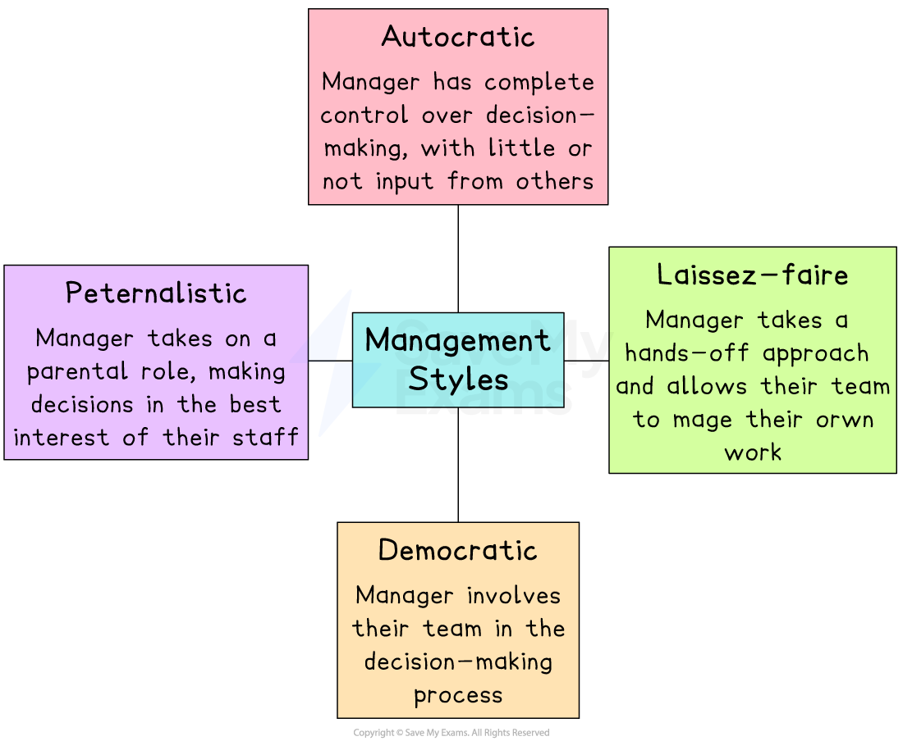
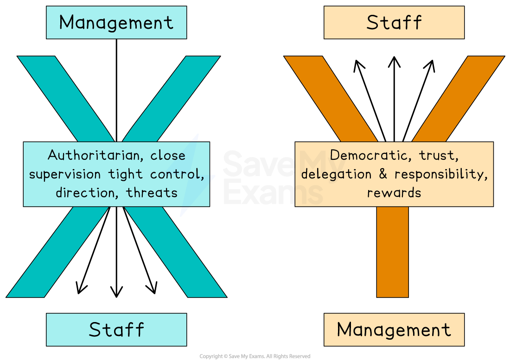

# Management Styles

## An Introduction to Management Styles

> **Spec point** — `spcpt_3djjqqRTyyTTqjrC`

## An introduction to management styles

- Management styles are **different approaches** to leading and **managing a team or business**
- An effective manager will be able to **use a variety of styles** depending on the situation to achieve the best results for the business

#### Common management styles

*Managers can adopt a range of styles, including autocratic, paternalistic, democratic or laissez-faire*

- The **choice of management style** can be influenced by business circumstances, as well as its nature and size

## Autocratic Management

> **Spec point** — `spcpt_2BHWpstsF6GvCjGm`

## Autocratic management

- An autocratic manager holds **absolute power **and **authority** over a business

  - The manager makes decisions without seeking input or agreement from others
  - They typically expect strict obedience and compliance from their ***subordinates***
- Autocratic managers often have **complete control over the decision-making process**

  - They set the direction and goals of the business
  - They do not usually consider the opinions, ideas, or expertise of their team members
  - Their decisions are generally not open to discussion or debate

#### Situations where autocratic management is effective

| **Situation** | **Explanation** |
|---|---|
| **Crisis situations** | - In times of immediate crisis, such as natural disasters or military conflicts, **quick and decisive actio**n is often required - Autocratic managers can make **swift decisions without the need for lengthy discussions,** which can be crucial in emergency situations |
| **Hierarchical organisations** | - Organisations with highly structured hierarchies may benefit from autocratic management for the sake of **coordination and efficiency** - In military units, for example, commanders often need to give **clear and direct orders that subordinates must follow** without question |
| **Time-sensitive projects** | - Autocratic management can help **speed up decision-making** - In businesses with strict deadlines, such as construction or event planning, an autocratic manager can ensure that tasks are completed promptly by providing **specific instructions** and **minimising time spent on discussion** |
| **Inexperienced or unmotivated teams** | - Autocratic management can be effective when working with teams lacking the necessary skills, experience or motivation - By providing clear** direction and close supervision,** an autocratic manager can guide the team towards achieving their goals more efficiently |
| **Maintaining order and discipline** | - In businesses where **strict discipline and adherence to rules** are important, such as energy generation, an autocratic manager may be necessary to **ensure compliance **and maintain order |

- Autocratic management has drawbacks, including

  - **Reduced employee morale** as workers have no input into decision-making
  - **Limited creativity**,** **as employees are required to follow strict instructions and are closely monitored
  - Lack of input from team members restricts an important source of **problem-solving ideas **and ***innovation***

## Paternalistic Management

> **Spec point** — `spcpt_d6PfyQ79YyqfvYgd`

## Paternalistic management

- Paternalistic managers assume a 'fatherly' role towards their subordinates, acting in a **protective and *****authoritarian*** manner

  - The manager **makes decisions for employees** while also showing concern for the **well-being and development** of  subordinates
  - The manager takes on responsibility for the **welfare of their employees**
  
    - They may provide guidance, support, and resources to ensure the success of their employees
    - *Huawei*’s Ren Zhengfei is viewed as a paternalist who has shaped the businesses culture with well-defined goals, **employee devotion and absolute obedience in return for highly competitive pay** and opportunities for staff to buy shares in the company
- Paternalistic management can create a **sense of security** and support among employees, increasing their loyalty and reducing ***staff turnover***
- It can also be perceived as **controlling** and **limits creativity and** ***innovation*** within a business
- It may create a **dependency on managers,** which restricts personal growth and professional development among employees

## Democratic management

> **Spec point** — `spcpt_rVXPwzP8ZVXcfC34`

## Democratic management

- Democratic managers actively** involve employees** in the decision-making process and **encourage discussion**, though they have the final say

  - Consultation, collaboration, ***delegation*** and teamwork are common features of democratic management
- This management style is most effective in organisations with **skilled, experienced and creative employees**

#### Evaluation of democratic management

| **Advantages** | **Disadvantages** |
|---|---|
| - **Encourages participation in decision-making **    - This involvement can lead to higher levels of **employee engagement** and **job satisfaction, **as individuals feel valued and empowered when their opinions  are considered - **Encourages creativity and innovation within a business**    - Employees are more likely to **share ideas **and **think outside the box** when they have a say in decision-making - **Can lead to more comprehensive problem-solving and decision-making**    - By considering a range of viewpoints, managers can make more **informed choices** and **avoid potential pitfalls** | - **Time consuming**    - Engaging all team members in discussions, collecting input and reaching agreement can slow down decision-making - **Conflicts and disagreements may arise**    - Resolving these conflicts can be challenging and time consuming - **May result in compromise on the quality of decisions**    - Popular opinions may overshadow expert knowledge and decisions may be watered down or influenced by the desire for agreement rather than the best outcome |

## Laissez-faire management

> **Spec point** — `spcpt_TvDK4d3Kg4zQKKxR`

## Laissez-faire management

- Laissez-faire managers play a **minimal role** in directing their business team

  - They allow subordinates significant **autonomy and freedom** in making decisions and completing tasks
- Laissez-faire management is most appropriate where workers are **highly skilled and self-motivated **and require minimal supervision

#### Evaluation of laissez-faire management

| **Advantages** | **Disadvantages** |
|---|---|
| - Encourages creativity and innovation within the business    - By giving employees the freedom to explore ideas and make decisions independently, it allows for diverse perspectives and fresh approaches to problem-solving - Empowers employees    - Employees are empowered because they have *autonomy* and ownership over their work   - This can enhance job satisfaction, motivation, and a sense of responsibility among team members as they feel trusted and valued - *Decentralised* decision making    - Employees can quickly respond to challenges and make decisions based on their expertise and knowledge | - Inefficiency and lack of coordination    - The absence of direct guidance and supervision can lead to inefficiency, a lack of coordination within the team and a decrease in productivity   - Individuals may struggle to prioritise tasks or make informed decisions - Inconsistency in the quality and outcomes of work    - Different employees may have varying approaches, leading to a lack of *cohesion* and potential conflicts in the team - It is challenging for managers to monitor progress, identify issues, and ensure that goals are being met    - This can lead to decreased productivity and difficulties in holding individuals *accountable* |

## McGregor's Theory X & Theory Y Managers

> **Spec point** — `spcpt_GPrvVcNFdh3sHjMc`

## McGregor's Theory X and Theory Y managers

- Douglas McGregor developed two contrasting theories that explained how **managers' assumptions about what motivates workers** affects the **style of management** they adopt

#### McGregor's Theory X and Theory Y

*McGregor's Theory X and Theory Y managers adopt different approaches with their subordinates, based on their assumptions about their attitude to work*

#### Assumptions of Theory X and Theory Y managers

| **Theory X** | **Theory Y** |
|---|---|
| - The average employee    - **Does not like work** and tries to escape it whenever possible   - Must be **persuaded, compelled, or warned with punishment** to achieve organisational goals   - Must be **closely supervised** and directed   - Has little or **no ambition** beyond financial goals   - Dislikes and **avoids responsibilities**   - Will **resist change** | - The average employee    - Perceives their job as relaxing and **normal**   - Naturally wants to **make effort** in their job   - Does not require threats or coercion to work, as they  can **self-direct and have self-control**   - Is **loyal and committed** to the organisation.   - Recognises and **welcomes responsibility**   - Has **skills, capabilities **and **resourcefulness **which can solve business problems |

- Holding these assumptions about their workers means that managers are likely to **adopt different approaches with their employees**

### Theory X and Theory Y approaches to management

- **Theory X managers** closely supervise employees

  - They provide **clearly defined tasks** and the promise of higher pay or the threat of **punishment **as means of motivation
  - They may use **autocratic **measures, which can result in mistrust and resentment among employees
  - McGregor recognised that this approach can be appropriate, especially where workers lack experience or maturity

- **Theory Y managers** establish a positive working environment

  - The organisation's** objectives match employees' personal objectives**
  - They develop a **cooperative** relationship with employees and allow them freedom to make and contribute to decisions
  - McGregor acknowledged that this theory isn't appropriate in every situation
  
    - It is an alternative to persuade managers to adopt a positive mindset when managing subordinates

> **Exam Hint**
> Your exam case study is likely to provide some hints about the management style adopted within a business. You may find that a manager adopts elements of different styles and should be able to explain why this may be. You may consider the business context, business objectives, the type of workers, timescales, and the level of risk in your explanation.
