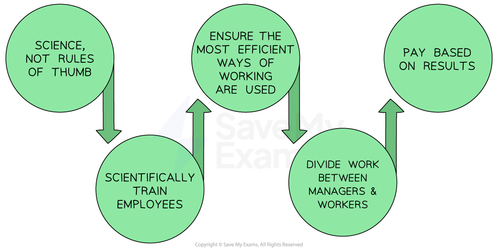

# Motivation Theories: Taylor, Mayo and Maslow

## Taylor's Motivation Theory

> **Spec point** — `spcpt_yr953J85cRZGnD8n`

## Taylor's motivation theory

- Taylor's theory focuses on **breaking down complex tasks** into simpler ones, standardising work processes and providing workers with **clear instructions **and **training** to achieve maximum efficiency
- **Manufacturing businesses** most commonly use Taylor's principles to structure staff benefits

  - ***Piece rate*** pay systems link output to financial rewards
  - Production lines involving human labour are often set up based on these principles

#### Taylor's theory of motivation

*Taylor's method starts with a scientific analysis of what is involved in a job and then breaks it down into parts for which employees can be trained *

### The steps in Taylor's process

**1. Study and analyse the work process**

- Carefully analyse each step of the work process
- Break down **complex tasks** into simpler ones and identify the most *efficient ***way to perform each task**

**2. Standardise the work process**

- This involves creating **detailed procedures and instructions **for each task so that workers can follow these procedures consistently

**3. Select and train workers**

- Workers should be carefully selected based on their **skills and abilities**
- Train workers to perform their tasks efficiently and effectively

  - This training includes both **technical skills** and the **proper attitudes **and **behaviours** required to be successful (e.g patience in a repetitive task)

**4. Provide incentives for performance**

- Scientific management emphasises the **use of incentives** to motivate workers

  - This may include ***bonuses ***or** piece-rate pay**

#### Evaluating Taylor's theory

| **How businesses use Taylor's approach** | **Advantages** | **Disadvantages** |
|---|---|---|
| - Workers are trained to perform only one task, which they become very skilled at - Workers are usually paid for the completed work (piece rate pay), e.g. \$0.16 per T-shirt completed by garment workers in Bangladesh | - Increased *efficiency *lowers costs - Standard procedures that everyone follows reduce errors - Specialisation of labour leads to greater efficiency and productivity - Clear lines of *authority *lead to more efficient decision-making and communication - Good training and development improves employee performance and job satisfaction | - Overemphasis on efficiency reduces worker satisfaction and creativity - Workers may disengage from work if they are reduced to working in a **machine-like system** - This approach may not work for roles that need high levels of creativity, problem-solving or *interpersonal skills* - Potential for *exploitation*, as this approach may be used to extract more work from workers without paying them fairly |

## Mayo's Motivation Theory

> **Spec point** — `spcpt_cPwbcV9ZXcNhBsRc`

## Mayo's motivation theory

- Mayo's theory focuses on the **importance of social factors in the workplace**

  - These include factors such as **communication, motivation, and job satisfaction**
- Mayo suggests that the key to improving productivity and job satisfaction lies in understanding and** improving relationships between workers**, **supervisors **and** management**

#### How businesses use Mayo's Human Relations theory

| **How businesses use Mayo's approach** | **Advantages** | **Disadvantages** |
|---|---|---|
| - **Empowering employees** in decision-making, e.g, creating teams which decide their priorities - **Team-building activities** are used to build relationships - **Providing feedback** and recognition  to employees, e.g. Worker of the Week - **Creating a positive work environment** by promoting open communication and providing support to employees, e.g. offering wellness programmes - **Encouraging employee development** by offering training programmes, *mentorship *and career advancement | - **Improved job satisfaction** as workers feel valued and supported - **Open and honest communication**, which reduces misunderstandings and conflicts - **Employee *****empowerment ***increases workers' sense of ownership and responsibility - **Stronger teams**, as there is a sense of community and team spirit | - **Time-consuming**, as building positive relationships requires time and effort - **Lack of control** as workers take more decisions - **Resistance to change**, as some workers and managers may be resistant to the changes required by Mayo's theory - **Potential for conflict**,** **as attempts to build stronger relationships can also lead to disagreement - It may not work for businesses which require a high degree of individual *autonomy *and independence |

## Maslow's Hierarchy of Needs

> **Spec point** — `spcpt_VNBxNSmCGc3rmvQK`

## Maslow's hierarchy of needs

- Maslow outlined** five tiers of human needs **that must be met for individuals to reach their full potential
- Once a tier of needs has been met, it is **unlikely to continue to motivate **

  - For example, once safety needs are met through satisfactory pay, employees will **look for the next set of needs** - love and belonging needs – to be met

#### Maslow's hierarchy of needs

*Maslow's Hierarchy of Needs explains human motivation based on the pursuit of different levels of needs being fulfilled*

**1. Physiological needs**

- Businesses can **provide necessities** for their employees, e.g **comfortable work environment,** access to clean water and food and adequate rest breaks

**2. Safety needs**

- Businesses can provide *job security*, fair pay, benefits, and **safe working conditions** for their employees

**3. Love and belonging needs**

- Businesses can encourage teamwork and generate a **sense of community** and belonging within the workplace

**4. Esteem needs**

- Businesses can provide recognition for employees' accomplishments and provide a positive *work culture *that **values individual contributions**

**5. Self-actualisation needs**

- Businesses can help employees achieve this need by offering opportunities for employees to **pursue their passions** and interests

  - E.g. **Barclays Bank** supports elite sportspeople by allowing them time off work to continue their training (the focus is on getting the job done, not having to be present at work at a certain time)

#### Evaluating Maslow's theory

| **Advantages** | **Disadvantages** |
|---|---|
| - By meeting employees' needs, a more satisfying work environment is established    - This can lead **to increased productivity** and** lower *****staff turnover***** rates** - Offering ***incentives *****that align** with their specific needs and desires improve staff loyalty - Employees who feel valued and supported by their employers are more likely to **perform at a higher level** | - Businesses need to tailor their approach to meet the individual needs of their employees, as **one size does not fit all** - Meeting many individual needs can be **expensive**,** **especially when offering costly *perks* - **Determining the best way to motivate **requires significant effort from management to connect individually with workers |
