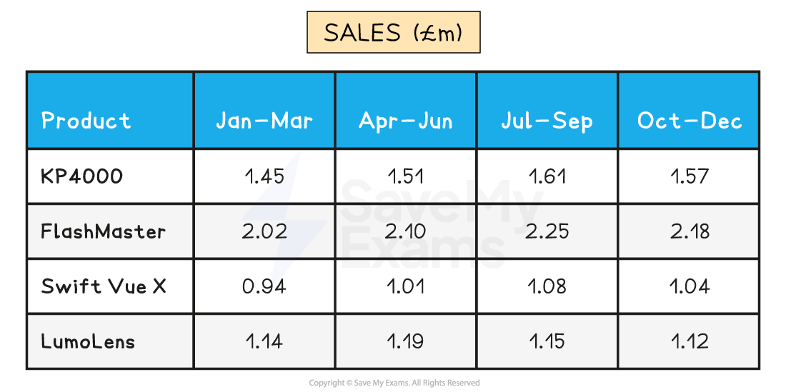
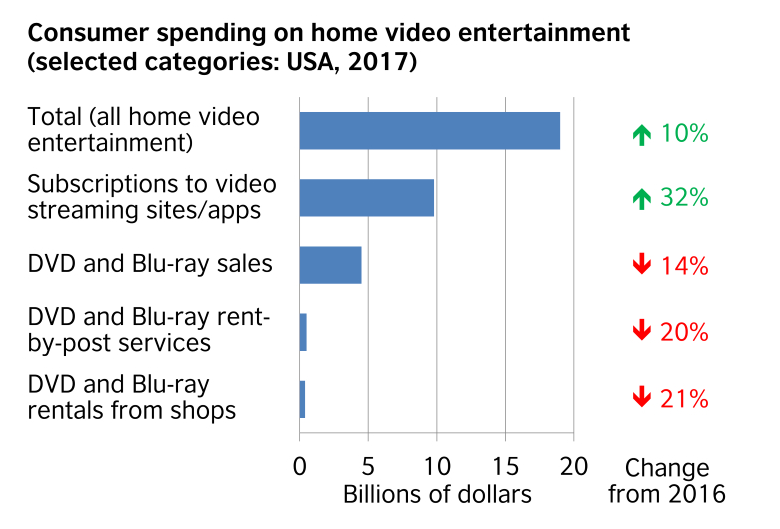
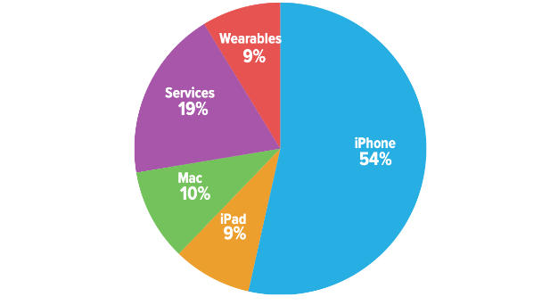
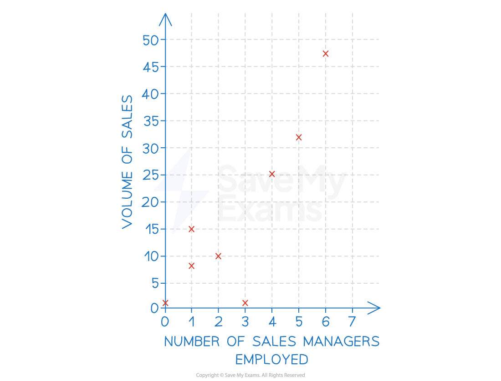
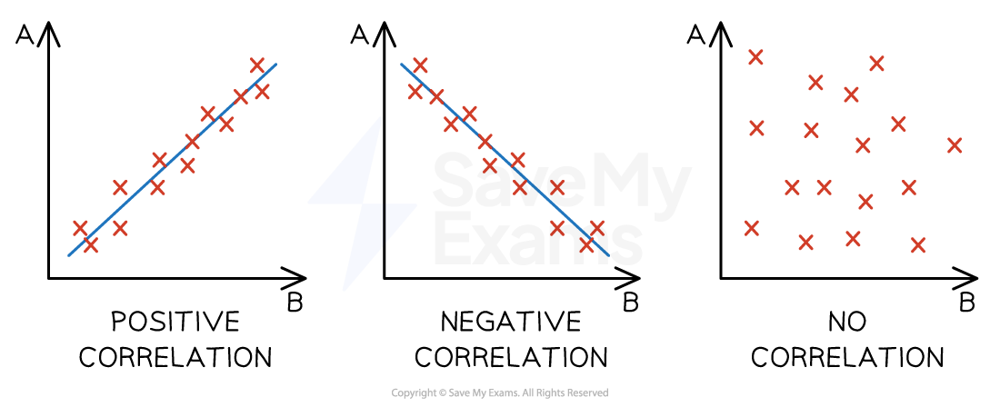
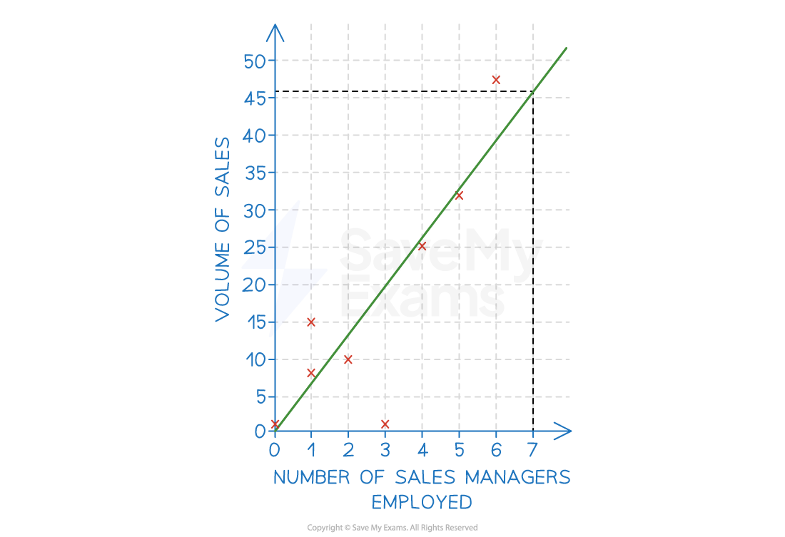

# Market Research Data

## Reliability of market research data

> **Spec point** — `spcpt_RVp874FtBwjx9v3v`

## Reliability of market research data

- Market research is a valuable tool that helps businesses **make informed choices** about, for example, product development, pricing and promotion
- However, if the data collected is unreliable, it can lead to **poor decisions** that waste time, money and resources

### Why market research data can be unreliable

| **Reason** | **Explanation** | **Example** |
|---|---|---|
| **Respondents may not give truthful or accurate answers** | - People might give answers they think sound good, rather than what they truly believe. Others may guess or not take the questions seriously | - A customer claims they would buy an eco-friendly product to appear responsible, but they don’t actually plan to |
| **Questions may be poorly designed or unclear** | - If the wording is confusing, too vague, or *biased*, responses can be inconsistent or misleading | - A survey asking “Do you like affordable luxury?” may be interpreted differently by each person |
| **Secondary data may be outdated or collected for a different purpose** | - Existing data might not reflect current trends, or it may have been gathered with different goals in mind | - A business uses a 2019 report on travel habits, which doesn’t reflect post-pandemic behaviour |
| **Data collection methods may be inconsistent or poorly managed** | - Mistakes in how the research is conducted, recorded or analysed can reduce reliability | - An interviewer forgets to record some answers or enters the wrong data into a spreadsheet |

## Analysis of quantitative and qualitative market research data

> **Spec point** — `spcpt_j6WtJrnCC2g5fvyf`

## Analysis of quantitative and qualitative market research data

### Quantitative data

- **Quantitative data **is based on numbers

  - It could include financial reports (e.g. sales, costs), market data (e.g. market share) or summaries of data gained from primary research (e.g. on a scale of 1–10, rate our customer service)
- It is beneficial for a range of reasons

  - Percentages, scores, or yes/no answers are straightforward to organise, compare and present using graphs or charts
  - Large amounts of numerical data can reveal clear patterns in customer behaviour over time
  
    - E.g. A clothing retailer may notice that online sales increase by 20% every November, helping them plan future promotions

#### Analysis of quantitative data using mean, median, mode and range

| **Term** | **Definition** | **How to calculate** | **Example** |
|---|---|---|---|
| **Mean** | - The average of a set of numbers | - Add all the numbers together, then divide by how many numbers there are | $\mathrm{Data}:4,6,8\,\,\mathrm{Mean}=(4+6+8)\div3=6$ |
| **Median** | - The middle value when the numbers are in order | - Arrange the data from smallest to largest and find the middle number | $\mathrm{Data}:3,5,7\,\mathrm{Median}=5\,\,\mathrm{Data}:3,5,7,9\,\mathrm{Median}=(5+7)\div2=6$ |
| **Mode** | - The number that appears most often | - Find the value that repeats the most in the data set | $\mathrm{Data}:2,4,4,5\,\,\mathrm{Mode}=4$ |
| **Range** | - The difference between the highest and lowest values | - Subtract the smallest number from the largest | $\mathrm{Data}:2,7,9\,\,\mathrm{Range}=9-2=7$ |

### Qualitative data

- **Qualitative data **gathers descriptions or explanations

  - These can be based on conversations, discussions, impressions and emotional feelings and are usually gathered through primary research
  - It helps businesses understand not just what customers do, but why they do it
  - By listening to detailed customer feedback, businesses can make meaningful improvements to products or services based on real user experiences
  
    - E.g. A technology company might learn from a focus group that users find a mobile app too complicated, leading to changes in layout and features

#### Analysis of qualitative data

- Businesses often analyse qualitative data through a process called **coding**

  - This is where **similar responses or themes are grouped together**, so the business can identify patterns and common issues
  - Each theme is given a code to make it easier to sort and compare

> **Case Study**
> **Coding in action**
> 
> 
> 
> A mobile phone company collects hundreds of open-ended survey responses asking customers what they like or dislike about a new handset
> 
> Marketing researchers read through the comments and assign codes:
> 
> - “BAT” for battery life
> - “CAM” for camera quality
> - “EAS” for ease of use
> - “DES” for design and appearance
> 
> After coding the responses, they may notice that many customers mention “BAT” (battery life) negatively
> 
> The business can then use this insight to **improve the battery** in the next version of the product
> 
> They may also **adjust their marketing** to focus on features that customers value more positively

#### Limitations of quantitative and qualitative research data

| **Limitations of quantitative data** | **Limitations of qualitative data** |
|---|---|
| - Numerical data **may be out-of-date**, especially in dynamic markets - **Data analysis and interpretation** is a complex skill that is likely to be lacking in smaller businesses - Looking at a small amount of data and then ***extrapolating*** results can provide wrong assumptions on which to base decisions - Numerical data does not provide reasons for outcomes, e.g. data may reveal sales volumes are falling but **not the reason for the decline** | - ***Bias*** may mean that analysts can **interpret responses in a particular way** - Respondents may **lack awareness or language skills **to explain preferences accurately - Respondents in **focus groups** may be influenced by the responses of others or not provide accurate information - Qualitative data** **is **difficult to present in graphs and charts,** so it may not be easily understood |

## Interpretation of tables, charts and graphs

> **Spec point** — `spcpt_wqQPMHhGMG3Fh6Hc`

## Interpretation of tables, charts and graphs

### 1. Tables

- Tables summarise data in an **organised** form

*A table summarises data in an organised form*

- The table shows that:

  - **Flashmaster** generates the **highest sales** in each period
  - Sales of **LumoLens **are **lower at the end of the year **than at the start of the year

### 2. Graphs and charts

- Data contained in graphs and charts can be important sources of marketing research
- Data may be presented in a range of forms

#### Bar charts

- **Bar charts** show data that are independent of each other, such as sales per store

*A bar chart showing sales revenue for a selection of home video entertainment formats in the USA in 2017 (Source: British Council)*

#### Pie charts

- **Pie charts** show how a whole is divided into different elements, such as total sales divided amongst different product types

*A pie chart showing Apple's quarterly revenue by category in April 2021 (Source: Six Colours)*

#### Scatter graphs

- Scatter graphs allow businesses to compare **two variables**, such as sales volume and ***advertising***, to establish if there is any **correlation **between them

*A scatter graph showing the number of sales managers employed by a business and the volume of items sold*

- A correlation exists where there is a **relationship **or **connection **between the two variables in a scatter graph

  - A **positive correlation** means that **as one variable increases, so does the other variable**
  
    - A **line of best fit** that **slopes upwards** can be identified
  - A **negative correlation** means that **as one variable increases, the other variable decreases**
  
    - A **line of best fit** that **slopes downwards** can be identified
  - **No correlation** means that there is **no connection** between the two variables
  
    - It is not possible to identify **a line of best fit**

#### Correlation types

*The main types of correlation between two variables: positive, negative and no correlation*

- Where a ***line of best fit *****can be identified** and when ***causation**** *is determined, a business can **extrapolate** data to make **predictions** around changes to either of the variables

  - E.g. extrapolation of the line of best fit in the example below means that the business could predict that **employing seven sales managers would likely result in sales of 46 units**

#### Extrapolation using a line of best fit

*A scatter graph with a line of best fit showing the number of sales managers employed by a business and the volume of items sold*

> **Exam Hint**
> When drawing a line of best fit, you should try to include as many data points above the line as below the line
> 
> Watch out for outlying data — if there is more than one outlier above the line, adjust your line of best fit upwards
> 
> Similarly, if there is more than one outlier below the line, adjust your line of best fit downwards. Just one outlier should not influence your line of best fit
