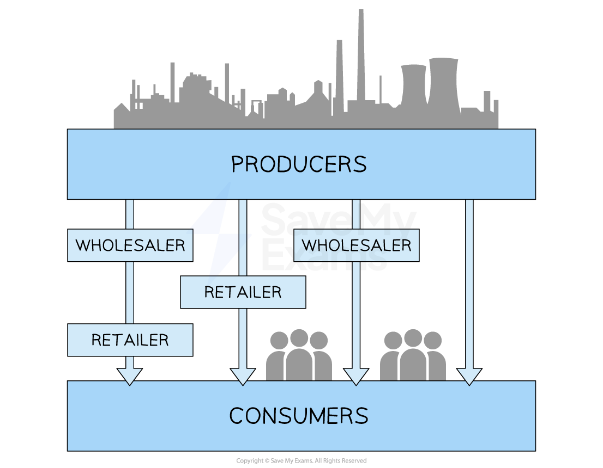

# Marketing Mix: Place

## Introduction to place

> **Spec point** — `spcpt_qJyf7pPSKcSQnDQy`

## An introduction to place

- **Place** in the marketing mix refers to **where customers purchase** a business's products and the ***distribution channels*** used to move the product from producer to consumer
- In a competitive environment, location and distribution decisions can give a company a ***competitive advantage***

  - Businesses could locate themselves in areas with** high foot traffic** to achieve high sales volumes
  - They may use **innovative online channels** to reach customers who prefer to shop online
- Changing consumer needs can impact the way businesses distribute their products

  - ***E-commerce*** makes it easier for consumers to **shop online** and have products delivered to their doorstep
  
    - Many businesses have therefore invested in their online presence, offering **convenience **and **fast delivery **to meet customer needs

## Channels of distribution

> **Spec point** — `spcpt_7nGyWK3gzKHVYR2Y`

## Channels of distribution

- Channels of distribution are the **intermediaries** through which physical products** move** **from the business to the end consumer**

#### Different distribution channels

*The two different types of distribution channels businesses can use to move products to the end customer    *

#### Explanation of the distribution channels

| **Channel** | **Explanation** | **Example** |
|---|---|---|
| Producer → Wholesaler → Retailer → Consumer | - This channel is commonly **used by smaller retail businesses** that lack space or sufficient cash flow to hold large amounts of inventory - **Advantage:** Small shops can buy little and often from the wholesaler, so they do not need big, costly storage space - **Disadvantage:** Two extra *markups* (wholesaler and retailer) push the selling price up for customers | - **The Coca-Cola Company** produces soft drinks, which are sold in bulk to a **wholesaler** - The wholesaler sells smaller quantities to a convenience store - The convenience store then sells individual soft drinks to the customer |
| Producer → Wholesaler → Consumer | - This channel is less common but can be used when there are **no physical retail stores**, or for products where the wholesaler can **sell directly to bulk-buying consumers** (e.g. institutions or large events) - **Advantage**: It can reduce distribution costs by cutting out the retailer, allowing slightly lower prices for large-scale buyers - **Disadvantage**: It is not suitable for everyday consumers who want to buy in small quantities or need advice before purchasing | - **CleanPro Chemicals**, a manufacturer of industrial cleaning supplies, sells bulk quantities of detergent to a wholesaler - The wholesaler then sells large tubs of cleaning products directly to schools, hotels or industrial users without going through a retail store |
| Producer → Retailer → Consumer | - This channel is often used for **products with high demand** or where the cost of distribution is high - This method is also common **where customers require support or advice** in selecting the product - **Advantage:** Retail staff can give advice and *after‑sales* help, which suits complex goods such as laptops - **Disadvantage:** Inventory sits in the retailer’s warehouse or shop, tying up cash until each item is sold | - **Toshiba** produces laptops and sells them directly to electronics retailers - **Currys **employs knowledgeable sales staff who sell Toshiba laptops to end customers |
| Producer → Consumer | - This channel is commonly used for **products that are sold online** or through direct sales channels - **Advantage:** No intermediaries mean lower costs, so the firm can offer low online prices or keep more profit - **Disadvantage:** The producer must handle delivery, returns and customer service itself, which can be expensive and time-consuming | - **GermanWings** sells its service (airline passenger tickets) directly to the end customer on its website |

## Digital versus physical distribution

> **Spec point** — `spcpt_Xj6DTvRJ4nPRwRQn`

## Digital versus physical distribution

- **Digital distribution** is the process of delivering **products or services electronically**, usually over the internet, without the need for physical transportation or traditional retail outlets
- It allows businesses to **reach customers directly and instantly**, using online platforms, software or digital files

### Examples of digital distribution

- **E-commerce platforms**

  - Websites or apps where goods are purchased and delivered digitally
  - Examples include
  
    - Amazon for eBooks
    - Steam for games
    - Udemy for online courses
- **Downloads and streaming**

  - Files are delivered digitally to the user’s device or accessed on-demand
  - Examples include
  
    - Spotify for streaming
    - Netflix for video
    - Adobe Creative Cloud for software
- **Cloud-based delivery**

  - Products are accessed online through cloud services rather than downloaded
  - Examples include
  
    - Google Docs
    - Microsoft 365
- **Digital wallets and app stores**

  - Payment and delivery systems that host apps, games and tools for immediate use
  - Examples include
  
    - Apple App Store
    - Google Play

#### Comparison of digital and physical channels of distribution

| **Digital distribution** | **Traditional distribution** |
|---|---|
| - Delivered electronically – no physical stock or transport needed | - Physical delivery through wholesalers, retailers, or direct sellers |
| - Instant access for consumers, often 24/7 | - Delivery takes time and depends on stock and location |
| - Can be global from the start, reaching wide markets | - Often restricted by geography, transport and store networks |
| - Typically lower cost per unit (no packaging or delivery) | - Higher cost due to shipping, warehousing, and staff |
| - Ideal for intangible goods (e.g. media, software, *NFT*s) | - Required for tangible goods (e.g. clothing, furniture) |
