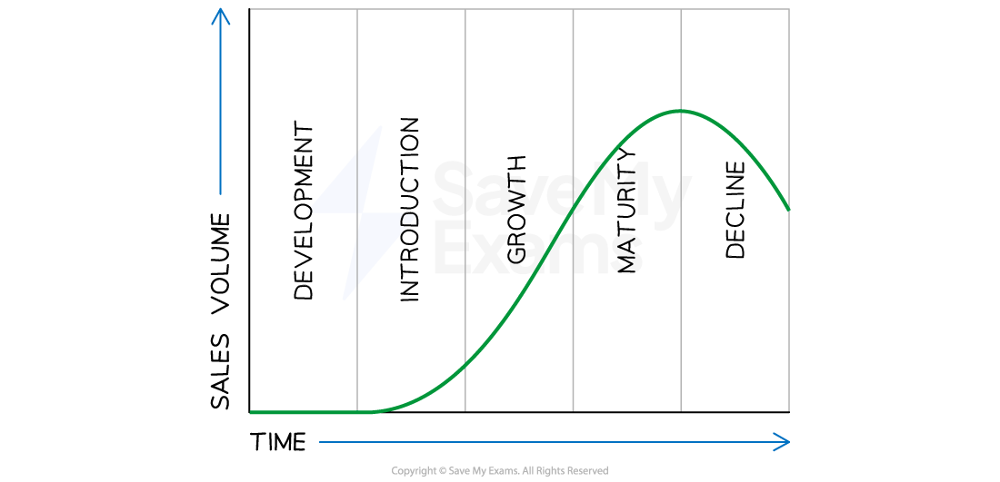
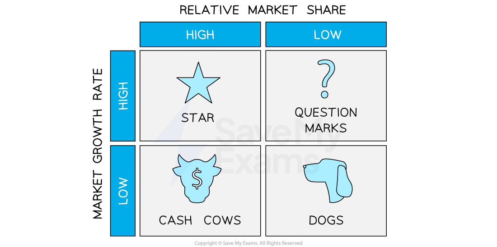
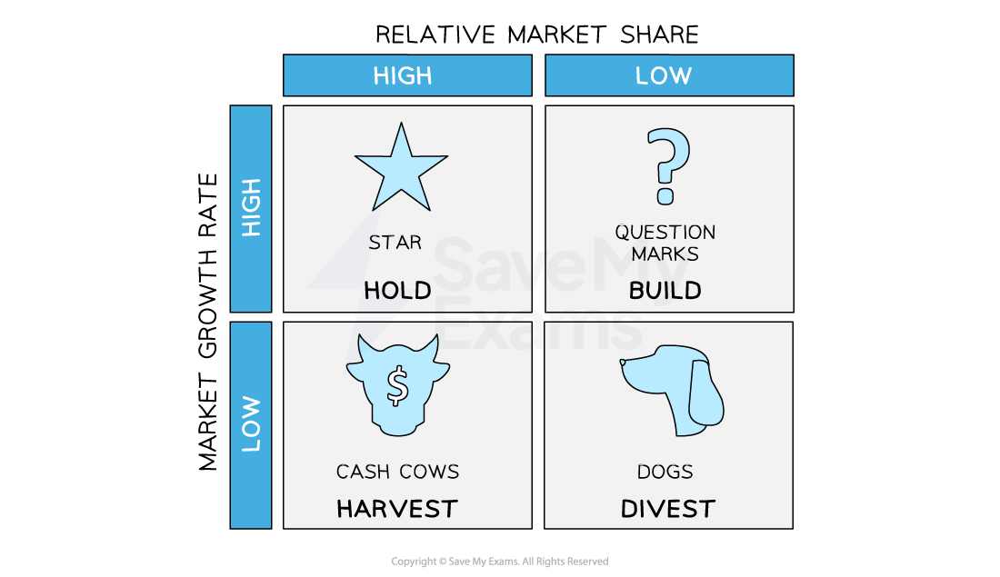

# Marketing Mix: Product Portfolio Analysis

## Stages in the product life cycle

> **Spec point** — `spcpt_rSSs4h3QxqPkb7Fv`

## Stages in the product life cycle

- The product life cycle describes the **different stages a product goes through** from its conception to its eventual decline in sales
- There are typically **five stages in the product life cycle:** development, introduction, growth, maturity and decline

#### A typical product life cycle

*The five stages a product goes through over its life span — from development to decline (and ultimately withdrawal from a market)*

#### Stages of the product life cycle

| **Stage** | **Explanation** | **Implications for cash flow** |
|---|---|---|
| **Development** | - Generating and screening product ideas, and then designing and developing the product - The business **usually incurs high costs** for research and development, marketing research and product testing | - Cash flow is **usually negative** during this stage, as the company is investing heavily in the product without generating any **revenue** |
| **Introduction** | - The stage begins when the product is launched - Characterised by **slow sales growth**, as the product is still new and unknown to most consumers | - **Cash flow is usually negative** as the business usually incurs high costs for promotion, advertising and distribution |
| **Growth** | - The product enters this stage when sales begin to increase rapidly - The business focus shifts from building market share and increasing production to **meeting the growing demand** | - **Cash flow** usually turns **positive **during this stage as sales revenue increases and costs are spread out over a larger volume of production |
| **Maturity** | - Characterised by **slowing sales growth** as the product reaches its peak in terms of **market penetration** | - **Cash flow is usually positive** during this stage as sales revenue continues to come in and costs are reduced through ***economies of scale*** and efficient production processes |
| **Decline** | - Starts when sales begin to decline as the product **becomes obsolete** or is replaced by newer products - The business focus shifts to managing the product's decline and reducing costs | - Cash flow **usually turns negative** as sales revenue declines and costs associated with the product's decline increase |

## Extension strategies

> **Spec point** — `spcpt_YyDpgB6K3hDb9sZf`

## Extension strategies

- Extension strategies refer to the techniques used by businesses to **extend the life of a product beyond its natural life cycle**
- These strategies are **designed to boost sales **and maintain profitability for a product that has** reached the decline stage** of its life cycle
- There are two types of extension strategies:

  - **Product-related** extension strategies
  - **Promotion-related** extension strategies

#### 1. Product-related extension strategies

- These extension strategies involve **changing or modifying the product** to make it more appealing to customers and extend its life cycle

  - **Product improvements**
  
    - e.g. Samsung releases new versions of its Galaxy Smartphone every year with upgraded features and improvements to the previous model
  - **Line extensions**
  
    - e.g. Coca-Cola introduced Diet Coke and Coke Zero as line extensions of its original Coca-Cola
  - **Repositioning**
  
    - e.g. when IBM's personal computer division started losing market share to other brands, it repositioned its products as high-end business machines and focused on the enterprise market

#### 2. Promotion-related extension strategies

- These extension strategies involve changing the promotional aspects to extend a product's life cycle

  - **Changes to advertising**
  
    - e.g. Kellogg's continues to recreate advertisements for its Corn Flakes cereal, which has been around since 1906
  - **Price promotions**
  
    - e.g. Cyber Monday occurs on the first Monday after Thanksgiving in the USA, and electronic firms discount prices significantly to boost sales of their products
  - **Sales promotions**
  
    - e.g. many coffee shops offer a **loyalty programme** where customers can earn a free drink for every six drinks consumed

## The Boston Matrix and its uses

> **Spec point** — `spcpt_2svXq6nP6pv2kQ6q`

## The Boston Matrix and its uses

- The Boston Matrix is a tool used by businesses to **analyse their product portfolio** and make **strategic decisions** about each product
- The matrix **classifies products into four categories** based on their ***market share*** and the ***market growth rate***

  - Cash Cow
  - Problem Child/Question Mark
  - Star
  - Dog

#### The Boston Matrix

*The classification of products in the Boston Matrix according to their market share and the growth rate in the market as a whole *

- By categorising products into these categories, businesses can **allocate resources more effectively**, optimising their cash flow and developing marketing strategies that align with the product's potential

### Explanation of product types in the Boston Matrix

#### Cash cow

- Cash cows are products with a **high market share in a mature market** (the entire market is no longer growing)

  - They generate **significant positive cash flow** but have low growth potential
  - Cash cows provide stable sources of income

#### Problem child/question mark

- Problem child or question mark products have a **low market share in a high-growth** market
- These products **have the potential to become stars** if the company invests in their development

  - There is often a **negative cash flow**, as businesses usually invest in problem child/question mark products to increase their market share and **turn them into stars**

#### Star

- Star products have a **high market share in a high-growth market**
- The company typically invests in stars to **maintain or increase their market share**

  - These generate **significant positive cash flow** and have the potential for continued growth

#### Dog

- Dog products have a **low market share in a low-growth market**

  - They generate** little revenue** for the company and have no growth potential

### Limitations of the Boston Matrix

- While the Boston Matrix provides **valuable insights for marketing managers** and serves as a useful **starting point for portfolio analysis**, there are some limitations to its usefulness

| **Limitation** | **Explanation** |
|---|---|
| **Simplistic approach** | - The BCG matrix classifies products **solely on market growth rate and relative market share**    - Other key factors, such as **competition**, **technological advancements**, **customer preferences** and other industry trends, are ignored   - This may lead to poor strategic decisions - A **high market share does not guarantee profitability** when the market is highly competitive    - E.g. despite controlling a market share of around 50% between them, the **three largest airlines in the USA **achieve average annual profit margins of less than 5% |
| **Lack of focus on the future** | - It is **based on current market conditions **and **historical data** and does not consider changes in the competitive environment - It may **not identify emerging trends**, which are crucial for long-term planning |
| **Ignores interdependencies** | - It **treats each product in isolation** and does not account for potential ***synergies*** or *interdependencies * - In reality, some **products may complement each other** or benefit from shared resources, which can affect marketing decisions |
| **Time-consuming** | - Identifying market growth rates and market share for each product within a business's portfolio is likely to take **expertise **and **time** - If market conditions are changing rapidly, **regular changes must be made** to the positioning of products to ensure that appropriate marketing decisions are made |

## The impact of portfolio analysis on marketing decisions

> **Spec point** — `spcpt_YBQXCFMDDKFTBDHC`

## The impact of portfolio analysis on marketing decisions

- Both the product life cycle and portfolio analysis help businesses make **marketing decisions** by understanding:

  - Where a product is in its journey
  - How profitable or risky it is
  - How best to allocate **marketing budgets**, **promotional efforts** and **future investment**

### Marketing decisions made using the product life cycle

- Knowing where a product is in its life cycle helps a business **plan the right marketing strategy**, avoid wasted spending, and **maximise profits** at each stage

#### Strategies at each stage of the product life cycle

| **Stage** | **Marketing decisions** |
|---|---|
| **Introduction ** | - The focus is on creating awareness - Marketing decisions may include high promotional spending, special offers or launch events to attract early customers |
| **Growth ** | - As sales rise, businesses often invest in wider advertising, expand distribution, and emphasise the product’s advantages over competitors |
| **Maturity ** | - With many competitors, businesses may use price reductions, loyalty schemes, or product updates to maintain customer interest and defend market share |
| **Decline ** | - At this point, the business must decide whether to withdraw the product, reduce promotion, or attempt to extend its life with improvements or new uses |

### Marketing decisions made using the Boston Matrix

- The Boston Matrix helps businesses **prioritise marketing spending** by identifying which products need support, which generate income and which may no longer be worth promoting

- **Marketing strategies **for products in a business portfolio vary depending on the** BCG Matrix quadrant in which they sit**

#### Boston matrix strategies

*Four different marketing strategies based on the BCG Matrix *

### Hold strategies for stars

- Allocate more resources to **support further growth**
- **Build market share **through continuous investment in product development, marketing and innovation to maintain a strong market position
- Capture additional market segments by **expanding the product's reach** into new geographical markets

### Harvest strategies for cash cows

- Maintain market dominance by protecting existing market share through branding, quality and customer loyalty
- **Optimise profitability by streamlining operations**, reducing costs, and maximising efficiencies to maximise profits
- Extract cash flows to invest in other products or new ventures

### Build strategies for question marks

- Conduct market research and analysis to determine the **potential for growth and profitability**
- Invest selectively and **allocate resources strategically to question marks with the highest potential** and withdraw resources from those with low potential
- Invest in marketing, research and development to increase market share and convert them into stars

### Divestment of dogs

- **Sell off the product** or business unit if it no longer fits with the company's overall strategy or long-term objectives
- Harvest or maintain if the product can still **generate some cash flows**
- If the product has no future prospects **plan for an orderly exit** from the market
