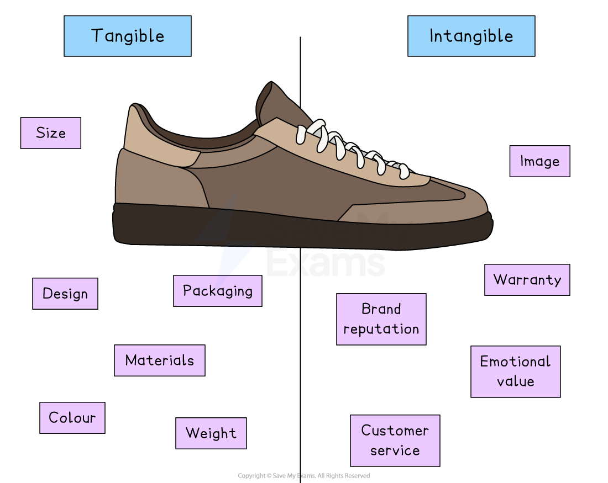
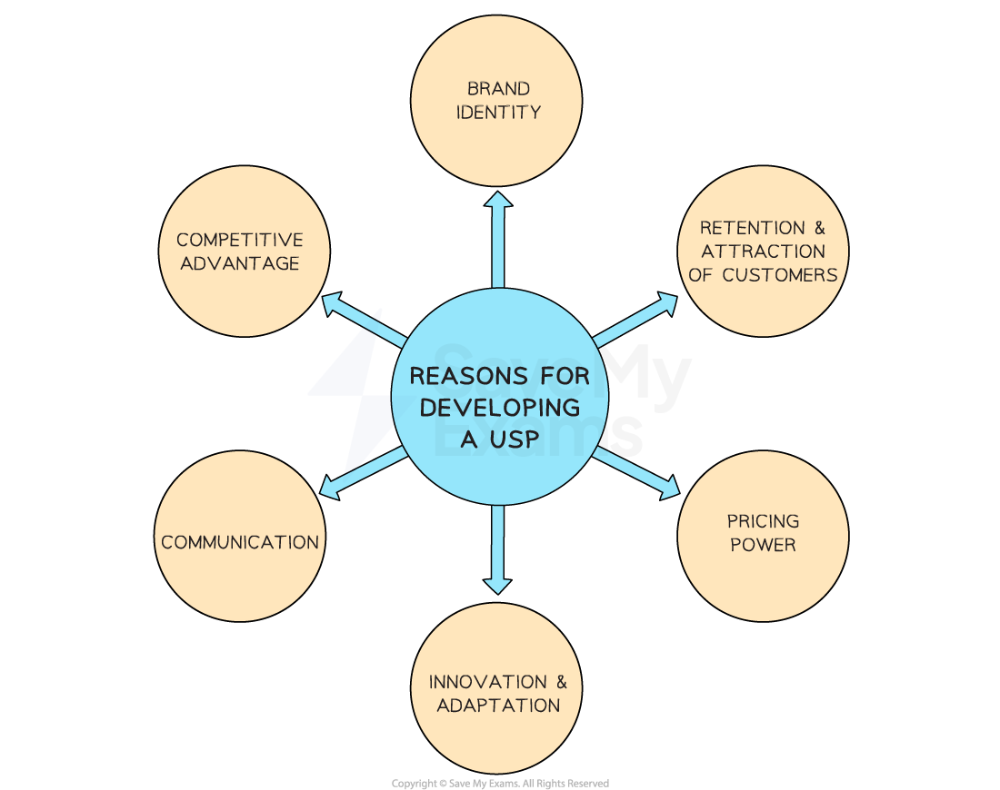

# Marketing Mix: Product

## Goods and services

> **Spec point** — `spcpt_pXJDhHNcVQVRwYRk`

## Goods and services

- Goods are **physical, tangible items** that can be touched, stored and owned

  - They are usually **produced, then sold**, and can be taken home or delivered
  
    - Examples include a loaf of bread, a car or a pair of shoes

- **Services **are **non-physical, intangible activities** provided by people or businesses

  - They are usually **performed at the time of purchase**, and cannot be touched or stored
  
    - Examples include a haircut, a taxi ride or legal advice
- In many situations, when a customer buys a **product**, they are also receiving a **service** as part of the overall experience

  - This is because businesses want to provide value beyond the physical item and improve **customer satisfaction and loyalty**

> **Case Study**
> **Buying a new car – product and services combined**
> 
> 
> 
> Priya and Henry decide to buy a brand-new electric car from a local dealership
> 
> The car itself is a **tangible product**, as it is a physical item they can see, test and drive away
> 
> However, their purchase also includes several **services** provided by the dealer to enhance their experience
> 
> - **Test drive and personalised advice**
> 
>   - A salesperson offers Priya and Henry a free test drive and gives them advice on which model suits their needs based on their lifestyle and budget.
> - **Finance and insurance assistance**
> 
>   - The dealership helps them set up a car loan and offers optional car insurance plans
> - **Free servicing for 12 months**
> 
>   - As part of the deal, Priya and Henry receive a 12-month free servicing package, including checks and minor repairs
> - **Home Delivery**
> 
>   - Once the paperwork is complete, the car is delivered directly to their home
> - **Customer support and warranty**
> 
>   - They receive a 5-year *warranty *and access to customer support in case they need help with features or maintenance

## Tangible and intangible product attributes

> **Spec point** — `spcpt_qBMfQpNWRkSfp8gN`

## Tangible and intangible product attributes

- When a customer buys a product, they are influenced by both **tangible** and **intangible attributes**

  - These are the features that affect how the product looks, feels, performs or is experienced

#### Tangible and intangible attributes of a pair of trainers

*A pair of trainers has a range of tangible and non-tangible attributes that affect a customer's decision to buy*

### Tangible attributes

- These are the **physical features** of a product that can be touched, seen, or measured
- They include things like **size, colour, design, packaging, materials, and weight**
- Customers can **compare** tangible features before buying

  - E.g. When buying a pair of running shoes, the tangible attributes include the **shape, colour, sole type, weight **and **material** used
  - The customer can try them on and feel the comfort and fit

### Intangible attributes

- These are **non-physical features** that relate to the **experience or perception** of the product
- They include things like **brand reputation, warranty, customer service, image **and **emotional value**
- These features are often the reason a customer **chooses one brand over another**, even if the tangible features are similar

  - E.g. The same running shoes may come with a trusted brand name, a 12-month warranty, and a ‘satisfaction guarantee’
  - The buyer may also feel a sense of pride or motivation wearing a well-known performance brand

## The importance of product development

> **Spec point** — `spcpt_jWZr4V3TRpGVKKJv`

## The importance of product development

- **Product development **is the process of creating and launching new goods or services

  - It can help a business grow, stay competitive and meet changing customer needs
  - Without developing new products, a business risks becoming outdated or losing its *market share*

### Why product development is important

- **Responding to changing customer needs**

  - Customers’ tastes, preferences, and lifestyles change over time
  - Developing new products helps businesses stay relevant and meet these new demands
- **Staying ahead of competitors**

  - By launching innovative or improved products, businesses can attract new customers and keep existing ones from switching to rivals
  
    - E.g. A tech company that releases a new smartphone with unique features may gain an advantage over competitors
- **Increasing sales and market share**

  - New products can generate excitement, attract more attention, and increase overall sales
  - They may also open up opportunities to reach new *market segments*
- **Extending the *****product life cycle***

  - As older products reach the end of their life cycle, new products can replace them and keep the brand fresh and active in the market
- **Taking advantage of new technology**

  - Businesses can use advances in technology to improve performance, design, or *sustainability*, which can make their products more attractive
  
    - E.g. A home appliance company might develop smart, energy-efficient models to appeal to eco-conscious consumers

#### Costs of new product development

| **Cost** | **Explanation** |
|---|---|
| **Market research collection and analysis can be time-consuming and expensive** | - Before launching a new product, businesses often need to carry out detailed research to understand customer needs, competitor activity and market trends |
| **Investment in research, development, and design is often very costly** | - Developing a successful product may require expert staff such as engineers or designers, as well as specialised equipment or software |
| **The cost of producing trial products can be significant** | - Creating *prototypes *or test versions often results in waste, especially if expensive or unusual materials and *components *are used - Early versions may need several changes before being finalised |
| **There may be low sales if the product does not meet market expectations** | - If the business targets the wrong customer group or develops a product that fails to solve a real need, it may sell poorly, resulting in lost revenue after a major investment |
| **A failed product can damage the brand and other products in the range** | - If customers are disappointed with a new product, it can affect their trust in the brand as a whole, leading to reduced sales of existing, successful products |

## Product differentiation

> **Spec point** — `spcpt_DR6v4gm2cRbKbNDd`

## Product differentiation

- **Differentiation** is **where a business distinguishes its products from those of competitors**

  - This involves creating functions or features of the product (or firm) which help it to stand out from its competitors
  - Strong product differentiation helps the firm to develop its ***competitive advantage***

#### Methods of differentiation

- * *Successful business or product differentiation helps the business to **increase demand for its products,** **increase brand loyalty**, and allow the business to **charge higher prices**

*Business can differentiate their products in many different ways *

#### Differentiation methods

| **Method** | **Explanation** | **Example** |
|---|---|---|
| **Marketing and branding** | - **Advertising **using media such as TV or online, or **promotional activities** such as price promotions helps a business to stand out | - **Compare the Market **created a memorable brand identity** **around a meerkat, playing on the words 'market' and meerkat |
| **Packaging** | - Well-designed and attractive packaging that appeals to the target market can **provide *****shelf appeal ***and encourage customers to select one product over another | - **Apple** products are well known for their superior packaging, which creates an exciting opening experience for the customer |
| **Functions and features** | - Adding unique features gains attention and **increases demand** from customers who may provide the business with favourable reviews | - **Samsung**'s** **Galaxy* *Watch 5 has robust health tracking tools built into it, along with an amazing screen |
| **Customisation** | - Allowing customers to **design or customise their products** allows the firm to charge a higher price | - **MoonPig'**s celebration cards can be completely customised |
| **Customer service** | - Businesses that ensure they have a good **reputation for customer service** are likely to retain customers | - In 2014, **Hyundai **in Singapore introduced a three year warranty on all new cars when the industry standard was one year |

## Unique selling points

> **Spec point** — `spcpt_Cg6dt4mgzmdZt9Xg`

## Unique selling points

- A unique selling point (USP) is a **distinguishing factor or characteristic** of a product, service or brand that **sets it apart from its competitors**

  - The USP helps a business to **differentiate** itself and **give customers a reason to choose one product or service over others** because it offers something **distinct and valuable**
- There are a range of **reasons why businesses develop a USP** which can include

  - Developing a ***brand identity***
  - Achieving a **competitive advantage** over rivals
  - Effective **communication** with customers
  - The **attraction **and** retention of customers**
  - Achieving **power over pricing**
  - Encouraging** *****innovation ***and **adaption**

#### Reasons for developing a USP

*The development of a USP can contribute to business success for many reasons*

- **Competitive advantage**

  - A strong USP gives a business a competitive edge by creating a ***barrier to entry*** for other businesses in the market
  
    - If a business can offer something that is difficult to imitate, it becomes more difficult for competitors to gain customers
- **Brand identity**

  - A unique selling point helps to shape the perception of the business in the minds of consumers
  
    - It becomes an essential part of the **brand's story** and **message,** which allows customers to associate specific qualities or benefits with the brand
- **Communication**

  - A well-defined USP provides a clear message that highlights the unique benefits and advantages offered by the product, making it more memorable
  
    - E.g. **Emirates**' USP is a high-quality service and** luxurious amenities **supported by extensive marketing efforts such as **sponsorship deals with sports teams and events**
- **Retention and attraction of customers**

  - A unique selling point can help attract new customers by appealing to their needs and desires, making customers more likely to **choose and remain loyal to the brand**
- **Pricing power**

  - A strong USP can often justify the firms decision to charge higher prices for products, as customers are willing to pay more
  
    - This pricing power can **improve a business's *****profitability**** *and financial performance
    - E.g. **Volvo **has a reputation for safety, reliability and comfort, which means that customers are willing to pay ***premium prices*** for its vehicles
- **Innovation and adaptation**

  - Developing and maintaining a unique selling point encourages businesses to continuously improve their products, explore new ideas and adapt to changing customer needs and preferences
  
    - E.g. **Apple **customers expect to be able to upgrade their technology devices frequently and value the ability to buy ***complementary goods,*** which add value
