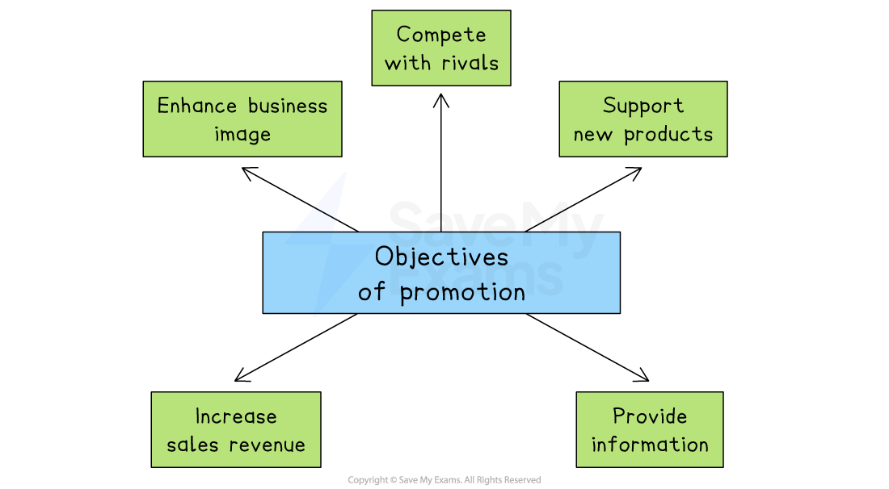
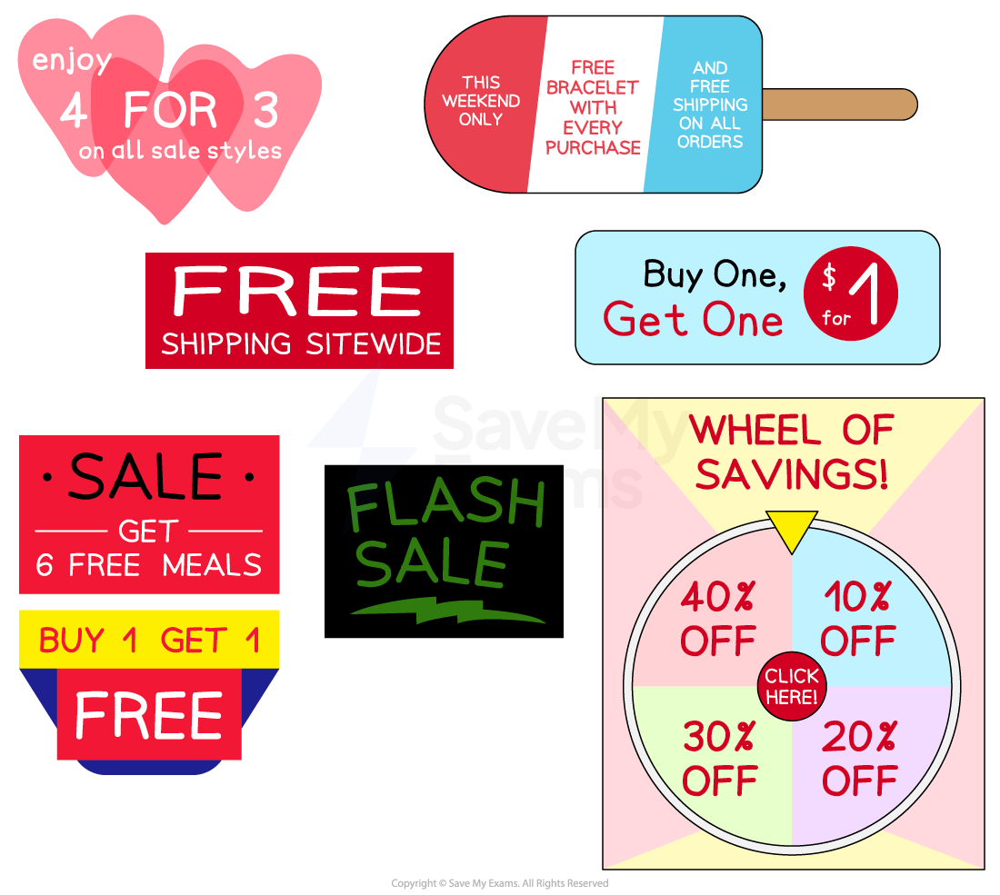

# Marketing Mix: Promotion

## The objectives of promotion

> **Spec point** — `spcpt_wK9tTnr9dW7d4Djn`

## The objectives of promotion

- Promotion plays a crucial role in **generating customer awareness**, interest and desire for a product

  - It communicates a business's** *****value proposition*** to potential customers and helps to *differentiate *the product or business from competitors

#### The main aims of promotion

*Promotion aims to support sales of new and existing products, inform customers and improve brand and business image*

- **Enhance business image**

  - Promotion helps build a strong, positive reputation that encourages trust and customer loyalty
- **Compete with rivals**

  - It allows a business to stand out in a crowded market and attract customers away from competitors
- **Support new products**

  - Promotion creates awareness and interest when launching a new product, helping it gain early sales
- **Increase sales revenue**

  - By encouraging more people to buy, promotion helps boost the volume of sales and overall income
- **Provide information**

  - Promotion informs customers about product features, prices, availability or special offers

## Advertising

> **Spec point** — `spcpt_Hy2TS277YzS9vjjJ`

## Advertising

- **Advertising** makes use of the media, such as television, newspapers and radio, to promote products or brands

  - It can **reach large audiences** and **increase brand awareness**
  - Advertising can also be used to **create a specific brand image or message**
  
    - E.g. The advertising campaign run by **Compare the Market **(Meerkat) uses **humour **to make shopping for **financial products** more attractive
  - Specialist media can **target specific *****market segments***
  
    - E.g. Upmarket **furniture** brands place advertisements in magazines such as **Homes & Antiques** and **Country Life**
- Advertising is an **expensive** promotional strategy

  - E.g. In the US high viewership for the Super Bowl means that 30-second tv advertisements have been sold for as much as \$6.5 million
  - In most cases, external specialists or **media agencies** create attractive and creative advertisements

## Sales promotion

> **Spec point** — `spcpt_zmxGZV83Db6jz6JN`

## Sales promotion

- **Sales promotion** involves the use of incentives or discounts to encourage customers to buy products

  - They are often **temporary **and are designed to **attract new customers** to try a product for the first time and become loyal to the brand
  - Examples of sales promotions include free samples, buy one get one free (bogof), discount coupons, loyalty cards, and competitions

#### Examples of sales promotions

*Sales promotions can include price reductions and encouragements to purchase a greater volume of products*

- Sales promotions can **quickly boost sales** though ***impulse purchases*** or customer engagement
- They are also an effective tool to **clear out excess stock**, **promote a new product** or **raise cash quickly**
- However, for a limited period, revenue per item is reduced

  - This is likely to increase the ***break-even point***
  - Customers may be **unwilling to pay a higher price** once the sales promotion has come to an end

## Direct promotion

> **Spec point** — `spcpt_VF7JQFzT2fSGhQsg`

## Direct promotion

- Direct promotion involves **communicating directly with customers** through email, text message, social media or post

  - E.g. Takeaway restaurants distribute menus to households in the local community
- Businesses can **target specific audiences** and personalise the message to individual customers
- Its impact is **measurable,** which enables businesses to track their results and adjust strategy accordingly
- However, direct promotion can be intrusive, as customers may perceive it as ***spam***
- It can also be costly, especially if businesses **do not have an established customer database** or need to purchase *leads*

## Digital promotion

> **Spec point** — `spcpt_qvhwTzNvgzDnNkFF`

## Digital promotion

- **Digital promotion** refers to the use of **online and electronic technologies** to promote a business’s products or services to consumers

### Examples of digital promotional activity

- **Social media marketing**

  - Promoting products through platforms like Instagram, Facebook, TikTok or X
- **Email marketing**

  - Sending promotional emails to target customers
- **Search engine marketing (SEM)**

  - Paid adverts that appear in search engine results (e.g. Google Ads)
- **Influencer marketing**

  - Paying social media personalities to promote a brand
- **Website banners and pop-ups**

  - Digital adverts placed on websites
- **Video marketing**

  - Promotional content shared on platforms like YouTube or embedded in websites
- **Content marketing**

  - Creating *blogs*, articles or videos to provide value and attract customers

### Evaluating digital promotion

| **Benefits** | **Drawbacks** |
|---|---|
| - **Cost-effective**    - Many digital methods, such as social media posts, are cheaper than traditional advertising | - **High competition and digital noise**    - With so many online adverts, customers may ignore or scroll past promotions |
| - **Targeted advertising**    - Businesses can focus promotions on specific customer groups based on age, location, interests and behaviour | - **Requires up-to-date skills and technology**    - Managing digital campaigns needs knowledge, time and regular updates |
| - **Measurable results**    - Businesses can track performance through data such as clicks, views and conversion rates | - ***Ad blockers***** reduce visibility**    - Many users install tools that prevent online ads from being seen |
| - **Global reach**    - Businesses can promote products internationally without the cost of physical stores | - **Negative feedback spreads quickly**    - Online complaints or bad reviews can go *viral *and harm a brand’s image |
| - **Interactive engagement**    - Customers can respond to adverts by liking, sharing or commenting, helping boost brand awareness | - **Can be impersonal**    - Some customers may prefer human interaction or personalised service over automated messages |

## The role of packaging in promotion

> **Spec point** — `spcpt_zMrrmsksngXdCnFg`

## The role of packaging in promotion

- **Packaging **is the physical container or wrapping for a product. It is also used for promotion and selling appeal
- Packaging is normally **designed to**

  - **Present **products in the most practical yet attractive way
  - **Communicate** the quality of the product
  - **Catch the customer's eye** when they shop
  - Provide** key information to customers**
  - **Establish the business brand image**
  - **Protect** a product from damage
- To stand out from the competition and establish a long-lasting relationship with consumers, brands are investing more money than ever before in **creative and environmentally friendly packaging designs**

  - This is becoming increasingly important for businesses as they place a **greater emphasis on sustainability** and their ***CSR*** policies

#### Examples of memorable packaging

| **Apple iPhone** | **Ferrero Rocher** |
|---|---|
|  |  |
| - Apple’s IPhone packaging is designed to open slowly - First customers lift the box top and a moment passes before gravity overcomes a slight vacuum and the bottom slowly descends - One by one, layers within the box are revealed with elements such as cables wrapped like origami | - Each chocolate is wrapped in luxurious gold foil, placed in a fluted paper cup and topped off with a gold-fonted label - Chocolates are arranged and stacked in a clear carrying case with rounded edges ensuring they can be viewed from any angle |
| **Tiffany** | **Pringles** |
|  |  |
| - Tiffany’s packaging - including its iconic Blue Box represents the entire retail enterprise - The colour shade, tissue paper and satin ribbon are protected by trademark and empty boxes and bags are often posted on sites like Etsy or eBay - A small silver and enamel Tiffany Blue Box is now even sold as a wearable charm | - Pringles resealable paperboard tube with a metal base and plastic cap is designed to stand up as well as ensure freshness and prevent damage - Upon his death in 1998 the packaging creator insisted he be buried in a Pringles can as he loved his design so much |

## The role of branding in promotion

> **Spec point** — `spcpt_ww8dZ483jrpHwQwv`

## The role of branding in promotion

- A brand is the set of** names, symbols, design elements **and **associations** that customers link to a product, service or business
- It can be considered as the **promise of a consistent experience** every time a customer buys a branded product

#### The UK's favourite brands

*According to a YouGov survey in early 2025, the UK's favourite brands included Cadbury, Walkers, Kit Kat and McVities*

### Why strong brands matter

- **Clear differentiation**

  - A strong brand makes a product instantly recognisable among near‑identical alternatives
  - This simplifies choices for time‑pressed shoppers
  - For example, **Innocent**’s playful tone and halo logo help its smoothies stand out in crowded supermarket chiller cabinets
- **Customer loyalty and repeat sales**

  - Familiar, trusted brands reduce perceived risk, so buyers return without comparing prices each time
  - This loyalty lowers the firm’s long‑run promotion costs
  - For example, **Colgate** maintains the market‑leading toothpaste share despite many cheaper own‑label options
- **Ability to charge premium prices**

  - A well‑regarded brand lets the firm *add value* beyond improvements to the physical product, increasing profit margins
  - For example, **Apple** sells iPhones at higher prices than comparable rivals because the customers associate the brand with design and quality
- **Easier new‑product launches **

  - Positive associations of a strong brand rub off on new items, cutting the need for heavy introductory advertising
  - For example, **Cadbury**'s reputation for quality chocolate ensured success for its launches of hot chocolate powder and ice cream bars
- **Stronger bargaining power with retailers**

  - Stockists such as supermarkets want well-known names that pull in customers, so big brands gain better shelf space and promotional support
  - For example, supermarkets run prominent displays on end aisles for **Coca‑Cola**, knowing it attracts shoppers
- **Intangible asset value **

  - A respected brand appears on *balance sheets* under *goodwill* and can be sold or *licensed*, generating extra income
  - For example, **Manchester United** licenses its crest for global *merchandise*, creating revenue far beyond match tickets
