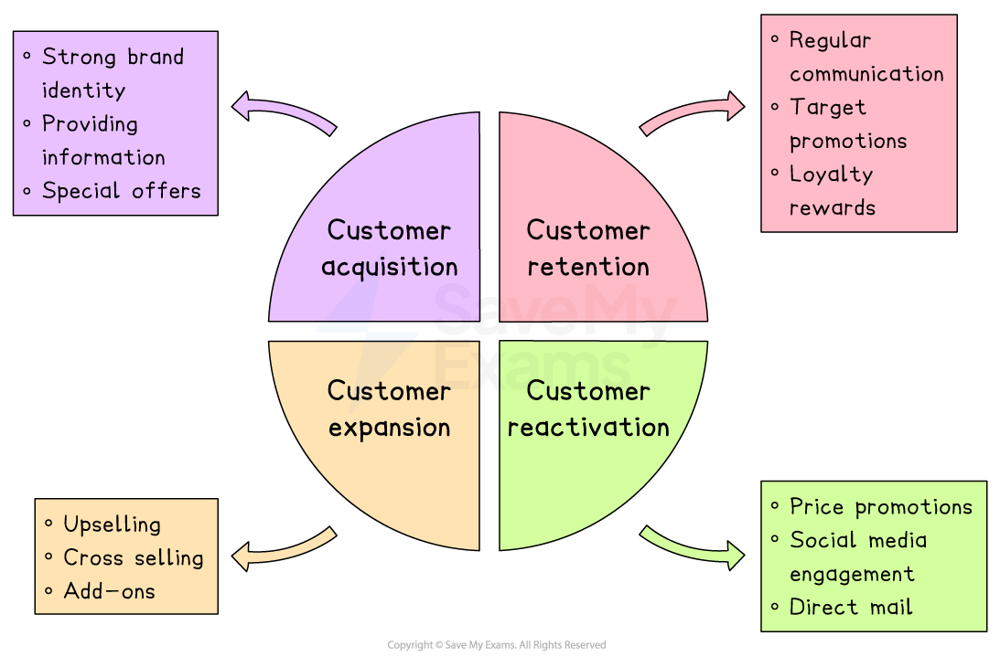

# Customer Relationship Marketing

## The aims of CRM

> **Spec point** — `spcpt_56Gj239QnYgjFtRw`

## The aims of CRM

- **Customer relationship marketing** (CRM) involves a business focusing their marketing efforts around** building a deep understanding of customers, consistently meeting customer needs **and** developing long-term customer loyalty**
- Marketing strategies and tactics are focused on** four key areas**

#### CRM strategies and tactics

*Customer relationship marketing involves the acquisition, retention, expansion and reactivation of customers*

### Customer acquisition

- **Attracting interested consumers **and **converting** them into **customers** to achieve growth, make money and improve chances of business survival
- Businesses can acquire customers in many different ways, including

  - Building a strong **brand identity**
  - Delivering excellent** customer experiences**
  - Providing clear **information**
  - Offering special** rewards,** such as price promotions

### Customer retention

- **Customer retention** involves encouraging customers to **remain loyal to a business** and its brands **over time**
- Encouraging loyalty is important for several reasons

  - **Attracting new customers often costs more** than retaining current customers
  - Loyal customers tend to be valuable repeat customers
  - Retained customers can refer new customers to a business
  
    - **Word-of-mouth marketing **is a form of free marketing for a brand
    - Happy customers talking about a business or brand in positive ways can help persuade people they know to become loyal customers as well
- Businesses can retain customers in many different ways, including

  - Customer ***loyalty schemes***
  - Regular **communication** about new products or promotional offers
  - Targeted **price promotions** or other **perks** for existing customers

### Customer expansion

- Customer expansion is the process of encouraging** existing customers** to **increase the value and frequency of their spending **on products and services over time
- Businesses can achieve customer expansion in several different ways, including

  - ***Upselling**** *by encouraging customers to upgrade to premium products
  - ***Cross-selling*** by offering customers a related product or service
  - Providing **add-ons** such as insurance policies, extra features or extended warranties

### Customer reactivation

- **Customer reactivation **involves **reaching out** to customers who have **previously expressed interest in or purchased a product** but have since become** disengaged**
- **Businesses can adopt a range of techniques to reactivate customers, including**

  - Social media engagement
  - Targeted price promotions for returning customers
  - Direct mailings via post or email

## Costs and benefits of CRM

> **Spec point** — `spcpt_3j5krtgVZVmQjCX4`

## Costs and benefits of CRM

### Benefits of CRM

- **CRM allows a business to build a detailed understanding of its customers’ needs and preferences**

  - This helps the business to tailor its products, services and promotional activity more precisely, increasing the chances of customer satisfaction and repeat sales
  
    - E.g. A clothing retailer might use CRM data to send personalised offers based on a customer’s past purchases
- **Retaining loyal customers is usually more cost-effective than attracting new ones**

  - CRM focuses on building long-term relationships with existing customers, which reduces marketing costs
  
    - E.g. A mobile phone company offering exclusive upgrades to loyal users instead of spending heavily on advertising to new customers

### Costs of CRM

- **CRM requires significant investment in staff training and development**

  - To deliver consistently good customer service, employees need to understand the CRM system and be committed to meeting customer expectations at every stage of the buying process
  
    - E.g. Hotel staff may need to learn how to use CRM software to remember guest preferences and deliver a personalised experience.
- **CRM is unlikely to succeed without ongoing, expensive customer research**

  - For CRM to be effective, the business must constantly collect, update and analyse customer data, which can be time-consuming and costly
  
    - E.g. An airline may need to invest heavily in customer surveys, feedback tools, and data analytics to truly understand traveller needs.
