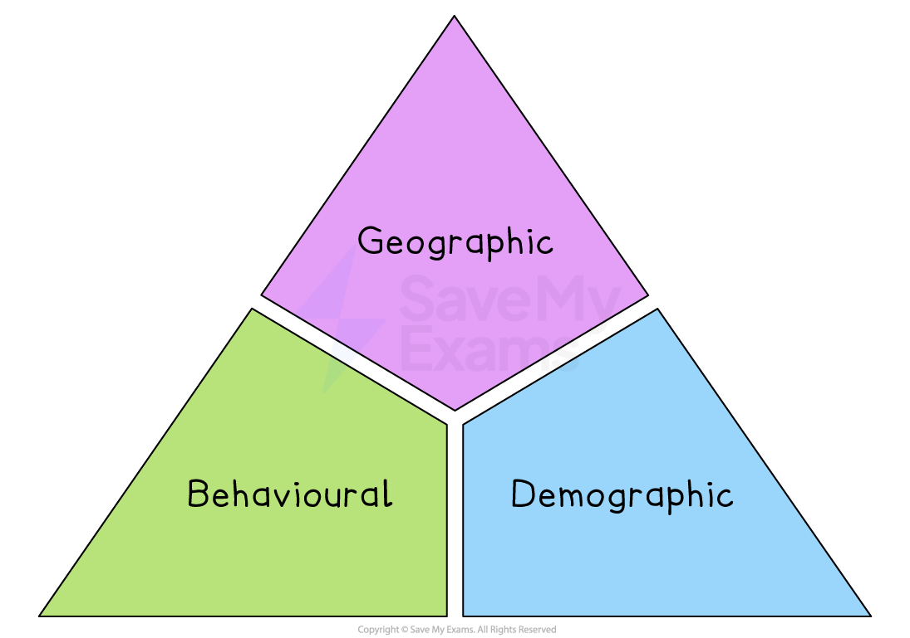

# Market Segmentation

## Methods of market segmentation

> **Spec point** — `spcpt_VZZ6ZvPnng8pGTsq`

## Methods of market segmentation

- **Market segmentation** is the process in which a single market is **divided into submarkets **or "segments"

  - Each segment represents a slightly different set of **consumer characteristics**
  - Firms often segment their markets according to factors such as **income**, **geographical location**,** religion**,** gender** or** lifestyle**
- A market for a good such as crisps is not simply seen as one market

  - For example, the crisp market is divided into many **market segments**
  
    - **Dinner party snacks** (Walkers Sensations, Pringles, Burts) are targeted at those with higher ***discretionary income*** with a premium price
    - **Health-conscious crisps** (Walker's Lite, Walkers Baked, Ryvita Lite) are targeted at the health-conscious market
    - **Lunch box value snacks** (multipacks, Hula Hoops, etc.) are targeted at families and the ***mass market***

#### Segmentation methods

*Markets can be segmented by geography, customer behaviour and demographics*

### Geographic segmentation

- **Geographic segmentation** involves breaking up a market into groups of customers who live, work or spend their leisure time in defined** locations**

  - ***Urban*** and rural customers' needs relate to their surroundings
  
    - E.g. **city-dwellers** are likely to purchase **small, electric vehicles**, while those who live in the **countryside** tend to prefer **larger, all-terrain vehicles**
  - Customers in warmer countries make different purchasing decisions to those living in cooler climates
  
    - E.g. sales of **air-conditioning units** in **Italy** and **Turkey** are significantly higher than in **Germany** and the **UK**
  - Within a country, customers living in different regions have varied preferences
  
    - E.g. **France** is well-known for its regional **food specialties,** with residents of southern *départements* generally preferring a Mediterranean diet, whilst those in more northern regions consume more dairy products and red meat

### Behavioural segmentation

- Customers make different** lifestyle**, **health **or **dietary **choices that can provide opportunities for businesses

  - E.g. **travel companies** target different packages at families, thrill-seekers and those looking to pursue a specialist interest such as cuisine or art
  - **Beyond Meat**'s entire product range is aimed at vegans, vegetarians and flexitarians cutting down on animal protein
  
    - Its plant‑based burgers and sausages are sold in supermarket meat aisles
- Some purchasing decisions are based on thorough research, whilst others tend to be ***impulse buys***

  - E.g. home store **Dunelm** places low-priced household essentials such as dusters and scented candles close to the checkout area
- Other behavioural factors include

  - the **frequency of purchase**
  
    - E.g. whether customers buy a product often or as a one-off, for regular consumption or as an occasional treat
  - whether customers are** brand loyal**
  
    - E.g. those that stick with the same brand may be rewarded with loyalty benefits, such as points for each £ spent, while those that switch brands may be attracted by special offers, such as BOGOF (Buy One Get One Free)

### Demographic segmentation

- **Demographic segmentation** involves breaking up a market into groups of customers with **similar characteristics**, such as **age**, **gender **and **family circumstances**

  - **Men and women** often have different purchasing preferences
  
    - Men tend to spend more than women when shopping
    - Women are more ***price-sensitive*** shoppers than men, buying more reduced-price items and using price promotions more frequently
  - As **populations age**, spending patterns are changing
  
    - Spending on **specialist services** such as personal care and single-person travel has increased significantly
  - Many products are aimed at different age groups, who are likely to have different interests, influences and ***spending power***
  
    - E.g. in 2022, consumers in the United States spent an average of \$1,945 on clothing, with most being spent by the generation born between 1965 and 1980, known as **Generation X**
  - Many countries have increasingly ***ethnically diverse*** populations
  
    - Markets for **clothing, food** and **celebration items** can be targeted at specific ethnic or religious groups

## Advantages and disadvantages of market segmentation

> **Spec point** — `spcpt_xt22tbZbJM9PGPsv`

## Advantages and disadvantages of market segmentation

| **Advantages** | **Disadvantages** |
|---|---|
| - **Recognises that consumers are not all identical**    - This allows businesses to treat customers as individuals with different needs, rather than using a one-size-fits-all approach   - E.g. A sports brand can create different marketing campaigns for runners, gym-goers, and footballers | - **Not everyone within a segment will behave in the same way**    - Just because people share certain characteristics doesn’t mean they will all make the same buying choices.   - E.g. Two teenagers may be the same age, but one prefers gaming and the other prefers sports |
| - **Consumer groups do not all share the same tastes and preferences**    - Segmentation helps businesses adapt products to suit different lifestyles, cultures, and buying habits   - E.g. A food company may offer spicy options in regions where spicy food is popular, and milder options elsewhere | - **It may be difficult to identify a segment, and consumers may belong to multiple segments**    - This makes it harder to design a focused marketing message that works for all individuals within overlapping segments   - E.g. A working parent might fit into both ‘budget-conscious’ and ‘family-focused’ segments, making targeting less straightforward |
| - **Products and marketing activities can be altered to meet the different needs of diverse groups**    - Businesses can target their messages more precisely and design features that appeal directly to specific groups   - E.g. Airlines often segment by travel class, offering different levels of service to economy and business passengers. | - **Segmentation requires more detailed marketing research, which can prove costly**    - Market research takes time, money, and expertise – but it can provide useful insights when done properly   - E.g. A travel agency targeting solo travellers may need to run surveys or focus groups to understand their needs. |
| - **Less expensive and wasteful than marketing to wide market segments**    - Focusing marketing only on likely buyers saves money and avoids advertising to uninterested consumers   - E.g. A luxury car brand targets high-income individuals rather than spending money promoting to the general public. | - **A segment may be identified but may be too small and unprofitable to cater to**    - If the group is too niche, the business may not generate enough revenue to cover its costs   - E.g. A company developing cricket gear for left-handed players might find the market too limited to be worth the investment. |
