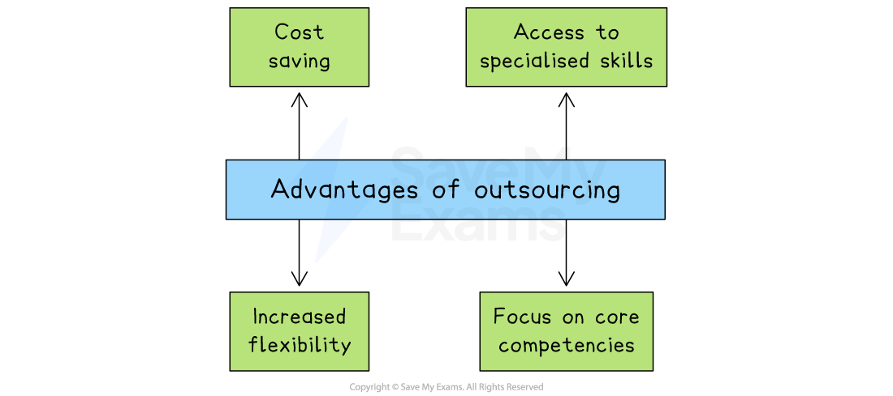

# Capacity Utilisation & Outsourcing

## Measuring capacity utilisation

> **Spec point** — `spcpt_4PXfBg7Fp8PKcRHC`

## Measuring capacity utilisation

- Capacity utilisation measures **how effectively** **a business uses its** ***assets*** **to produce output**

  - It **compares current output to the maximum possible output** a business can produce using all of its assets
- Capacity utilisation is calculated using the following formula and expressed as a percentage

$\mathrm{Capacity} \mathrm{utilisation}=\frac{\mathrm{Current} \mathrm{output}}{\mathrm{Maximum} \mathrm{possible} \mathrm{output}}\times100$

> **Worked Example**
> *Bäkkerei Lola* produces specialist Indian and Bangladeshi breads, which are sold to restaurants in the Munich area
> 
> Batch production is used in the factory to manufacture the range of breads and the factory can produce a maximum of 68,400 units per month
> 
> In May factory output was 51,420 units
> 
> Calculate* Bäkkerei Lola's* capacity utilisation in May.
> 
> (2)
> 
> **Step 1: Divide the current output by the maximum output**
> 
> $=\frac{51,420\mathrm{units}}{68,400\mathrm{units}}\,\,=0.75$**(1 mark)**
> 
> **Step 2: Multiple the outcome by 100 to obtain the percentage capacity utilisation**
> 
> $= 0.75 \mathrm{x} 100
> 
> = 75 \%$       **(1 mark)**

> **Exam Hint**
> In your exam, you may need to rearrange the capacity utilisation formula. You may be given the percentage of capacity utilisation and have to calculate the volume of output.

## The impact of under capacity utilisation

> **Spec point** — `spcpt_N3kz46fzvdmd8wdq`

## The impact of under-capacity utilisation

- Low capacity utilisation means resources are being underused

  - This may lead to inefficiencies and lost potential output

#### Positive and negative impacts of undercapacity utilisation

| Positive impacts | Negative impacts |
|---|---|
| - The business is not working at full stretch, so it** can easily increase production** if needed or take on unexpected orders - Spare time can be used for important jobs like **checking and fixing machinery**, helping to prevent breakdowns in the future | - Unit costs are likely to be higher because **fixed costs are spread over fewer units** of output - Workers are under-deployed, leading to fears of redundancy - If staff are not fully occupied, they may **worry about losing their jobs**, which can affect morale and motivation |

## Improving capacity utilisation

> **Spec point** — `spcpt_dHNHbvSbF4qZd7Rc`

## Improving capacity utilisation

- High capacity utilisation means a business is** making the most of its resources**, such as staff, machines, and buildings

  - This helps to lower unit costs, improve efficiency, and increase profits

#### Ways to increase capacity utilisation

*Outsourcing offers a range of benefits to businesses, including cost savings and increased flexibility*

- **Increase customer demand**

  - Boost sales through marketing, special offers, or new products so more output is needed
- **Make better use of staff and equipment**

  - Improve planning and scheduling to ensure that workers and machines are kept busy and productive
- **Accept more orders, even at lower profit margins**

  - Taking on additional work, like bulk or discounted orders, can help fill unused capacity and reduce unit costs
- **Use spare capacity to produce for other businesses**

  - If a business has too much capacity, a business could offer manufacturing services to other companies
- **Launch products or services at different times of year**

  - Spreading demand across the year avoids quiet periods and helps keep production steady
- **Close under-used parts of the business**

  - If some facilities are regularly unused, shutting them down can cut costs and improve overall efficiency

## The impact of operating over maximum capacity

> **Spec point** — `spcpt_qGdVSzRBCMs8tdBQ`

## The impact of operating over maximum capacity

- High capacity utilisation may mean **flexibility to respond to new orders **is lost

  - Staff are under pressure to increase output
  - Overworked staff may leave, increasing ***staff turnover***
  - Machinery operates at its limit and is more prone to **breakdowns**, which** disrupts production**
- High capacity utilisation **minimises unit costs** and increases **competitiveness**

  - Busy workers **feel secure in their employment**
  - A busy business is likely to be **well thought-of** and attract customers who are willing to wait for products to be delivered

## Outsourcing

> **Spec point** — `spcpt_QBqy5GYt9ZQSqQJd`

## Outsourcing

- Outsourcing is the process where a business ***delegates*** **specific business activities (IT, customer support, HR etc) to external service providers**

  - Businesses choose to outsource these functions to reduce costs, access specialised expertise, or focus on ***core competencies***

#### Advantages of outsourcing

*Outsourcing offers a range of benefits to businesses, including cost savings and increased flexibility*

- **Cost savings**

  - Businesses can often reduce expenses associated with operations such as hiring and training employees, maintaining infrastructure and managing IT systems
- **Access to specialised skills**

  - External specialists have resources that the business lacks internally, which allows it to benefit from the knowledge and experience of industry specialists when required
- **Increased flexibility**

  - Outsourcing provides greater flexibility to scale operations up or down based on demand fluctuations, which is particularly valuable in industries with seasonal or unpredictable demand
- **Focus on core competencies**

  - Businesses can concentrate their resources and efforts on their core competencies, where they can ***add value***

#### Disadvantages of outsourcing

- **Quality control**

  - Outsourcing makes it harder to ensure consistent quality and adherence to company standards
- **Loss of control**

  - Handing direct control over those activities to others outside of the business may be risky
  - Companies must carefully select reliable partners and establish clear contractual terms to protect their interests
- **Data security and confidentiality**

  - Sharing sensitive information outside of the business introduces risks to data security and confidentiality
