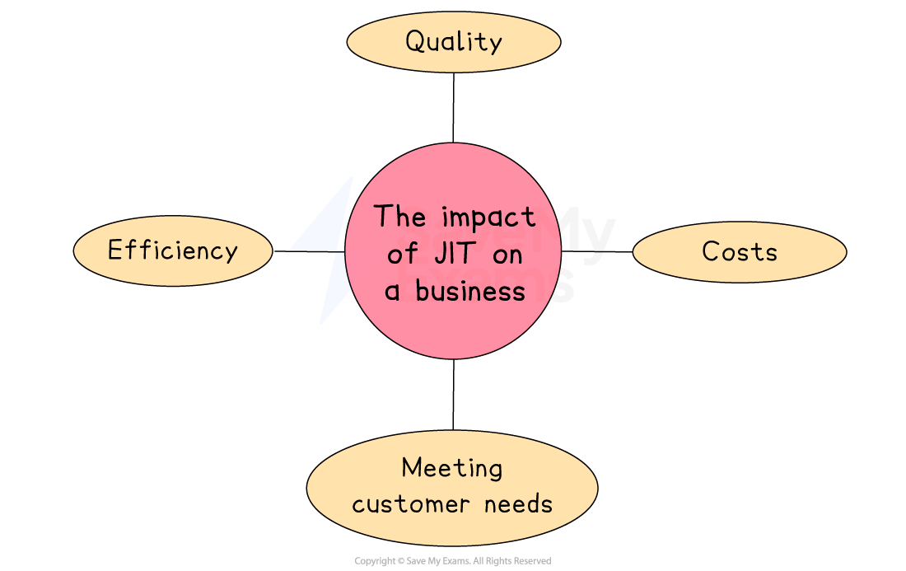

# Just in Time

## Just in Time versus Just in Case

> **Spec point** — `spcpt_2vnCnS82cTpmxjjy`

## Just in Time versus Just in Case

### 1. The just-in-time approach (JIT)

- The** just-in-time (JIT) **approach** **involves ***raw materials*** and ***components*** being **ordered as required** and delivered "just in time" to be used in production
- Raw materials and components are ordered from a **small number **of** trusted key suppliers just before they are to be used**

  - **Close**,** long-term** relationships with these suppliers** **need to be developed
  
    - Many businesses using JIT inventory management systems aim to source raw materials and *components *from local or regional suppliers
    - They must be **flexible** and **reliable**
    - They may be required to** hold inventory on behalf **of a JIT-operating customer
    - They are often in** close proximity **to their key JIT-operating customer

#### Evaluating the just-in-time approach

| **Advantages** | **Disadvantages** |
|---|---|
| - **Stockholding costs**, including storage rental and security, are minimised - Inventory and finished goods are **less likely to be damaged** in storage - Close working relationships are developed with a **small number of trusted suppliers** - ***Cash flow***** is improved**,** **as money that is not tied up in stocks **can be put to other uses** - **Unused storage space** is available for productive use or can be disposed of | - Bulk buying ***economies of scale***** **are not generally possible - Unable to respond to **unexpected increases in demand** without precise forecasting of demand - High ***administration***** costs** due to frequent ordering of stock - **Unreliable suppliers** (e.g. late or poor-quality deliveries) can quickly halt production - **External factors** can delay delivery of stock, e.g. increased border checks on imported goods since Brexit |

> **Exam Hint**
> When you explain the JIT approach, link every benefit (less inventory, lower storage costs) to a risk (stockouts if deliveries slip)
> 
> Showing both sides proves you understand why lean systems boost profit only when suppliers are rock‑solid

### 2. The just-in-case approach

- **Just-in-case inventory management **involves a business holding a quantity of raw materials, components or finished goods as ***buffer stock***

  - Stock is held in case of** shortages** so as to provide a ***competitive edge***** **over rivals unable to meet demand
- The decision to keep buffer stocks is one that businesses have to weigh up very carefully

  - Holding inventory incurs **storage and security costs** and can increase **waste**, as stock could be damaged, stolen or become ***obsolete***
  - Failing to hold enough inventory could mean a business is **unable to meet demand**, potentially missing out on ***sales revenue***

#### Evaluating the just-in-case approach

| **Advantages** | **Disadvantages** |
|---|---|
| - Buffer stocks ensure a **stable supply of goods,** allowing a business to respond to increases in demand - Extreme **price fluctuations **due to shortages of inventory can be avoided - Businesses that are **dependent on particular raw materials **avoid supply disruption - Businesses with a regular supply **gain a reputation** for always being able to meet customers' needs | - Holding buffer stocks can be expensive, as it requires storage facilities and **inventory management systems** - Buffer stocks can become **obsolete** if the demand for a particular product or input declines - Holding buffer stocks **ties up cash **that could be invested in other areas of the business |

## The impact of adopting a JIT approach

> **Spec point** — `spcpt_RNNMwhGFwzdT7QhM`

## The impact of adopting a JIT approach

- The JIT approach has significant effects on several areas of a business

*Adopting JIT can have a significant impact on costs, quality, efficiency and a business's ability to meet customer needs*

### Impact on costs

- **Lower inventory costs**

  - Since stock is only ordered when needed, businesses spend less on storage facilities and insurance
- **Less money tied up in stock**

  - Firms have more *working capital *available for other uses, like marketing or staff training
- **Fewer waste costs**

  - JIT reduces the risk of *obsolete *or damaged stock, especially for *perishable *or seasonal items

### Impact on quality

- **Improved supplier quality**

  - Businesses work closely with reliable suppliers to ensure materials meet high quality standards
- **Faster *****feedback loops***

  - Any quality issues are noticed and fixed quickly, as production is continuous and lean
- **Focus on right-first-time**

  - As there’s no buffer stock, production teams must work efficiently and avoid errors

### Impact on efficiency

- **Streamlined production**

  - JIT promotes smoother workflows and reduces idle time between stages of production
- **Motivated workforce**

  - Workers often have more responsibility and take part in continuous improvement (*Kaizen*)
- **Space-saving**

  - With fewer storage needs, factory space is better used for production activities

### Impact on meeting customer needs

- **Faster response to changes**

  - Businesses can adapt quickly to shifts in consumer demand, reducing the risk of overproducing unpopular products
- **Customisation**

  - JIT allows more flexible and tailored production, often linked to modern *mass customisation* systems.
- **Freshness and quality**

  - Products are made closer to the time of sale, especially useful in food and fashion industries
