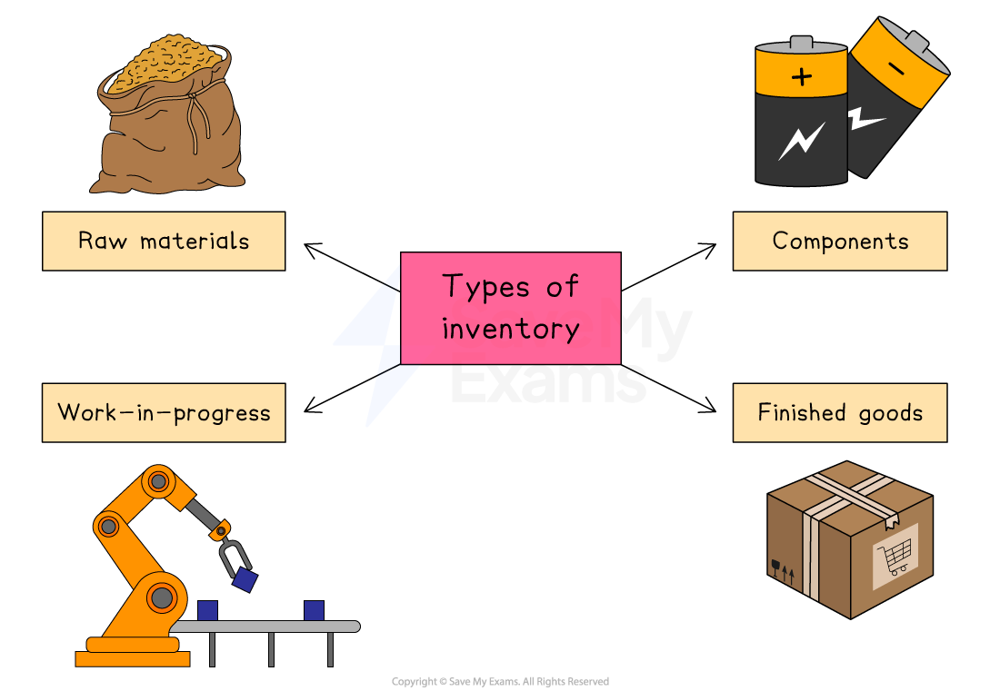

# Methods of Inventory Management

## The purpose of inventory

> **Spec point** — `spcpt_FzM3CMzkmZpRQsQq`

## The purpose of inventory

- **Inventory** is the goods and materials a business holds for the ultimate goal of resale or for use in production

#### Types of inventory

*Inventory consists of raw materials, components, work-in-progress and finished goods*

| **Raw materials** | **Components** |
|---|---|
| - These are the natural resources or goods that are **used to make other products**    - Examples in vehicle production include steel, plastic and oil | - The parts used in the production of goods    - Examples in vehicle production include circuit boards, body panels and gearboxes |
| Work-in-progress | **Finished goods** |
| - This includes **partially finished **products awaiting completion    - In car production, this could include vehicles awaiting spray-painting or quality control checks | - These are completed products which require no further manufacturing    - In car production, these are vehicles ready for sale to the final customers |

## Costs and benefits of holding inventory

> **Spec point** — `spcpt_7chcbSB3Bp66DSZY`

## Costs and benefits of holding inventory

- The management of stock is an important consideration for businesses
- Problems may arise from holding** **inventory

  - Storage costs (e.g. warehouse rental, security costs) will be higher than necessary
  - The risk of spoilage and stock  *shrinkage****  ***is increased, leading to increased costs
  - Money tied up in stock could be used elsewhere in the business
  - Time and resources are needed to monitor and track stock levels
- However, if a business holds inventory, it means that

  - Products are available when needed, improving customer satisfaction
  - Buying quantities of inventory and storing it may reduce *unit costs* due to bulk buying discounts
  - Production isn't held up by supply issues
  - Extra stock helps meet peaks in sales, such as during holiday periods

## The importance of supply chain management

> **Spec point** — `spcpt_Cd8qZCmmRckQGSRc`

## The importance of supply chain management

- The **supply chain** is the network of organisations, people, activities and resources that move a product** from its basic raw material right through to the final customer**
- It includes the following:

  - **Stock control**:** **planning, implementing and monitoring the movement of raw materials, components, work-in-progress and finished goods
  - **Quality control**:** **ensuring output meets standards so that the end product is safe and meets customer expectations
  - **Transport networks**:** **ensuring efficient deliveries of goods to customers, taking account of speed, reliability and costs
  - **Supplier networks**:** **developing strong relationships with suppliers willing to work *collaboratively* to improve quality
- **Global supply chains** require these activities to be coordinated **across international borders**

  - Some stages can be **completed at lower cost** in certain countries
  
    - **E.g. China** has a reputation for producing high quality, low-cost electronics components
  - *Labour-intensive* processing, such as clothes manufacturing, is outsourced to countries with **low labour costs**,** **such as** Vietnam**
  - **Scarce raw materials** may only be available in certain countries/regions

### Building an effective supply chain

| Decision area | What it involves |
|---|---|
| **Make or buy (produce in-house or outsource)** | - Decide whether to produce in-house or buy from specialists |
| **Choosing suppliers** | - Single, trusted supplier or multiple backup options - Local or global sources |
| **Purchasing approach** | - *Bulk buying* for discounts or frequent, small orders for flexibility |
| **Information sharing and use of technology** | - Real-time data, bar codes, *RFID* and *cloud* systems keep production partners fully informed |
| **Logistics structure** | - How many and where warehouses are needed - Transport options — use an external *haulier* or keep control of deliveries |

### Why does an effective supply chain matter?

1. **Faster delivery to customers**

  - When every link is well-coordinated, products move quickly from factory to shelf, beating slower rivals
2. **Lower operating costs**

  - Just-in-time (JIT) deliveries and bulk purchasing agreements reduce storage, handling and material expenses
  - E.g*. ***Aldi** negotiates long-term contracts with a small group of trusted suppliers, helping it minimise warehouse inventory and keep prices low
3. **Consistent quality**

  - Close, long-term relationships with suppliers make it easier to enforce standards and fix problems early
4. **Greater resilience to shocks**

  - A well-planned supply chain includes backup suppliers and effective data sharing so the business can adapt when something goes wrong

## Inventory control charts

> **Spec point** — `spcpt_9tPNjVFVCs6hD85m`

## Inventory control charts

- An **inventory control diagram** shows how** **inventory moves into and out of a business over time

#### An inventory control diagram

*An example of an inventory control diagram for a small manufacturing business*

- The **maximum inventory level **is the maximum amount of stock a business is able to hold in normal circumstances (1,600)
- The **reorder level** is the level at which a business places a new order with its supplier (800)
- The **minimum stock level** is also known as the **buffer inventory **level and is the lowest level to which a business is willing to allow inventory levels to fall (400)
- **Lead time** is the length of time from the point of inventory being ordered from the supplier to it being delivered (one week)
- The stock level line shows how inventory levels change over the given time period

  - As inventory is used up, a downwards slope is plotted
  - When an order is delivered by a supplier, the stock level line shoots upwards

> **Worked Example**
> The diagram below shows inventory movements of kitchen shelving units sold by TamFix Limited*.*
> 
> 
> 
> Identify the following points:
> 
> 1. The minimum stock level
> 2. The reorder level
> 3. The reorder quantity
> 4. The lead time for kitchen shelving units
> 
> (4)
> 
> **Answer:**
> 
> **Step 1: Identify the minimum stock level**
> 
> - The minimum stock level is identified by the bottommost dotted line
> - In this case, it shows that the minimum stock level is 200 units    **(1)**
> 
> **Step 2: Identify the reorder level**
> 
> - The reorder level is clearly identified on the diagram
> - In this case, it shows that the reorder level is 500 units     **(1)**
> 
> **Step 3: Identify the reorder quantity**
> 
> - The reorder quantity is the difference between the maximum stock level (shown by the topmost dotted line) and the minimum stock level
> 
> $=1000\mathrm{units}-200\mathrm{units}\,\,=800\mathrm{units}$
> 
> - The reorder quantity is, therefore, 800 units     **(1)**
> ** **
> 
> **Step 4: Identify the lead time for kitchen shelving units**
> 
> - The lead time is the difference in time between the time an order is placed and the time the inventory is delivered
> - In this case, assuming a five-day working week, the lead time for shelving units is **two days**  **(1)**

> **Exam Hint**
> Always clearly label lead time, reorder level and buffer stock, and include units
> 
> Show your workings — examiners award method marks even if the final figure is wrong

## Buffer inventory

> **Spec point** — `spcpt_v2ZK46zCFJtn9528`

## Buffer inventory

- Buffer inventory is a quantity of stock kept in case of shortages

  - This can provide a  ***competitive edge**** * over rivals unable to meet demand
  - This approach is commonly called **‘just in case’ **stock control
- The decision to keep buffer stocks is one that businesses have to weigh up very carefully

  - The decision will be influenced by the nature of the business and the product/service it provides

#### Evaluating the use of buffer stocks

| **Advantages** | **Disadvantages** |
|---|---|
| - **Stability in supply** Buffer stocks ensure a stable supply of goods which is able to respond to unexpected customer demand - **Price stabilisation** Buffer stocks can help prevent extreme price fluctuations, as it helps the market **avoid shortages,** which would result in rapid price increases - **Raw materials security** Businesses that are **dependent on particular raw materials **avoid disruption to their supply - **Competitive advantage** By having a reliable supply of goods, businesses can **gain a reputation** for always being able to meet the needs of their customers | - **Cost** Holding buffer stocks can be expensive, as it requires storage facilities and **inventory management systems** - **Risk of obsolescence** Buffer stocks can become obsolete if the demand for a particular product or input declines - **Opportunity cost** Holding buffer stocks **ties up capita**l that could be invested in other areas of the business |
