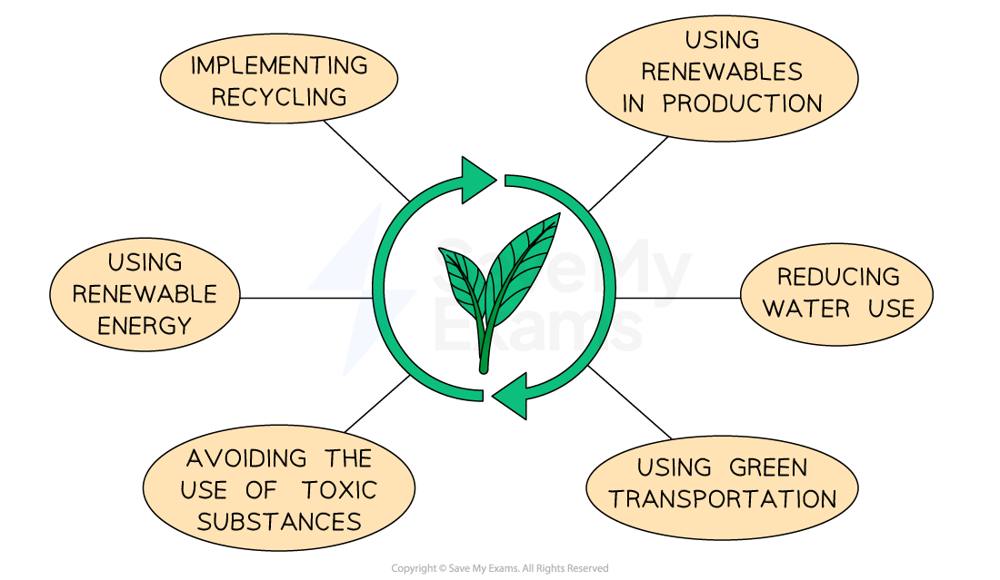

# Efficiency, Productivity & Sustainability

## The importance of efficiency, effectiveness, productivity and sustainability

> **Spec point** — `spcpt_WCNVhfJskhBPPwYf`

## Efficiency, effectiveness, productivity and sustainability

- **Efficiency** means producing goods or services with the minimum amount of waste, time or resources
- **Effectiveness** means achieving the business’s objectives by doing the right things to satisfy customer needs and meet goals
- **Productivity** is the volume of output produced per worker (or per hour, machine, etc.) that shows how well available resources are used to generate output

### Why are these factors important?

#### Lower costs

- Efficient use of resources helps reduce waste and cut production costs

#### Higher profit margins

- Improved productivity and lower costs can increase the amount of profit made per sale

#### Better use of resources

- Efficient businesses make the most of time, money, staff and materials

#### Improved competitiveness

- Businesses that are productive and effective can offer competitive prices or higher-quality products

#### Customer satisfaction

- Being effective means meeting customer needs, which leads to loyalty and repeat purchases

#### Faster response to demand

- Productive operations allow quicker production and delivery, keeping up with customer demand

#### Supports business growth

- Efficient and productive businesses can expand more easily and take on larger orders

## Measurement of labour productivity

> **Spec point** — `spcpt_r7G952F6twFgRX4N`

## Measurement of labour productivity

- The **labour productivity** of a business is measure of the** output per worker** during a specified period of time
- Businesses aim to **increase the level** of labour productivity to **improve competitiveness**
- Labour productivity is calculated using the formula

$\mathrm{Labour} \mathrm{productivity}=\frac{\mathrm{Output}}{\mathrm{Number} \mathrm{of} \mathrm{workers}}$

> **Worked Example**
> The table shows the number of pairs of luxury wool socks produced by *Scotty Socks Ltd* in 2023 and 2024.
> 
> | **Year** | **Units produced** |
> |---|---|
> | 2023 | 46,000 |
> | 2024 | 69,000 |
> 
> In 2023 *Scotty Socks *employed 50 staff. In 2024 the number of staff employed by the business increased by 20%.
> 
> **Calculate **the percentage change in labour productivity between 2023 and 2024.
> 
> (4)
> 
> **Step 1:Calculate the labour productivity for 2023**
> 
> $\frac{=46,000\mathrm{units}}{50\mathrm{workers}}\,\,=920\mathrm{units} \mathrm{per} \mathrm{worker}$**         ****(1)**
> 
> **Step 2: Calculate the labour productivity for 2024**
> 
> $=\frac{69,000\mathrm{units}}{60\mathrm{workers}}\,\,=1,150\mathrm{units} \mathrm{per} \mathrm{worker}$**         ****(1)**
> 
> **Step 3: Calculate the percentage difference between the two years ((new-old) / old)**
> 
> $= \frac{ 1 , 150 - 920 units}{920 units} \times 100 
> 
> = 25 \%$**        ****(1)**
> 
> **Step 4: Identify whether the percentage difference is an increase or decrease**
> 
> - **25% percentage**** increase** **        ****(1)**

### The link between high labour productivity and competitive edge

- Businesses aim to **increase the level** of labour productivity to **improve competitiveness**

*Higher labour productivity improves businesses' competitiveness*

- High labour productivity reduces the labour cost per unit, leading to improved efficiency and the potential for a meaningful competitive edge

## The impact of improved sustainability

> **Spec point** — `spcpt_4KTf56W48HvjGDPp`

## The impact of improved sustainability

- **Sustainability** means meeting our current needs without compromising the ability of future generations to meet their own needs
- Businesses can contribute to sustainability by changing their operations in a variety of ways

*Businesses can contribute to sustainability in a range of ways*

### Improving sustainability

#### 1. Using renewables in production

- More than 99% of the wood used in **IKEA**'s furniture products is either sourced from sustainable sources or recycled

#### 2. Reducing water use in industrial processes

- Introduced in 2011, **Levi's** Water<Less programme reduces the use of water in the manufacture of the company's denim products, so far saving over 4.2 billion litres of water in shortage areas

#### 3. Using green transportation, such as electric vans

- Almost 40% of delivery company **Evri**’s London vehicles are zero-emission and the company operates e-cargo bikes across four UK cities

#### 4. Avoiding the use of toxic substances

- Home accessories brand **Parachute** uses organically-grown textiles, with no harmful chemicals used at any stage of production

#### 5. Using renewable energy, such as solar

- **Unilever** uses 100% renewable electricity across all its factories, offices, ***R&D*** facilities, data centres, warehouses and distribution centres. They also generate their own solar power at production facilities in 23 countries.

#### 6. Implementing recycling

- **Revive Innovations Ltd** recycles compact discs, turning them into beautiful items of furniture and home accessories

### The benefits of improving sustainability

| **Benefit** | **Explanation** |
|---|---|
| **Meeting customer expectations** | - Eco-conscious customers prefer sustainable businesses, helping improve brand image and loyalty |
| **Cost savings** | - Reducing energy use, waste and materials can lower long-term costs |
| **Legal and ethical compliance** | - Helps meet environmental laws and shows the business is acting responsibly |
| **Competitive advantage** | - A strong reputation for sustainability can help the business stand out from rivals |
| **Long-term survival** | - Protects resources and helps the business stay successful in the future |
