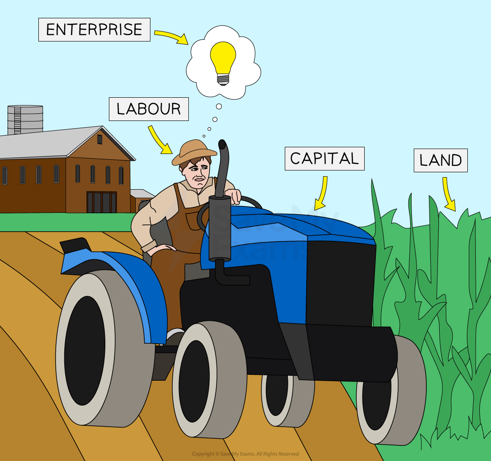
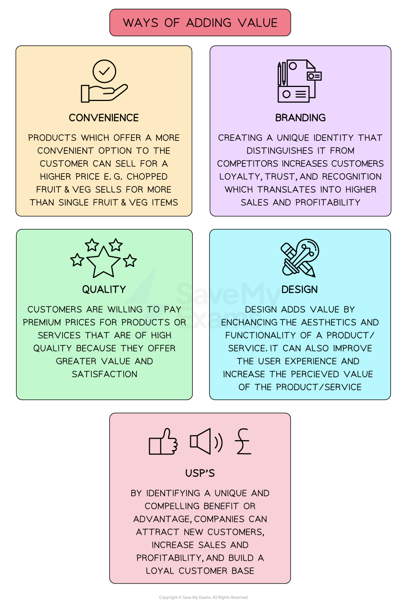

# The Transformational Process

## Using factors of production

> **Spec point** — `spcpt_nY5C5StPxDs8663W`

## Using factors of production

- **Factors of production** are the resources used to produce goods and services

*The four factors of production are land, capital, labour and enterprise*

- The production of any good or service requires the use of **a combination of all four factors of production**

### The four factors of production

#### 1. Land

- **Non-man-made natural resources** available for production
- Some countries have a vast amount of a particular natural resource and are able to specialise in its production

  - E.g.** Kuwait** specialises in the product of oil, which accounts for 95% of its ***exports***

#### 2. Capital

- Any **man-made** **resource **that is used to produce goods or services
- Examples include tools, buildings, machines and computers

#### 3. Labour

- The **human input** into the production process, labour involves mental or physical effort
- Not all labour is of the same quality

  - It can be **skilled or unskilled**
  - Some workers are more productive than others because of their education, training and experience

#### 4. Enterprise

- Enterprise involves **taking risks** in setting up or running a firm
- An entrepreneur decides on the combination of the **factors of production** necessary to produce goods/services with the aim of generating profit

## Stages of the transformational process

> **Spec point** — `spcpt_ySkcyjNv9mWftpz4`

## Stages of the transformational process

- Businesses take **inputs** and **transform** them in order to produce **outputs** that customers will want to buy

#### The transformational process

*The transformational process*

- **Inputs** used in the transformation process may be financial, human or physical resources, as well as ***enterprise***
- **Outputs** are goods and services, as well as ***by-products*** and waste

  - E.g. **Rothaus brewery** takes **inputs **including malts, hops and barley and uses the staff on the brewery premises in Freiburg, as well as equipment, such as mash tuns, to **transform** them by brewing these inputs into its **main** **output **— its range of beers — as well as **by-products**, such as compost

## Operations and added value

> **Spec point** — `spcpt_SgvFC5d9h5wMNDK2`

## Operations and added value

- Adding value is the process of **taking raw materials and using them in such a way that the end product created is worth more than the cost **of the raw materials used to create it - value has been added

  - E.g., customers pay more for potatoes when they are packaged as oven chips than they would be willing to pay for a bag of potatoes
  - If value is not added to the materials and components that a business buys, fixed costs cannot be paid and no profit will be made

*Some of the methods of adding value allow for product differentiation, which allows the business to charge a higher selling price*

| **Method** | **Example** |
|---|---|
| **Branding** | - Apple has built a brand that many customers believe is **superior to other brands**    - They use quality materials, innovative design and good marketing   - This branding allows Apple to **charge a higher price** for its products, increasing added value |
| **Convenience** | - Persil initially sold bottles of liquid for dishwashing machine use    - This resulted in spillage as customers added the liquid to their machines   - Persil developed **tablets**, which offer a more convenient option that can be sold at a higher price |
| **Quality** | - **Jo Malone** perfume products are well known for their **beautiful packaging,** which creates an exciting opening experience for the customer    - This allows the firm to charge a higher price for its products, increasing added value |
| **Unique selling points (USPs)** | - MoonPig birthday cards can be **completely customised **(size, colour, design etc) - This customisation has helped Moonpig gain a competitive advantage    - It can charge a high price for its cards, increasing added value |
| **Design** | - **Samsung Galaxy Watch 5** has robust health tracking tools built into it, along with a highly advanced screen,    - These features allow the firm to **charge a higher price** for its products, increasing added value |
