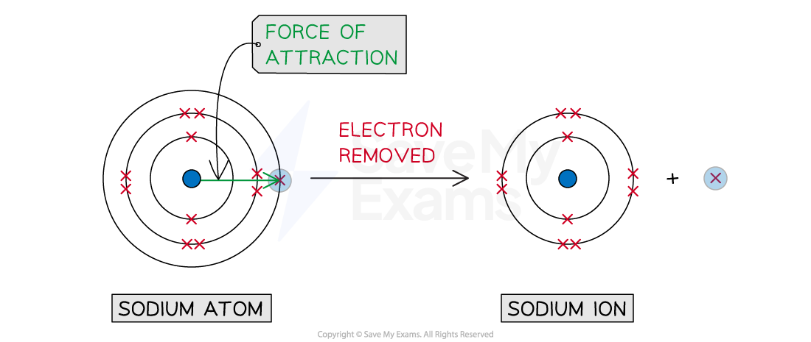

# Defining Ionisation Energy

## Ionisation Energy Definition & Equations

> **Spec point** — `spcpt_yXBkCC4sjD5KyPrZ`

## Ionisation Energy Definition & Equations

- **Ionisation** is the process by which an electron is removed from an atom or a molecule

#### Process of ionisation

*In the first ionisation of sodium, the single outer electron is lost*

- The **ionisation** **energy** (**IE**) of an element is the amount of energy required to remove **one mole **of electrons from **one mole** of gaseous atoms of an element to form **one mole **of gaseous ions
- Ionisation energies are measured under **standard conditions **which are 298 K and 101 kPa
- The units of IE are **kilojoules** **per** **mole** (kJ mol-1)
- The values for ionisation energies are always positive as this is an endothermic process

  - This is because **energy is required** to overcome the force of attraction between the electron and the central positive nucleus

### First ionisation energy

- The **first ionisation energy **(IE1) is the energy required to remove **one mole of electrons** from one mole of gaseous atoms of an element to form one mole of gaseous 1+ ions

  - E.g. the first ionisation energy of gaseous calcium:

**Ca (g) → Ca****+**** (g) + e****-****          **IE1 = +590 kJ mol-1

### Second ionisation energy

- The **second** **ionisation** **energy** (IE2) of an element is the amount of energy required to remove **one mole **of electrons from **one mole** of gaseous 1+ ions of an element to form **one mole **of gaseous **2+ ions**

  - E.g. the second ionisation energy of gaseous calcium:

**Ca****+**** (g) → Ca****2+**** (g) + e****-****          **IE2 = +1145.4 kJ mol-1

> **Exam Hint**
> - It is a common mistake to write ionisation energies in more than one step
> 
>   - For example; Ca (g) → Ca2+ (g) + 2e-
> - Ionisation energies should take place one step at a time
> - Students often miss out the gaseous state symbol in the equation and also in the definition, so make sure you include this
