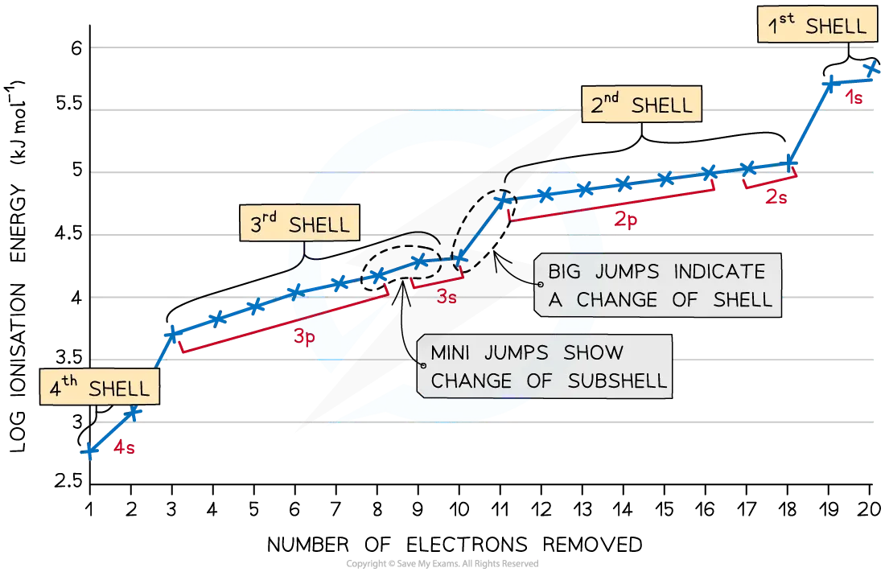

# Ionisation Energy Trends

## Trends in Ionisation Energy

> **Spec point** — `spcpt_gXGMxJcrhrnxtZD6`

## Trends in Ionisation Energy

- Ionisation energies show **periodicity**, a recurring trend across each **period of the Periodic Table**

  - As you move **left to right across a period**, **first ionisation energy generally increases**
  - This trend is linked to the **electronic configuration** of elements:
  
    - **Group 1 metals** (e.g. Na) have **low first ionisation energies** because they have a single outer electron that is easy to remove
    - **Noble gases** (e.g. Ne, Ar) have **very high ionisation energies** due to their full outer shells and strong nuclear attraction
- There are four factors that affect ionisation energy

  - Nuclear charge
  - Distance from the nucleus
  - Electron shielding
  - Spin-pair repulsion

#### Nuclear charge (number of protons)

- As atomic number increases, so does the **positive charge of the nucleus**
- A higher nuclear charge creates a **stronger electrostatic attraction** between the nucleus and outer electrons
- Therefore more energy is required to remove the electron, which means a **higher ionisation energy**

#### Distance from the nucleus (atomic radius)

- Outer electrons that are **further from the nucleus** experience **weaker attraction**
- The **greater the distance**, the **easier it is to remove the electron**
- Ionisation energy decreases with increased distance from the nucleus

#### Electron shielding (inner shell & sub-shell repulsion)

- **Electrons in inner shells** repel electrons in outer shells and **partially block** the attraction of the nucleus

  - This is known as the **shielding effect**
- More inner electron shells means greater shielding and therefore a lower ionisation energy
- **Inner sub-shells also shield**, so a 3p electron is shielded by the 3s electrons and is higher in energy than a 3s electron
- This explains the small drop from magnesium to aluminium:

  - Mg's outer electron is removed from a 3s sub-shell
  - Al's outer electron is removed from a 3p sub-shell, which is higher in energy as it is shielded by the 3s electrons
  - Less energy is needed to remove Al's outer electron, so its first ionisation energy is lower than Mg's

#### Spin-pair repulsion (electron–electron repulsion)

- In **orbitals that contain two electrons**, the electrons experience **repulsion** due to their like charges
- This repulsion slightly reduces the energy needed to remove one of the electrons
- This explains **small drops in ionisation energy across a period**, such as:

  - **Oxygen vs nitrogen** (O’s paired 2p electrons are easier to remove)
  - **Sulfur vs phosphorus** (S's paired 3p electrons are easier to remove)

## Ionisation Energy & the Periodic Table

> **Spec point** — `spcpt_7GFsrZwSKvKWbScF`

## Ionisation Energy & the Periodic Table

- **Across a period**:

  - first ionisation energy **increases** due to higher nuclear charge and same shielding
- **Down a group**:

  - first ionisation energy **decreases** due to greater atomic radius and more shielding

#### Graph of first ionisation energies from H to Na

*There are ionisation energy trends within periods and groups*

### Ionisation energy across a period

- **Across a period**, ionisation energy **increases** because:

  - **Nuclear charge increases**, pulling electrons closer
  - **Atomic radius decreases**, reducing the distance to outer electrons
  - **Shielding stays roughly constant**, since electrons are added to the same shell
  - Outer electrons are held more tightly, so **more energy is needed to remove them**

### Dips in the trend

- There is a slight **decrease **in IE1 between **beryllium **and **boron** as the fifth electron in boron is in the 2p subshell, which is further away from the nucleus than the 2s subshell of beryllium

  - **Beryllium** has a first ionisation energy of **900 kJ mol****-1** as its electron configuration is **1s****2**** 2s****2**
  - **Boron** has a first ionisation energy of **799 kJ mol****-1** as its electron configuration is **1s****2**** 2s****2**** 2p****x****1**
- There is a slight **decrease **in *IE*1 between **nitrogen **and** oxygen **due to **spin-pair repulsion** in the 2px orbital of oxygen

  - **Nitrogen** has a first ionisation energy of **1400 kJ mol****-1** as its electron configuration is 1s2 2s2 2px1 2py1 2pz1
  - **Oxygen **has a first ionisation energy of **1310 kJ mol****-1** as its electron configuration is 1s2 2s2 **2p****x****2** 2py1 2pz1
  - In oxygen, there are 2 electrons in the 2px orbital, so the repulsion between those electrons makes it slightly easier for one of those electrons to be removed

### Ionisation energy down a group

- The ionisation energy down a group **decreases** due to the following factors:

  - The number of protons in the atom is increased, so the **nuclear charge **increases
  - But, the atomic radius of the atoms increases as you add more shells of electrons, making the atoms bigger
  - So, the **distance **between the nucleus and outer electron **increases **as you descend the group
  - The **shielding **by inner shell electrons **increases **as there are more shells of electrons
  - These factors outweigh the increased nuclear charge, meaning it becomes **easier to remove the outer electron** as you descend a group
  - So, the ionisation energy decreases

#### Table summarising ionisation energy trends across a period & down a group

| **Across a period:** **Ionisation energy increases** | **Down a group:** **Ionisation energy decreases** |
|---|---|
| Increase in nuclear charge | Increase in nuclear charge |
| The same number of shells | Increased number of shells |
| Distance from the outer electron to the nucleus decreases | Distance from the outer electron to the nucleus increases |
| Shielding remains relatively constant | Shielding increases |
| Decreased atomic / ionic radius | Increased atomic / ionic radius |
| The attraction between the outer electron and the nucleus gets stronger so the outer electron is **harder **to remove | The attraction between the outer electron and the nucleus gets weaker so the outer electron is **easier **to remove |

## Successive Ionisation Energies of an Element

> **Spec point** — `spcpt_sVwHYTgrhtF5b7R2`

## Successive Ionisation Energies of an Element

- **Successive ionisation energies** of an element **increase**
- This is because once the outer electron is removed, the atom becomes a **positive ion**, making further electron removal **more difficult**
- As more electrons are removed:

  - **Shielding decreases**
  - The **proton-to-electron ratio increases**
  - **Attraction between nucleus and remaining electrons increases**
- The increase is **not constant**, it depends on the **electronic configuration**
- Taking calcium as an example:

#### Table showing the successive ionisation energies of calcium table

| **Electronic Configuration** | **1s****2**** 2s****2**** 2p****6**** 3s****2**** 3p****6**** 4s****1** | **1s****2**** 2s****2**** 2p****6**** 3s****2**** 3p****6**** ** | **1s****2**** 2s****2**** 2p****6**** 3s****2**** 3p****5** | ** 1s****2**** 2s****2**** 2p****6**** 3s****2**** 3p****4** |
|---|---|---|---|---|
| IE | First | Second | Third | Fourth |
| IE (kJ mol-1) | 590 | 1150 | 4940 | 6480 |

#### Successive ionisation energies of calcium

*Graph to show the successive ionisation energies for the element calcium*

- The **first ionisation energy** is relatively low due to **spin-pair repulsion** in the **4s orbital**
- The **second electron** is harder to remove because it is taken from a **1+ ion**, so there is greater attraction between the nucleus and the remaining electrons (and the spin-pair repulsion has gone)
- The **third ionisation energy** increases sharply as the electron is removed from the **3p subshell**, which is **closer to the nucleus**
- The **fourth electron** is more difficult to remove because it is taken from an **increasingly positive ion**, so the attraction to the nucleus is greater
- **Successive ionisation energies always increase** because electrons are being removed from an **increasingly positive ion**
- A **large jump** in ionisation energy indicates a **change in shell**, while **smaller jumps** reflect changes **within the same shell or subshell**

#### Using successive ionisation data

- Helps **predict or confirm electronic configuration**.
- Identifies the **number of outer-shell electrons**.
- Indicates the **group number** by locating the **position of a significant jump** in ionisation energy.
- Commonly applied to elements like **sodium (Na)**, **magnesium (Mg)**, and **aluminium (Al)** to deduce their place in the **Periodic Table**.

#### Successive ionisation energies table

| **Element** | **Atomic Number** | **Ionisation Energy (kJ mol****-1****)** |   |   |   |
|---|---|---|---|---|---|
| First | Second | Third | Fourth |   |   |
| Na | 11 | 494 | 4560 | 6940 | 9540 |
| Mg | 12 | 736 | 1450 | 7740 | 10500 |
| Al | 13 | 577 | 1820 | 2740 | 11600 |

### Sodium

- A large increase between the **first and second ionisation energies** shows that the first electron is much easier to remove than the second
- This first electron is in the **3s subshell**

  - This is the outermost shell
  - This electron experiences **less nuclear attraction** due to shielding and distance from the nucleus
- This suggests Na has **one valence electron**, so it belongs to **Group 1**
- The jump corresponds to removing the next electron from the **2p subshell**, which is closer to the nucleus and more strongly held

  - **Na:** 1s2 2s2 2p6 **3s****1**

### Magnesium

- A large increase between the **second and third ionisation energies** shows that the first two electrons are easier to remove than the third
- These two electrons are in the **3s subshell**

  - This is the outermost shell
  - These two electrons experience **less nuclear attraction** due to shielding and distance from the nucleus
- This suggests Mg has **two valence electrons**, so it belongs to **Group 2**
- The jump corresponds to removing the next electron from the **2p subshell**, which is held more tightly

  - **Mg:** 1s2 2s2 2p6 **3s****2**

### Aluminium

- A large increase between the third and fourth ionisation energies shows that the first three electrons are easier to remove
- These three electrons are in the **3s and 3p subshells**

  - These are part of the outermost shell
  - These three electrons experience **less nuclear attraction** due to shielding and distance from the nucleus
- This suggests Al has **three valence electrons**, so it belongs to **Group 13**
- The jump corresponds to removing the next electron from the **2p subshell**, which is closer to the nucleus and more strongly held

  - **Al:** 1s2 2s2 2p6 **3s****2**** 3p****1**

> **Exam Hint**
> - It is easy to remove electrons from a full orbital as they undergo **spin-pair repulsion.**
> - It gets more difficult to remove electrons from **principal quantum shells **that get closer to the nucleus as there is less **shielding **and an increase in **attractive forces **between the electrons and nuclear charge.
