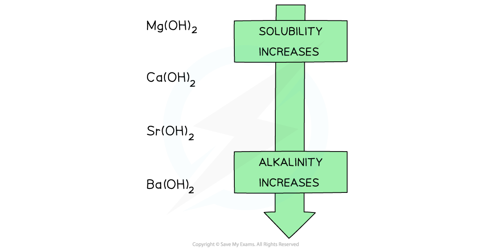
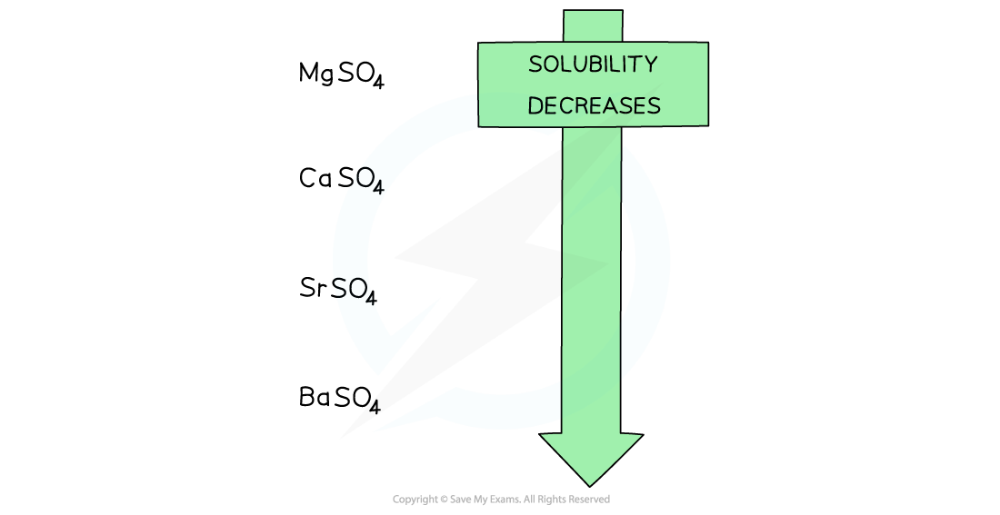

# Trends in Solubility of Group 2 Hydroxides & Sulfates

## Trends in Solubility in Group 2 Hydroxides & Sulfates

> **Spec point** — `spcpt_D8QTDDTJ8mHD6MPr`

## Trends in Solubility of Group 2 Hydroxides & Sulfates

### Group 2 hydroxides

- Going down the group, the solutions formed from the reaction of Group 2 oxides with water become more **alkaline**
- When the oxides are dissolved in water, the following ionic reaction takes place:

**O****2- ****(aq) + H****2****O(l) → 2OH****-**** (aq)**

- The higher the **concentration** of OH- ions formed, the more **alkaline** the solution
- The **alkalinity** of the formed solution can therefore be explained by the **solubility **of the Group 2 **hydroxides**

#### Solubility of the Group 2 hydroxides table

| **Group 2 hydroxide** | **Solubility at 298 K** **(mol / 100 g of water)** |
|---|---|
| **Mg(OH)****2** | 2.0 x 10–5 (sparingly soluble) |
| **Ca(OH)****2** | 1.5 x 10–3 |
| **Sr(OH)****2** | 3.4 x 10–3 |
| **Ba(OH)****2** | 1.5 x 10–2 (soluble) |

- The hydroxides dissolve in water as follows:

**X(OH)****2**** (s) → X****2+**** (aq) + 2OH****–**** (aq)**

- Where X is the Group 2 element
- When the metal oxides react with water, a Group 2 hydroxide is formed:

**XO (s) + H****2****O (l) → X(OH)****2**** (aq)**

- Going down the group, the **solubility** of these hydroxides **increases**
- This means that the **concentration** of OH- ions **increases,** increasing the pH of the solution
- As a result, going down the group, the **alkalinity** of the solution formed increases when Group 2 oxides react with water

#### The solubility of the Group 2 hydroxides

*Going down the group, the solubility of the hydroxides increases which means that the solutions formed from the reactions of the Group 2 metal oxides and water become more alkaline going down the group*

### Group 2 sulfates

| **Group 2 sulfate** | **Solubility at 298 K** **(mol / 100 g of water)** |
|---|---|
| **MgSO****4** | Highly soluble |
| **CaSO****4** | 1.2 x 10–3 |
| **SrSO****4** | 7.6 x 10–4 |
| **BaSO****4** | 1.0 x 10–4 (insoluble) |

- The sulfates dissolve in water as follows:

**XSO****4**** (s) → X****2+**** (aq) + SO****4****2-**** (aq)**

- Where X is the Group 2 element
- When the metal oxides react with sulfuric acid, a Group 2 sulfate is formed:

**XO (s) + H****2****SO****4**** (aq) → XSO****4**** + H****2****O (l) **

- Going down the group, the **solubility **of these sulfates **decreases**

#### The solubility of the Group 2 sulfates

*Going down the group, the solubility of the sulfates decreases*

> **Exam Hint**
> You only need to be able to state the variation in the solubilities of the hydroxides and sulfates for this topic.
> 
> [Enthalpy of Hydration: Ionic Charge & Radius](https://www.savemyexams.com/a-level/chemistry/cie/25/revision-notes/23-chemical-energetics/23-2-enthalpies-of-solution-and-hydration/factors-affecting-enthalpy-of-hydration/) in the A level course gives more detail on the solubility of Group 2 sulfates.
