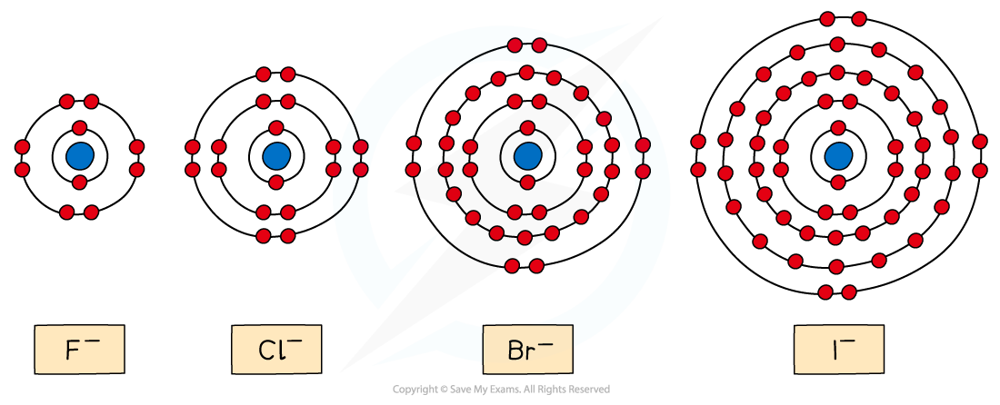
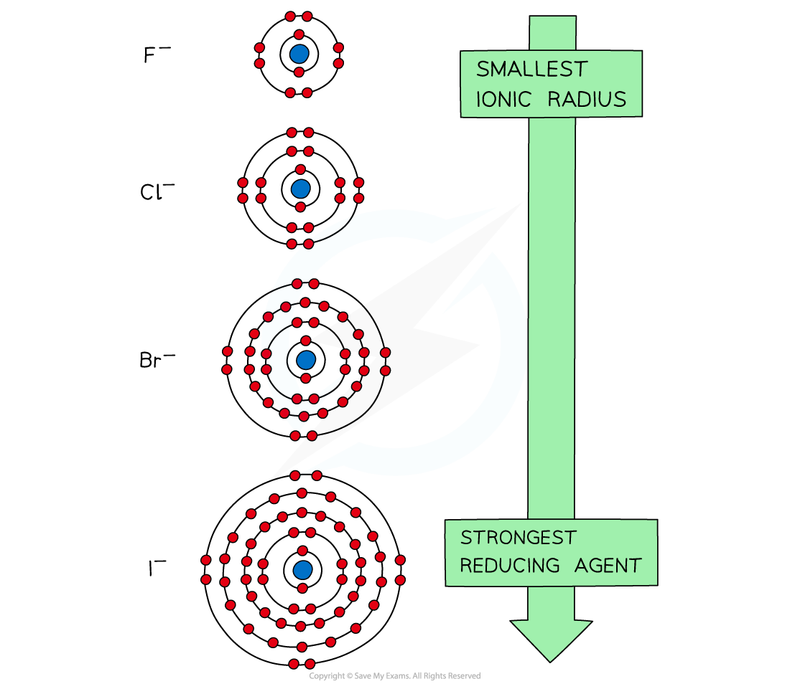
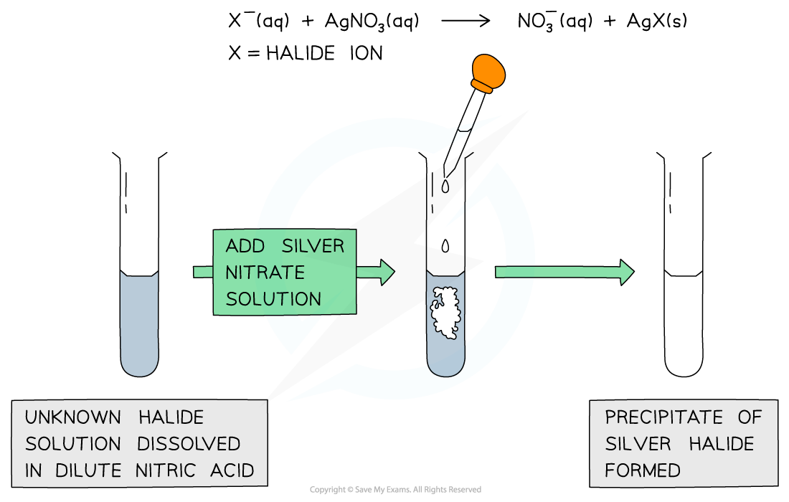
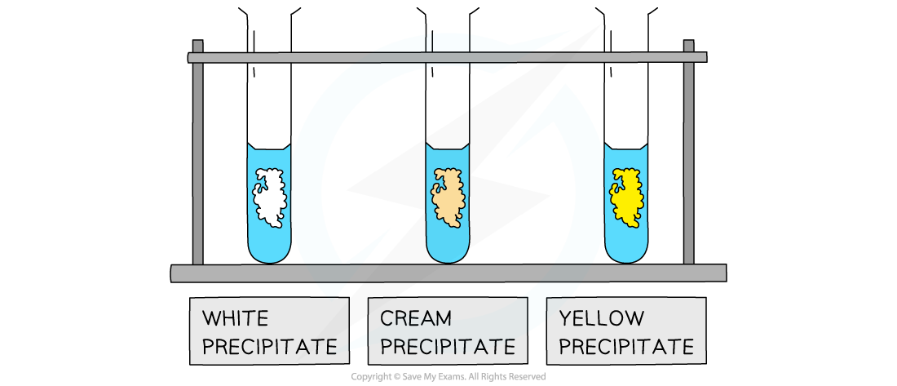
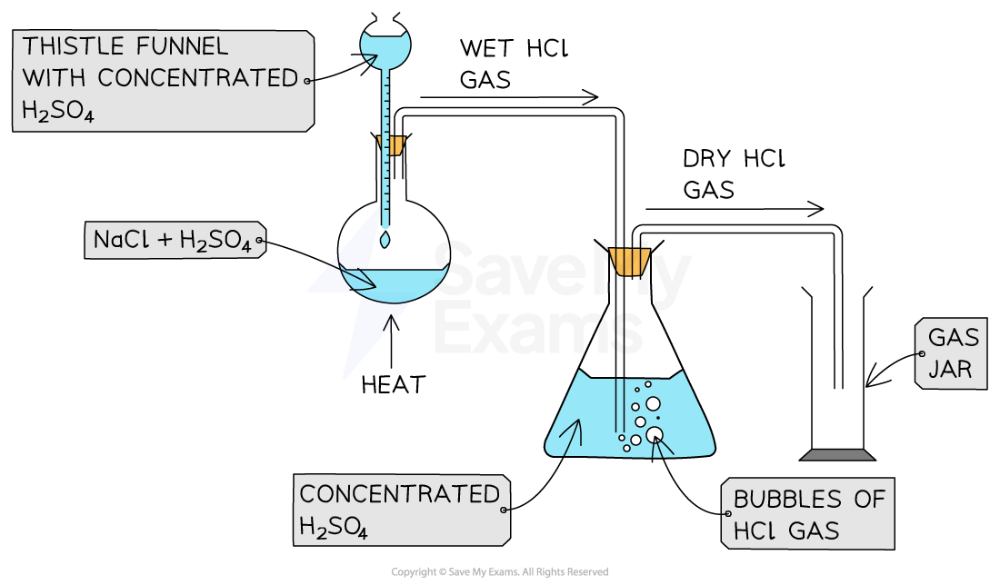

# Reactions of the Halide Ions

## Halide Ions: Reducing Agents

> **Spec point** — `spcpt_kYX8rJ8Ff8TSC2TK`

## Halide Ions: Reducing Agents

- Halide ions can also act as **reducing agents **and donate electrons to another atom
- The halide ions themselves get **oxidised** and lose electrons
- The **reducing power **of the halide ions **increases **going down the group
- This trend can be explained by looking at the ionic radii of the halides’ ions

#### The ionic radii of the halide ions

*The diagram shows that going down the group the ionic radii of the halogens increases*

- Going down the group, the halide ions become **larger**
- The outermost electrons get further away from the nucleus
- The outermost electrons also experience more **shielding** by inner electrons
- As a result of this, the outermost electrons are held **less** **tightly** to the positively charged nucleus
- Therefore, the halide ions lose electrons more easily going down the group and their **reducing power **increases

#### Linking the ionic radius to the reducing power of the halide ions

*The reducing power of the halide ions increases going down the group*

> **Exam Hint**
> The **ionic radius** is a measure of the size of an atom’s **ion**

## Reactions of Halide Ions

> **Spec point** — `spcpt_zZKJqYbTPGy3vBTg`

## Reactions of Halide Ions

### Silver ions & ammonia

- Halide ions can be identified in an **unknown** **solution** by dissolving the solution in **nitric acid **and then adding a **silver nitrate solution **followed by **ammonia **solution
- The halide ions will react with the silver nitrate solution as follows:

**General equation:   AgNO****3 ****(aq) + X****– ****(aq) → AgX (s) + NO****3****–**** ****(aq)**

**Ionic equation:   Ag****+ ****(aq) + X****– ****(aq) → AgX (s)**

- **X****-** is the halide ion in both equations
- If the unknown solution contains halide ions, then a **precipitate** of the **silver halide** will be formed (AgX)

#### Testing for halide ions

1. Add the halide solution to a clean test tube using a pipette
2. Add a few drops of **nitric acid**
3. Add a few drops of **silver nitrate solution**

*A silver halide precipitate is formed upon the addition of silver nitrate solution to halide ion solution*

4. Observe the formation of a coloured precipitate:

*The white, cream and yellow precipitates formed when halide ions react with silver nitrate solution*

- Each precipitate is associated with a specific halide ion:

  - A white precipitate of AgCl forms if chloride ions are present
  - A cream precipitate of AgBr forms if bromide ions are present
  - A yellow precipitate of AgI forms if iodide ions are present

#### Adding ammonia after the halide ion test

- The silver halide precipitates can look similar
- So, an additional test using ammonia solution can confirm their identity

1. Add **dilute ammonia** solution dropwise to the silver halide precipitate

  - If the precipitate dissolves, the halide is **chloride** (AgCl) 

2. If the precipitate does not dissolve, add **concentrated ammonia**

  - If the precipitate now dissolves, the halide is **bromide** (AgBr) 
  - If the precipitate still does not dissolve, the halide is **iodide** (AgI) 

#### Reaction of halide ions with silver nitrate & ammonia solutions table

| **Halide ion** | **Colour of silver halide precipitate** | **Effect of adding dilute ammonia solution to the precipitate** | **Effect of adding concentrated ammonia solution to the precipitate** |
|---|---|---|---|
| **Cl****–**** (aq)** | White | Dissolves | Dissolves |
| **Br****–**** (aq)** | Cream | Insoluble | Dissolves |
| **I****–**** (aq)** | Yellow | Insoluble | Insoluble |

### Concentrated sulfuric acid

- Chloride, bromide and iodide ions react with concentrated sulfuric acid to produce **toxic gases**
- These reactions should therefore be carried out in a fume cupboard
- The general reaction of the halide ions with concentrated sulfuric acid is:

**General equation:   H****2****SO****4 ****(aq) + X****– ****(aq) → HX (g) + HSO****4****– ****(aq)**

- Where **X****–** is the halide ion

### Reaction of chloride ions with concentrated sulfuric acid

- Concentrated sulfuric acid is dropwise added to sodium chloride crystals to produce **hydrogen chloride gas**

  - The hydrogen chloride gas produced is **wet**, so it can be passed through a conical flask of concentrated sulfuric acid to produce **dry** hydrogen chloride gas

#### Apparatus for the reaction of sodium chloride with concentrated sulfuric acid

*Sodium chloride reacts with concentrated sulfuric acid to form dense hydrogen chloride gas*

- The reaction that takes place is:

**H****2****SO****4 ****(aq) + NaCl (s) → HCl (g) + NaHSO****4 ****(s)      **

- The HCl gas produced is seen as **white fumes**

### Reaction of bromide ions with concentrated sulfuric acid

- The **thermal stability **of the hydrogen halides decreases down the group
- The reaction of sodium bromide and concentrated sulfuric acid is:

**H****2****SO****4 ****(aq) + NaBr (s) → HBr (g) + NaHSO****4 ****(s)     **

- The concentrated sulfuric acid **oxidises **HBr to **bromine**, and the sulfuric acid itself is **reduced **to **sulfur** **dioxide** **gas** (water is also formed):

**2HBr (g) + H****2****SO****4 ****(aq) → Br****2 ****(g) + SO****2 ****(g) + 2H****2****O (l)**

- The bromine is seen as a **reddish-brown gas**

### Reaction of iodide ions with concentrated sulfuric acid

- The reaction of sodium iodide and concentrated sulfuric acid is:

**H****2****SO****4 ****(aq) + NaI (s) → HI (g) + NaHSO****4 ****(s)          **

- **Hydrogen iodide **decomposes the **easiest**
- Sulfuric acid oxidises the hydrogen iodide to several extents:
- The concentrated sulfuric acid **oxidises **HI and is itself **reduced **to **sulfur** **dioxide** **gas**:

**2HI (g) + H****2****SO****4 ****(aq) → I****2 ****(g) + SO****2 ****(g) + 2H****2****O (l)**

- Iodine is seen as a violet/purple vapour
- The concentrated sulfuric acid **oxidises **HI and is itself **reduced **to **sulfur**:

**6HI (g) + H****2****SO****4 ****(aq) → 3I****2 ****(g) + S (s) + 4H****2****O (l)**

- Sulfur is seen as a **yellow solid**
- The concentrated sulfuric acid **oxidises **HI and is itself **reduced **to **hydrogen sulfide**:

**8HI (g) + H****2****SO****4 ****(aq) → 4I****2 ****(g) + H****2****S (g) + 4H****2****O (l)**

- Hydrogen sulfide has a **strong smell of bad eggs**

#### Halide ion reactions with concentrated sulfuric acid table

| **Halide ion** | **Reaction with concentrated sulfuric acid** | **Observations** |
|---|---|---|
| **Cl****–**** (aq)** | H2SO4 (aq) + NaCl (s) → HCl (g) + NaHSO4 (aq) | White fumes of HCl gas |
| **Br****–**** (aq)** | H2SO4 (aq) + NaBr (s) → HBr (g) + NaHSO4 (s)  2HBr (g) + H2SO4 (aq) → Br2 (g) + SO2 (g) + 2H2O (l) | Reddish brown Br2 gas |
| **I****–**** (aq)** | H2SO4 (aq) + NaI (s) → HI (g) + NaHSO4 (s)  H2SO4 (aq) + 2HI (g) → I2 (g) + SO2 (g) + 2H2O (l)  H2SO4 (aq) + 6HI (g) → 3I2 (g) + S (s) + 4H2O (l)  H2SO4 (aq) + 8HI (g) → 4I2 (g) + H2S (g) + 4H2O (l) | Violet / purple I2 vapour  Yellow solid of S  Strong, bad (egg) smell of H2S |

> **Exam Hint**
> It gets easier to oxidise the hydrogen halides as you descend Group 17: the halides become stronger **reducing agents**
