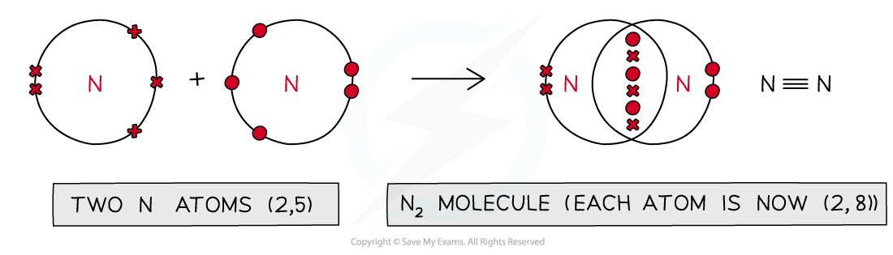
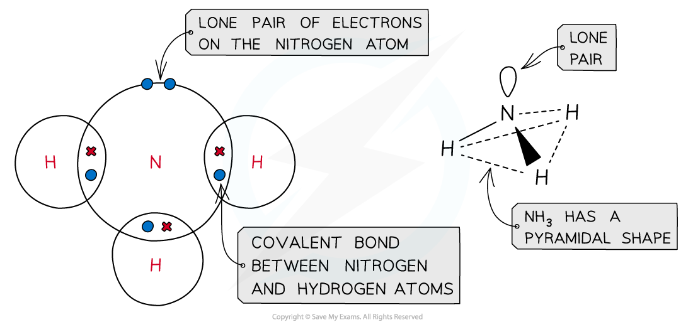
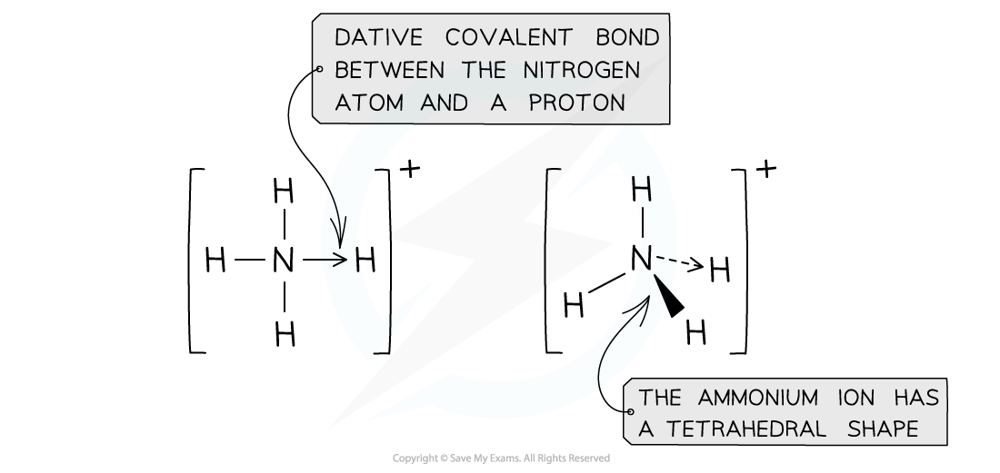
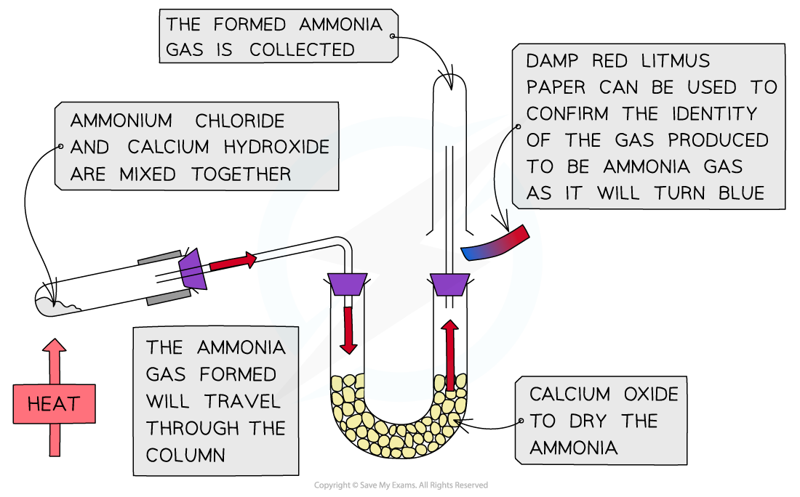

# Nitrogen & its Compounds

## Reactivity of Nitrogen

> **Spec point** — `spcpt_ZjJ8YTCQ7qJK2VKm`

## Reactivity of Nitrogen

- Nitrogen is a **diatomic **molecule and the main **unreactive gas** in air
- 78% of air is nitrogen gas
- The lack of reactivity of nitrogen gas can be explained by looking at its **intramolecular bonds**
- Intramolecular bonds are the bonds **within **a molecule

### Bonding in nitrogen

- The electron configuration of a nitrogen atom is 1s2 2s2 2p3
- To achieve a full outer shell of electrons, it needs to gain three electrons
- Nitrogen atoms therefore form a **triple covalent bond** between two nitrogen atoms in which they **share **three electrons with each other

#### Bonding in nitrogen

*The diagram shows a triple covalent bond between two nitrogen atoms to achieve a full outer shell of electrons*

- The **bond energy **of the nitrogen triple bond is 944 kJ mol-1
- This means that 1000 kJ of energy is needed to break one mole of N2 triple bond
- As it is so difficult to break the nitrogen triple bond, nitrogen and oxygen gas in air will not react with each other
- Only under extreme conditions will nitrogen gas react (e.g. during a thunderstorm)

### Polarity of nitrogen

- The electrons in a nitrogen molecule are shared **equally** between the two nitrogen atoms
- Therefore, nitrogen molecules are **nonpolar** molecules

#### Polarity in a nitrogen bond

*Since the electronegativity of the two nitrogen atoms is the same, the will pull the electrons towards them equally so overall the molecule is nonpolar*

- Due to the lack of polarity, nitrogen gas is **not attracted to** or **likely to react with** other molecules the way polar molecules would

> **Exam Hint**
> Nitrogen is very unreactive due to the lack of polarity and strength of its triple bond.

## Properties of Ammonia

> **Spec point** — `spcpt_yVqXHvZMbCYqrTPB`

## Properties of Ammonia

- **Ammonia** is a compound of nitrogen and will turn damp** red **litmus paper** blue** as it is an **alkaline** gas
- Ammonia is made on a large scale in industry using the **Haber **process:

**N****2 ****(g) + 3H****2 ****(g) ⇌ 2NH****3 ****(g)**

### Basicity of ammonia

- Ammonia can act as a **Brønsted–Lowry base** by accepting a **proton** (H+) using the **lone** **pair** of electrons on the nitrogen atom to form an **ammonium ion**:

**NH****3 ****(aq) + H****+ ****(aq) →  NH****4****+ ****(aq)**

- In an aqueous solution of ammonia, an equilibrium mixture is established

**NH****3 ****(aq) + H****2****O (l) ⇌  NH****4****+ ****(aq) + OH****- ****(aq)**

- Since the position of the equilibrium lies well over to the left the ammonia solution is only **weakly alkaline**
- There is a higher concentration of ammonia molecules than hydroxide ions in solution
- Ammonia is therefore a **weak base**

### Structure & formation of ammonium ion

- The ammonium ion is formed by an acid-base reaction of ammonia with water:

**NH****3 ****(aq) + H****2****O (l) ⇌  NH****4****+ ****(aq) + OH****- ****(aq)**

- The nitrogen in ammonia is covalently bonded to three hydrogen atoms and has one lone pair of electrons causing the ammonia molecule to have a **pyramidal shape**

#### Bonding in ammonia

*Ammonia has a pyramidal shape due to its lone pair of electrons*

- The nitrogen atom in ammonia uses its lone pair of electrons to form a dative bond with a proton to form the ammonium ion
- The ammonium ion has a **tetrahedral shape **in which all bonds have the same **length**

#### Bonding in the ammonium ion

*The tetrahedral shape of the ammonium ion*

### Preparation of ammonia gas from an ammonium salt

- Ammonia gas can be prepared from an ammonium salt and a base in an acid-base reaction:

**2NH****4****Cl (s) + Ca(OH)****2**** (s) **$\overset{\mathrm{heat}}{\rightarrow}$** CaCl****2**** (s) + 2H****2****O (l) + 2NH****3**** (g)**

- Ammonium chloride (NH4Cl) and calcium hydroxide (Ca(OH)2) are mixed together and then heated
- NH4+ acts as an **acid **(proton donor) and OH- acts as a **base **(proton acceptor)
- The same acid-base reaction (NH4+ + OH- → NH3 + H2O) is the basis of the test for ammonium ions: an **unknown solution **is warmed with aqueous sodium hydroxide
- If the unknown solution contains ammonium ions, the hydroxide ions react with them to form ammonia gas
- This ammonia gas will turn damp red litmus paper blue

#### Producing and testing for ammonia

*The diagram shows the apparatus set up for the preparation of ammonia gas from an ammonium salt and calcium hydroxide*
