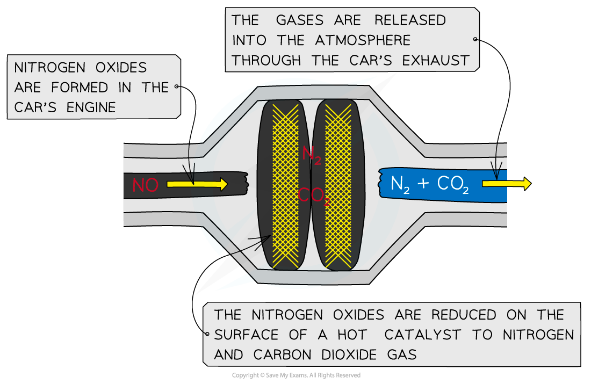
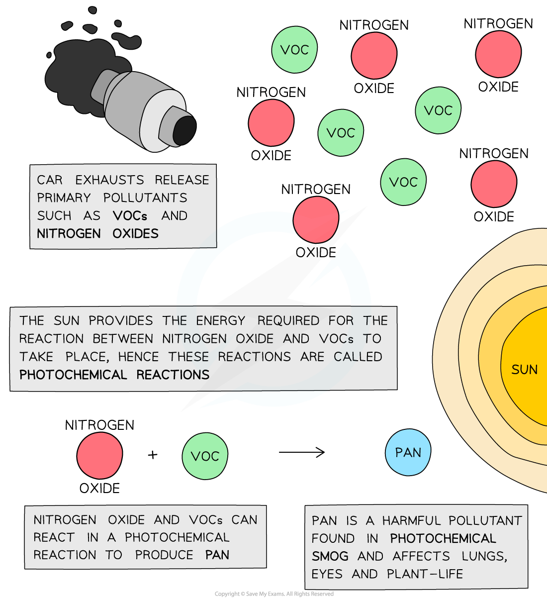
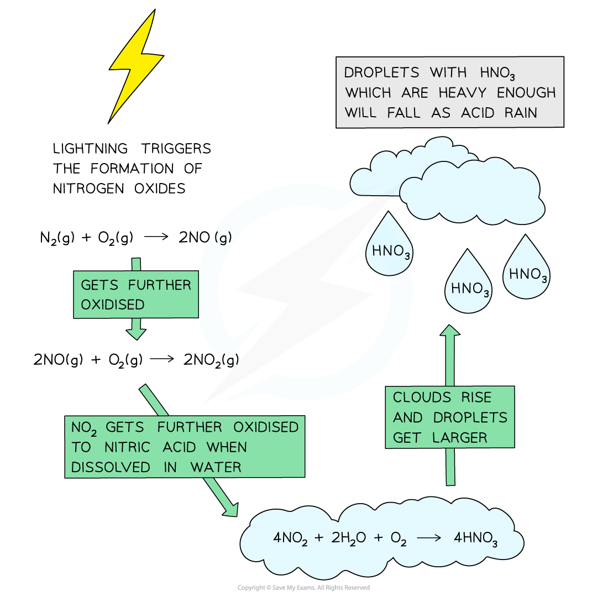
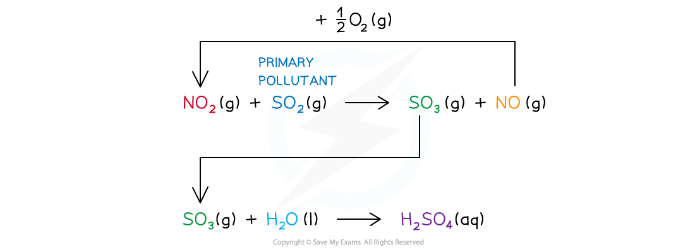

# Nitrogen Oxides

## Oxides of Nitrogen

> **Spec point** — `spcpt_WXp9yV6RjmGqJnn3`

## Oxides of Nitrogen

### Natural occurrence of nitrogen oxides

- Due to its lack of reactivity, only under extreme conditions will nitrogen react with oxygen to form **gaseous nitrogen oxides**
- An example of these extreme conditions is **lightning **which can trigger the formation of nitrogen(II) and nitrogen(IV) oxides (NO and NO2 respectively)
- The chemical equations for these reactions are:

**N****2 ****(g) + O****2 ****(g) → 2NO (g)**

**N****2 ****(g) + 2O****2 ****(g) → 2NO****2 ****(g)**

### Man-made occurrence of nitrogen oxides

- In the engine of a car, a mixture of air and fuel is compressed and ignited by a spark
- Air consists of 78% of nitrogen and 21% of oxygen
- Under the high pressure and temperature inside a car engine, nitrogen can react with oxygen to form nitrogen oxides
- These nitrogen oxides are released into the **atmosphere **through the car’s **exhaust** **fumes**

### Catalytic removal of nitrogen oxides

- The nitrogen oxides released through cars’ exhaust fumes **pollute **the atmosphere
- Many car exhaust systems are therefore fitted with **catalytic converters **to reduce the **pollutants **from motor vehicles
- The nitrogen oxides are **reduced** on the surface of the **hot catalyst **(eg. platinum) to form the unreactive and harmless nitrogen gas which is then released from the vehicle’s exhaust pipe into the atmosphere
- The chemical reaction for the reduction of nitrogen oxide to nitrogen gas by the catalyst is as follows:

**2CO (g) + 2NO (g) → 2CO****2 ****(g) + N****2 ****(g)**

#### Catalytic converters

*Catalytic converters help reduce the pollutant emissions from motor vehicles*

## Oxides of Nitrogen & Photochemical Smog

> **Spec point** — `spcpt_MMZw9fX88jdkvjNh`

## Oxides of Nitrogen & Photochemical Smog

- Nitrogen oxides are examples of **primary pollutants **because they are given off **directly **into the air from the source of pollution

  - Examples of pollution sources are car exhausts and power plants
- Nitrogen oxides are extra dangerous as they can react with substances in the air to make **secondary pollutants**

  - These are pollutants that are not given off directly into the air from human activity
- Exhaust fumes contain another primary pollutant called **volatile organic compound** (**VOCs**)

  - These are unburnt hydrocarbons from fuel and their oxidised products
- VOCs react with nitrogen oxides in air to form **peroxyacetyl** **nitrate** (**PAN**, CH3CO3NO2)
- Sunlight provides the energy needed to start off the reactions of VOCs and nitrogen oxides in air, so they are also called **photochemical reactions**
- PAN is one of the harmful pollutants found in **photochemical smog**
- ‘Smog’ is derived from ‘smoke’ and ‘fog’
- PAN affects the lungs and eyes and in high concentrations plant-life

#### Primary & secondary pollutant types & their pollution source summary

- Primary pollutant types

  - Nitrogen oxides (NO / NO2)
  
    - Lightning, car exhausts power plants
  - Volatile organic compounds (VOCs)
  
    - Unburnt hydrocarbons from fuel and their oxidised products in exhaust fumes
- Secondary pollutant type

  - Peroxyacetyl nitrate (PAN, CH3CO3NO2)
  - Photochemical reaction between nitrogen oxides and VOCs

#### The formation of peroxyacetyl nitrate (PAN)

*The diagram shows the formation of PAN from the photochemical reaction between VOCs and nitrogen oxide*

## Oxides of Nitrogen & Acid Rain

> **Spec point** — `spcpt_v2jg9zFZQVxnN3S7`

## Oxides of Nitrogen & Acid Rain

### Formation of acid rain by nitrogen oxides

- As mentioned earlier, lightning strikes trigger the formation of nitrogen(II) and nitrogen (IV) oxides in air:

**2NO (g) + O****2 ****(g) ⇌ 2NO****2 ****(g)**

- The air also contains oxygen and tiny droplets of water that make up clouds
- The nitrogen(IV) oxide (NO2) dissolves and reacts in water with oxygen as follows:

**4NO****2 ****(aq) + 2H****2****O (l) + O****2 ****(g) → 4HNO****3 ****(aq)**

- When the clouds rise, the temperature decreases, and the droplets get larger
- When the droplet containing dilute nitric acid are heavy enough, they will fall down as **acid rain**

#### Forming acid rain

*The diagram shows the formation of acid rain by the oxidation of nitrogen(IV) oxide*

### Nitrogen oxide as a catalyst

- Acid rain also contains **dilute sulfuric acid** (H2SO4)
- Sulfur(IV) oxide (SO2) is another pollutant found in the atmosphere
- When SO2 is oxidised, it forms SO3 which reacts with rainwater to form dilute sulfuric acid as follows:

**SO****3 ****(g) + H****2****O (l) → H****2****SO****4 ****(aq)**

- Nitrogen oxides can **directly **cause acid rain but can also act as **catalysts **in the formation of acid rain
- NO2 catalyses the oxidation of SO2 to SO3:

**NO****2 ****(g) + SO****2 ****(g) → SO****3 ****(g) + NO (g)**

- The formed NO gets oxidised to regenerate NO2:

**NO (g) + ½ O****2 ****(g) → NO****2 ****(g)**

- The regenerated NO2 molecule can get again oxidise another SO2 molecule to SO3 which will react with rainwater to form H2SO4

#### Forming sulfuric acid

*The formation of dilute sulfuric acid is catalysed by the nitrogen oxides*
