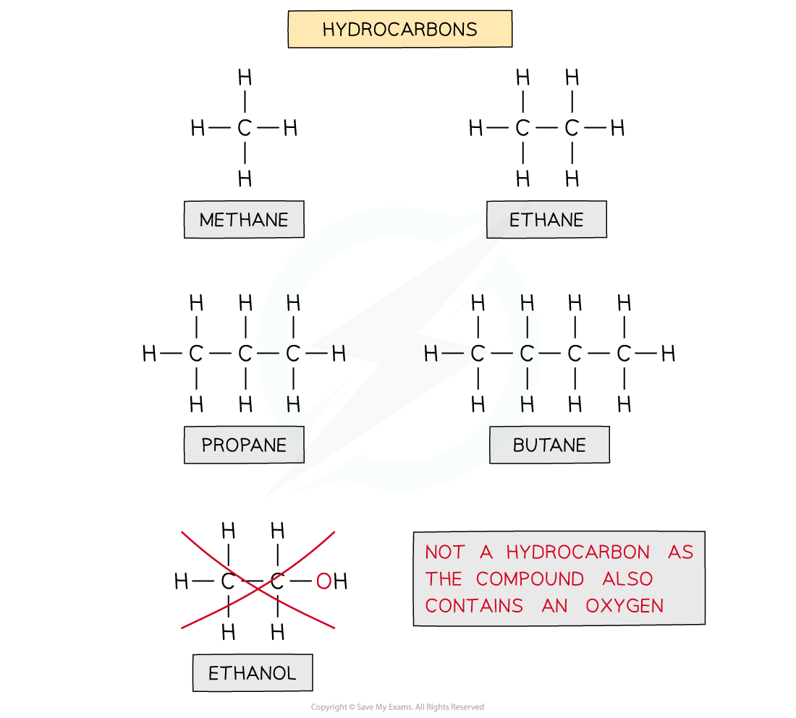
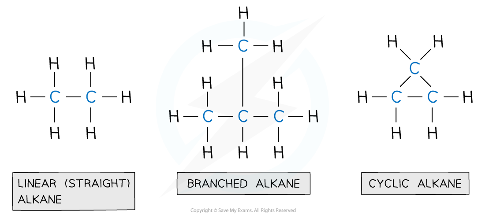

# Hydrocarbons & Alkanes

## Hydrocarbons

> **Spec point** — `spcpt_jptnPNnPshVwycwD`

## Hydrocarbons

- **Organic chemistry** is the chemistry of carbon compounds
- Carbon forms a vast number of compounds because it can form strong covalent bonds with itself
- This enables it to form long chains of carbon atoms, branched chains or cycles, and hence an almost infinite variety of carbon compounds are known
- Carbon always forms four covalent bonds which can be single, double or triple bonds

#### Examples of carbon structures

*There is an almost infinite variety of chains, branches and rings able to form*

- A **functional group** is a specific atom or group of atoms which confer certain physical and chemical properties onto the molecule
- Organic molecules are classified by the dominant **functional group** on the molecule
- Organic compounds with the same functional group, but with each successive member different by CH2 are called a **homologous series**

  - Every time a carbon atom is added to the chain, two hydrogen atoms are also added, which is why the successive members differ by CH2

- Hydrocarbons are compounds that are made up of carbon and hydrogen atoms **ONLY**

#### Examples of hydrocarbons

*Ethanol is NOT a hydrocarbon as the molecule also contains an oxygen atom and is not solely made up of carbon and hydrogen*

> **Exam Hint**
> You must state that hydrocarbons are ‘**only’** made up of C and H atoms if defining this term in an exam

## Alkanes

> **Spec point** — `spcpt_Bk6CctHBVZ7t2gBH`

## Alkanes

- A **functional group **is an atom or a group of atoms in an organic molecule, which determines the physical and chemical properties of the molecule
- **Alkanes **are the simplest hydrocarbons with no functional group
- They are made up of carbon and hydrogen atoms bonded to each other with single covalent bonds

#### Different types of alkanes

*Alkanes are compounds made up of carbon and hydrogen atoms only and contain no functional group*

#### Homologous series of alkanes table

| **Name of alkane** | **Number of carbons** | **Chemical formula** | **Boiling point in °C** | **State at room temp** | **Melting point in °C** |
|---|---|---|---|---|---|
| Methane | 1 | CH4 | -161 | gas | -182 |
| Ethane | 2 | C2H6 | -88 | gas | -183 |
| Propane | 3 | C3H8 | -42 | gas | -188 |
| Butane | 4 | C4H10 | -0.5 | gas | -138 |
| Pentane | 5 | C5H12 | 36 | liquid | -130 |
