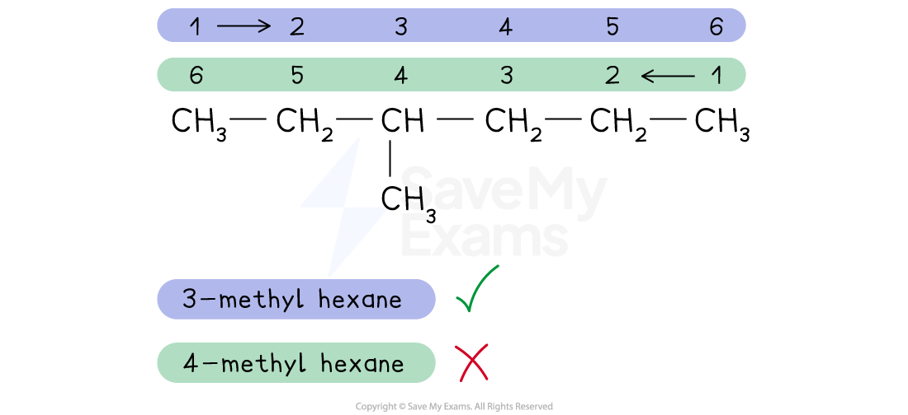
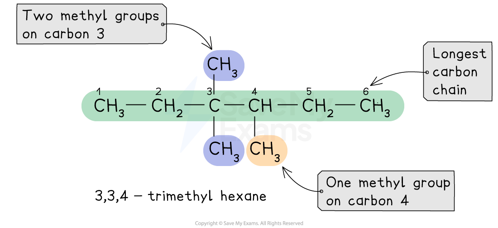
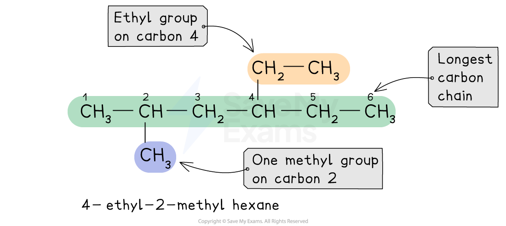

# Naming of Organic Compounds

## Nomenclature of Aliphatic Compounds

> **Spec point** — `spcpt_nf3jtTMfZNRyHcQF`

## Nomenclature of Aliphatic Compounds

- **Systematic nomenclature **can be used to name organic compounds and therefore make it easier to refer to them
- The **alkanes** provide the basis of the naming system and the **stem** of each name indicates how many carbon atoms are in the **longest chain **in one molecule of the compound

#### Nomenclature of organic compounds table

| **Number of C atoms** | **Molecular formula of straight-chain alkane** | **Name of alkane** | **Stem used in naming** |
|---|---|---|---|
| 1 | CH4 | methane | meth- |
| 2 | C2H6 | ethane | eth- |
| 3 | C3H8 | propane | prop- |
| 4 | C4H10 | butane | but- |
| 5 | C5H12 | pentane | pent- |
| 6 | C6H14 | hexane | hex- |
| 7 | C7H16 | heptane | hept- |
| 8 | C8H18 | octane | oct- |
| 9 | C9H20 | nonane | non- |
| 10 | C10H22 | decane | dec- |

### Side chains

- When naming compounds with side chains or functional groups, number the carbon atoms in the longest chain, starting from the end that gives the lowest possible numbers to the substituents
- In structural formulas, a side chain is often shown in brackets.

  - E.g. CH3CH(CH3)CH2CH3
- Side chains are named by changing the **-ane** ending of the parent alkane to** -yl**
- These groups are known as alkyl groups

#### Naming organic compounds with one alkyl side chain

*The longest chain provides the main name and the side chain is shown as a numbered alkyl prefix*

- If there are more than one of the same alkyl side chain or functional groups, **di-** (for two), **tri-** (for three) or **tetra-** (for four) is added in front of its name
- The adjacent **numbers **have a comma between them
- **Numbers **are separated from **words **by a hyphen

#### Naming organic compounds with multiple, identical side chains

*The longest chain still provides the main name and the side chains are shown as numbered alkyl prefixes*

- If there is more than one type of alkyl side chain, the same numbering system applies but the different side chains are listed in alphabetic order

#### Naming organic compounds with multiple, different side chains

*The longest chain still provides the main name and the side chains are still shown as numbered alkyl prefixes but in alphabetical order*

#### Functional groups & their nomenclature table

| **Class** | **Systematic prefix–** **or –suffix ** | **Example** |
|---|---|---|
| alkane | –ane |   ethane |
| alkene | –ene |   ethene |
| halogenoalkane | fluoro– chloro– bromo– iodo– |   if X = F, fluoroethane |
| alcohol | hydroxy– –ol |   ethanol |
| aldehyde | –al |   ethanal |
| ketone | –one |   propanone |
| carboxylic acid | –oic acid |   ethanoic acid |
| ester | –oate |   methyl ethanoate |
| amine | –amine |   ethanamine |
| nitrile | -nitrile |   propanenitrile |

> **Worked Example**
> Name the following molecules using correct systematic nomenclature:
> 
> 1. 
> 2. 
> 3. 
> 4. 
> 5. 
> 
> **Answers:**
> 
> 1. The chemical name is 2,5,5-trimethylhex-2-ene
> 
>   - The longest carbon chain is six carbons long
>   - There is an alkene / double carbon-carbon bond on carbon-2
>   - There are 3 methyl groups on carbons 2, 5 and 5
> 2. The chemical name is propanal
> 
>   - The longest carbon chain is 3 carbons long with only single carbon-carbon bonds
>   - There is an aldehyde group which is fixed as carbon-1
> 3. The chemical name is 3-methylbutanal
> 
>   - The longest carbon chain is 4 carbons long with only single carbon-carbon bonds
>   - There is a methyl group on carbon-3
>   - There is an aldehyde group which is fixed as carbon-1
> 4. The chemical name is butanoic acid
> 
>   - The longest carbon chain is 4 carbons long with only single carbon-carbon bonds
>   - There is a carboxylic acid group which is fixed as carbon-1
> 5. The chemical name is 2-chlorobutane
> 
>   - The longest carbon chain is 4 carbons long with only single carbon-carbon bonds
>   - There is a chlorine atom attached to carbon-2

> **Exam Hint**
> An **aliphatic** compound is **straight** or **branched-chain** and also includes **cyclic** organic compounds that do not contain a **benzene** ring.
