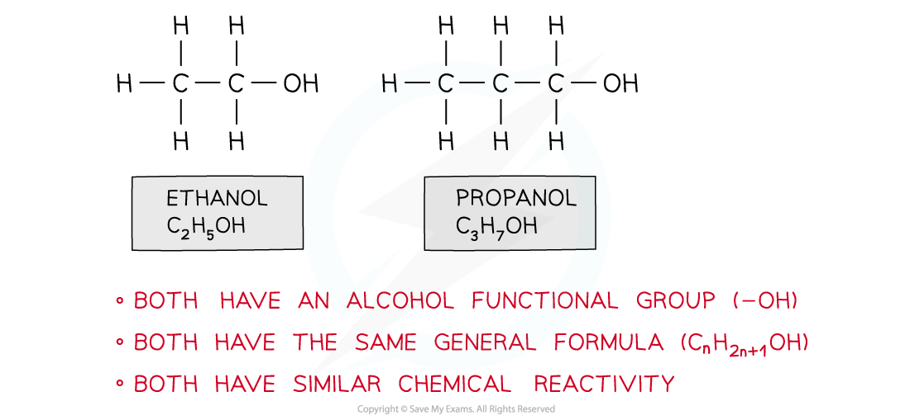
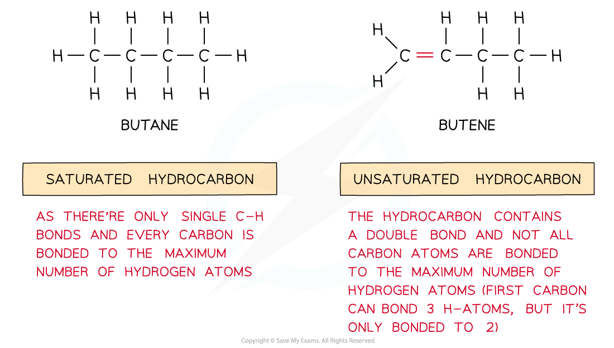
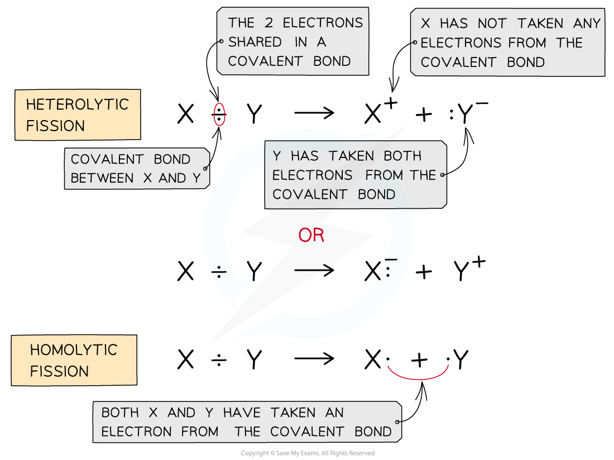
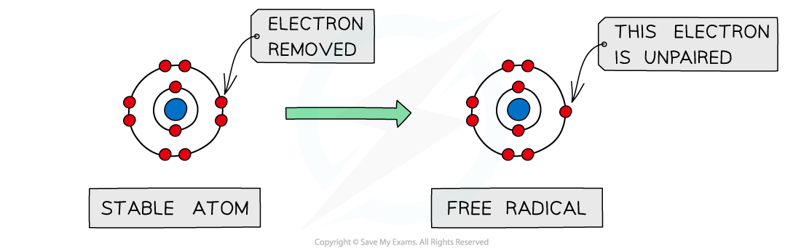
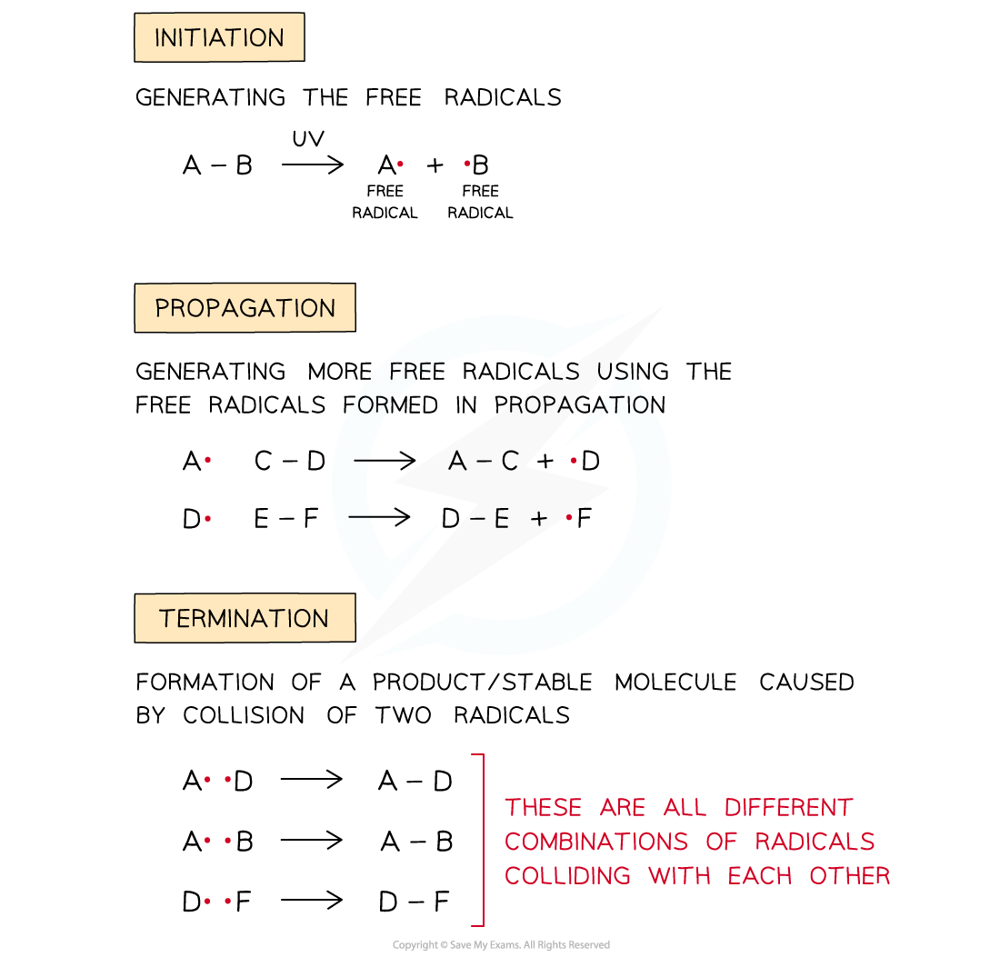
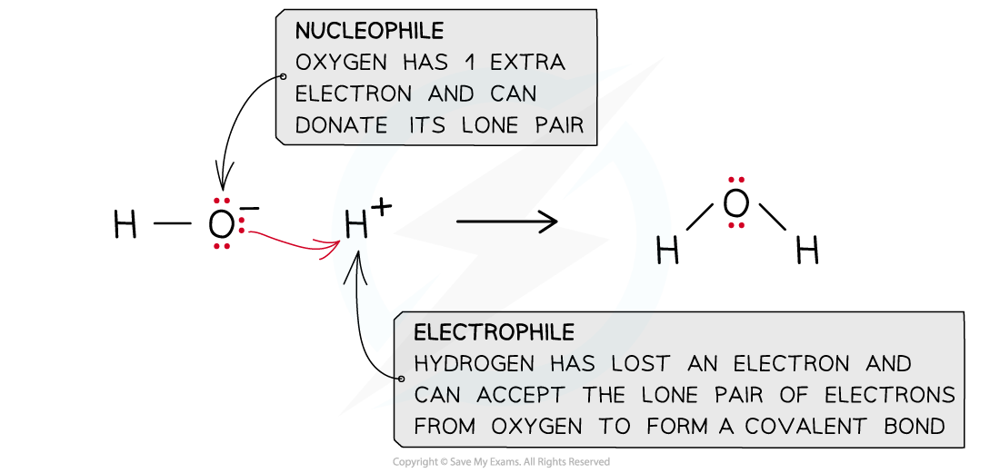
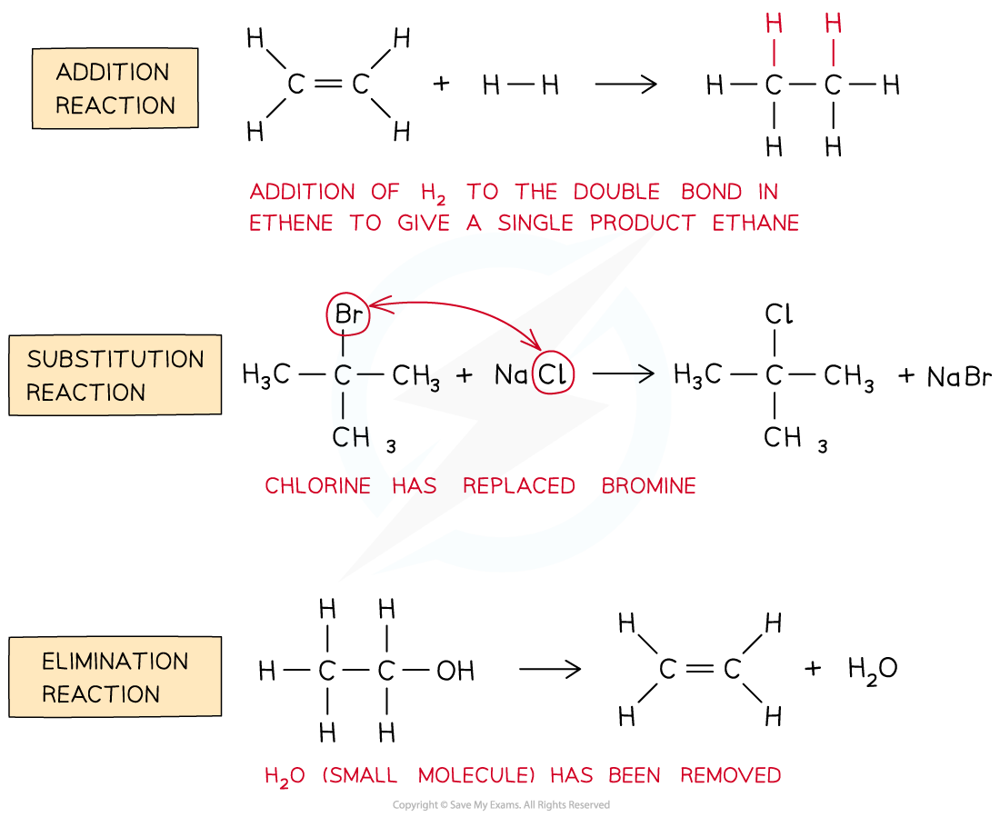
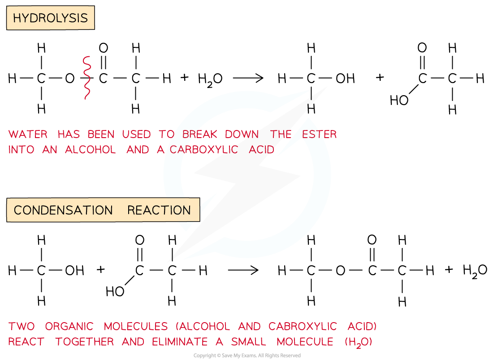
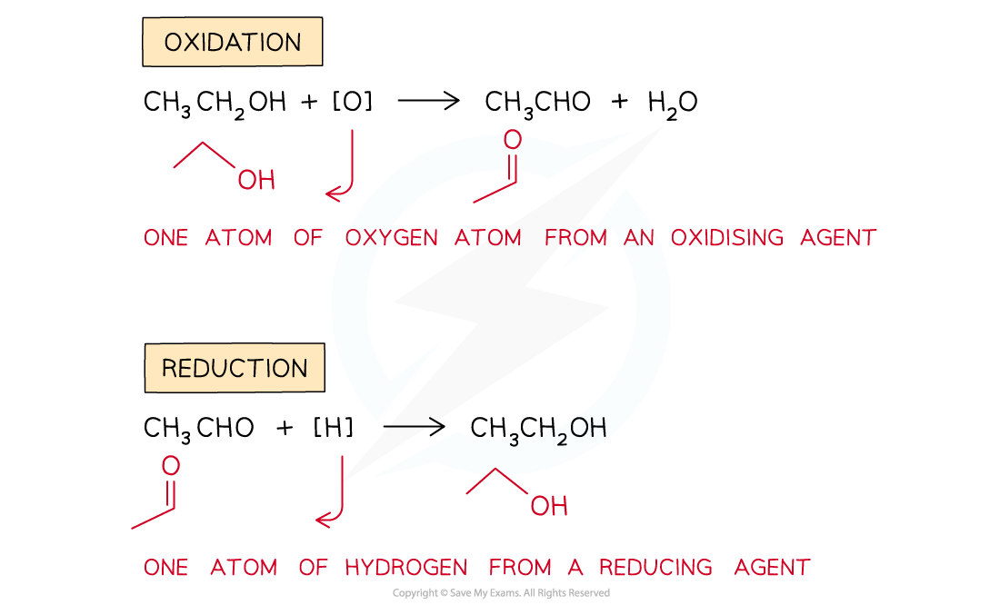

# Characteristic Organic Reactions

## Definitions in Organic Chemistry

> **Spec point** — `spcpt_jWB5gK4XNw8yxZ9R`

## Definitions & Terminology in Organic Chemistry

### Homologous series

- A homologous series is a group of organic compounds that have the same functional group, the same general formula and similar chemical properties

#### The homologous series of alcohols

*Ethanol and propanol belong to the same homologous series*

### Saturated & unsaturated hydrocarbons

- **Saturated **hydrocarbons are hydrocarbons which contain single bonds only resulting in the maximum number of hydrogen atoms in the molecule
- **Unsaturated **hydrocarbons are hydrocarbons which contain carbon-carbon **double** or **triple** bonds

#### Comparing the alkane and alkene homologous series

*The diagram shows saturated hydrocarbons which contain single bonds only and unsaturated hydrocarbons which contain double/triple bonds as well*

### Homolytic & heterolytic fission

- **Homolytic fission **is breaking a covalent bond in such a way that each atom takes an electron from the bond to form two radicals
- **Heterolytic fission **is breaking a covalent bond in such a way that the more electronegative atom takes both the electrons from the bond to form a negative ion and leaves behind a positive ion

#### Examples of homolytic & heterolytic fission

*In heterolytic fission, the most electronegative atom takes both electrons in the covalent bond. While in homolytic fission, each atom takes one electron from the covalent bond*

### Radical chain reactions

- A **free radical **is a species with one (or more than one) unpaired electrons

#### Free radicals

*The diagram shows a free radical which has one unpaired electron*

- A **free radical reaction **is a reaction involving free radicals and is a three-step reaction:

  - **Initiation **is the first step and involves breaking a covalent bond using energy from ultraviolet (UV) light from the sun to form two free radicals
  - The **propagation **step is the second step in which a radical formed in initiation attacks a reactant molecule to form a new radical (one radical is used up and one is made, so the number of radicals does not increase)
  
    - These in turn can again attack other molecules to form more free radicals and so on
  - In the **termination **step, two free radicals react together to form a product molecule

#### The steps of a free radical reaction mechanism

*The main steps of a free radical reaction mechanism are initiation, propagation and termination*

### Nucleophiles & electrophiles

- A **nucleophile** is an electron-rich species that can **donate** a pair of electrons

  - ‘Nucleophile’ means ‘nucleus/positive charge loving’ as nucleophiles are attracted to positively charged species
  - **Nucleophilic **refers to reactions that involve a nucleophile
- An **electrophile **is an electron-deficient species that can **accept **a pair of electrons

  - ‘Electrophile’ means ‘electron/negative charge loving’ as electrophiles are attracted to negatively charged species
  - **Electrophilic** refers to reactions that involve an electrophile

#### Examples of a nucleophile and an electrophile

*A nucleophile ‘loves’ a positive charge and an electrophile ‘loves’ a negative charge*

### Types of reactions

- An **addition **reaction is an organic reaction in which two (or more) molecules combine to give a **single** **product** with no other products
- A **substitution **reaction is a reaction that involves **replacing** an atom or group of atoms with another atom or group of atoms
- An **elimination **reaction is a reaction in which a small molecule (such as H2O or HCl) is **removed** from an organic molecule
- A **hydrolysis **reaction is a reaction in which a compound is **broken** **down** by **water** (it can also refer to the breakdown of a substance by dilute acids or alkalis)
- A **condensation **reaction is a reaction in which two organic molecules join together and in the process **eliminate** small molecules (such as H2O or HCl)

#### The different types of reactions in organic chemistry

*It is important to be able to describe and identify the different types of reaction in organic chemistry*

### Oxidation & reduction

- An **oxidation **reaction is a reaction in which oxygen is added, electrons are removed or the oxidation number of a substance is increased

  - In organic chemistry, it often refers to the **addition of oxygen **or removal of hydrogen atoms to a substance
  - In equations for organic redox reactions, the symbol** [O]** can be used to represent one atom of oxygen from an oxidising agent
- A **reduction **reaction is a reaction in which oxygen is removed, electrons are added or the oxidation number of a substance is decreased

  - In organic chemistry, it often refers to the **removal of oxygen **or addition of hydrogen atoms to a substance
  - In equations for organic redox reactions, the symbol** [H] **can be used to represent one atom of hydrogen from a reducing agent

#### Examples of oxidation and reduction

*In organic chemistry oxidation is often the gain of oxygen or loss of hydrogen atoms and reduction is the gain of hydrogen and loss of oxygen atoms*
