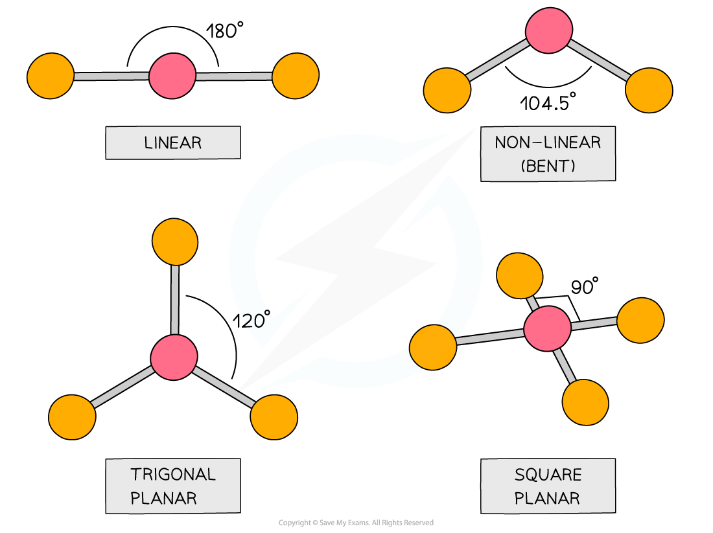
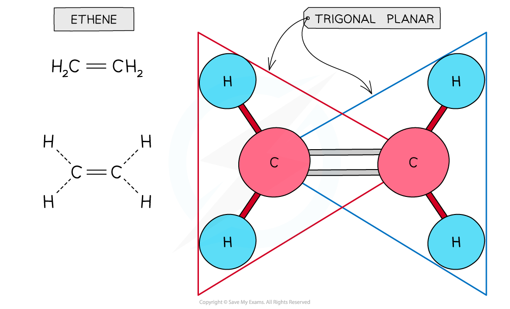
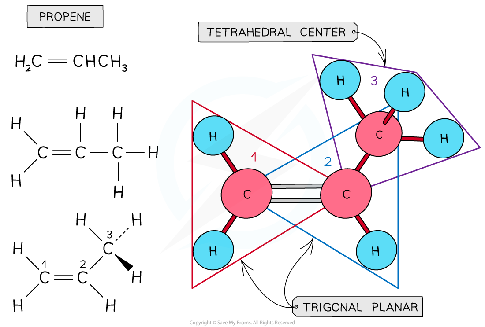
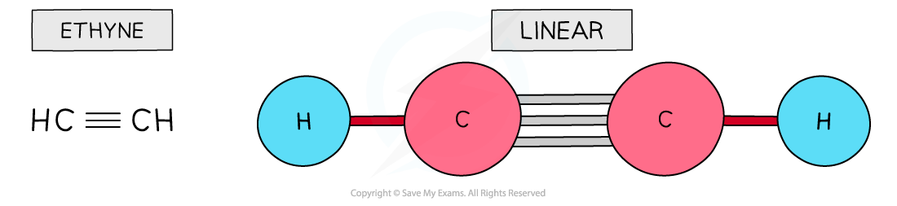
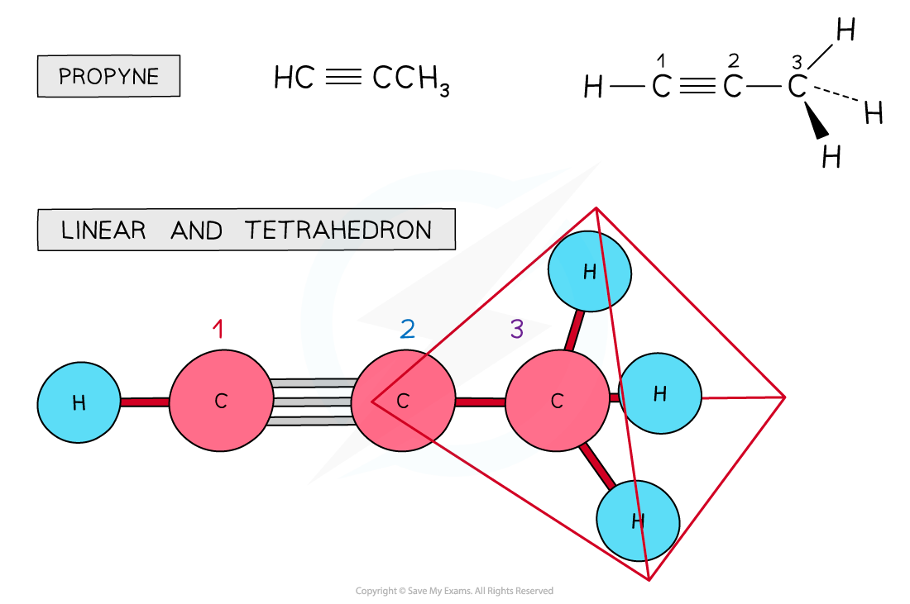

# Planarity of Organic Molecules

## Planar Molecules

> **Spec point** — `spcpt_Bb7Zq92CG2N8Mfgn`

## Planar Molecules

- Planar molecules have all their atoms in the same plane

  - E.g. linear, bent, trigonal planar and square planar

#### Examples of planar molecules

*The diagram shows molecules which have all their atoms in the same plane with their name and the associated bond angle*

- The presence of an sp2 hybridised carbon can force the molecule to adopt a planar configuration **(trigonal planar**)
- The 3 σ bonds position themselves in a trigonal planar position so that the bonding pair of electrons are as far away from each other and therefore minimise the repulsion between them

#### The planarity of ethene

*Ethene is a planar molecule with two trigonal planar centres around the carbon atoms*

#### The planarity of propene

*Propene has two trigonal planar centres around the carbon-carbon double bond and one tetrahedral centre*

- The presence of an sp hybridised carbon can also force the molecule to adopt a planar configuration (**linear**)
- The 2 σ bonds position themselves in a linear position to minimise the repulsion between the bonding pairs of electrons

#### The planarity of ethyne

*Ethyne is a planar molecule with one planar centre: the molecule is linear*

#### The planarity of propyne

*Propyne has one planar centre around the carbon-carbon triple bond (linear) and one tetrahedral centre*
