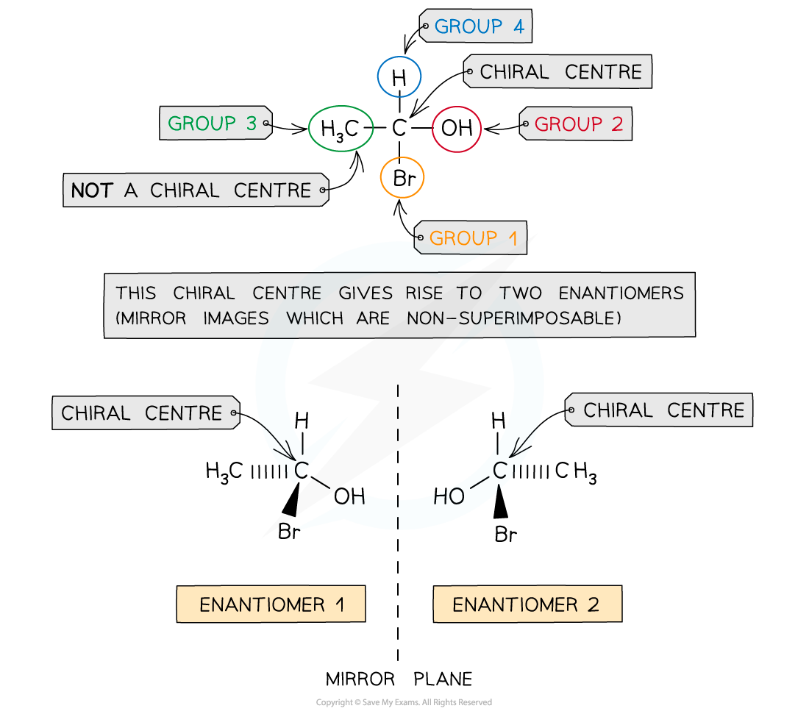
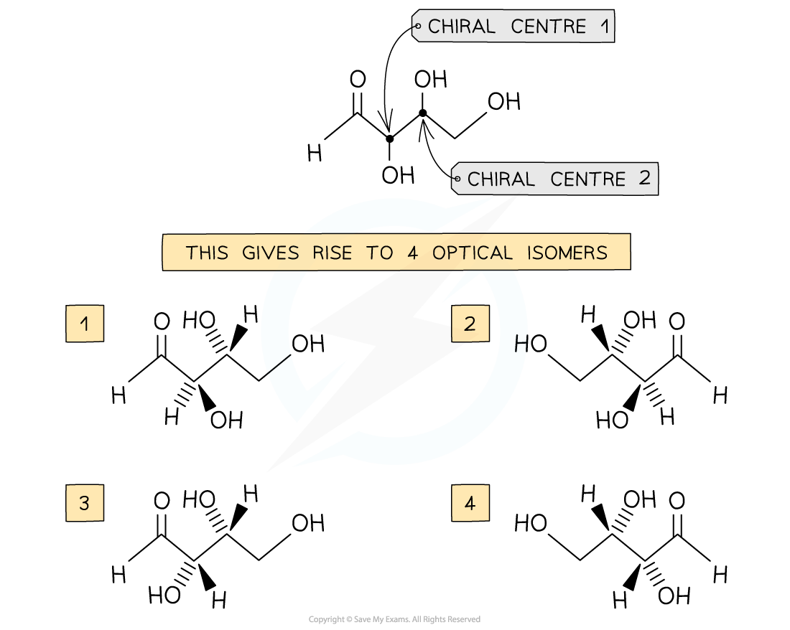
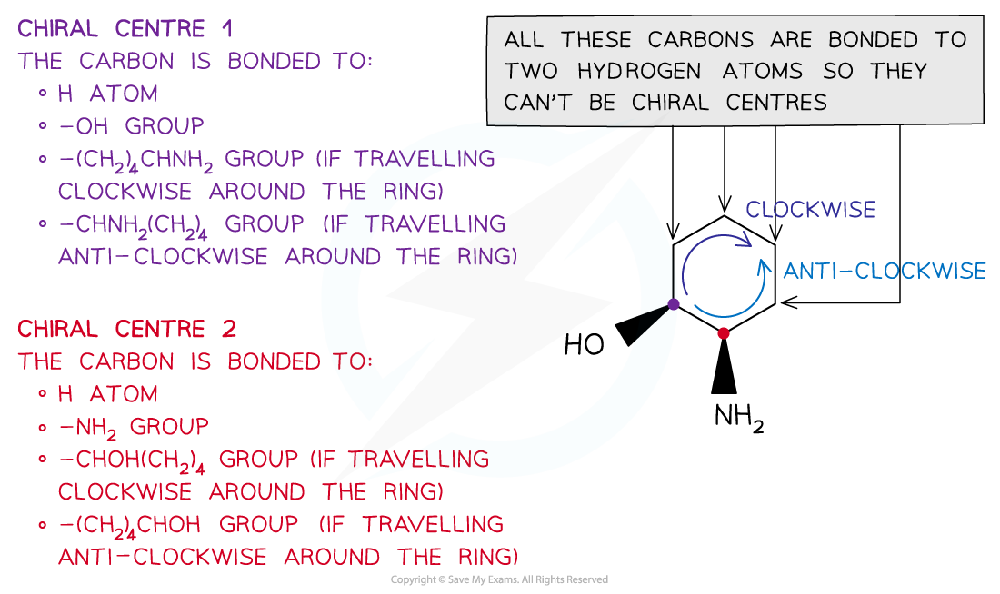

# Chirality

## Chirality & Enantiomers

> **Spec point** — `spcpt_X7vDgdxQs3VpCRb6`

## Chirality & Enantiomers

### Chiral centres in non-cyclic molecules

- A **chiral** **centre** in a molecule is a carbon atom that has four different atoms or groups of atoms attached
- This gives rise to two optical isomers which are also called **enantiomers**
- The enantiomers are **mirror images **of each other and cannot be superimposed

#### Chiral centres in non-cyclic molecules

*The presence of the chiral centre in the molecule allows two enantiomers to exist which are stereoisomers as the molecules have the same atoms bonded to each other, but they are differently arranged in space*

- When the molecule contains more than one chiral centre (asymmetric carbon) more than two optical isomers will be formed

  - If there are two chiral centres, each chiral centre can have two arrangements in space (mirror-image forms)
  - There are **four** possible optical isomers

#### Molecules with multiple chiral centres

*Each chiral centre gives rise to two optical isomers; therefore, the molecule has a total of four optical isomers*

### Chiral centres in cyclic molecules

- To determine the chiral centre in a cyclic molecule, the carbon bonded to four different atoms or groups of atoms should be found

  - E.g. 2-aminocyclohexanol has two chiral centres so it can form four optical isomers

#### Chiral centres in cyclic molecules

*To decide where the chiral centres are in a cyclic molecule, the carbon atoms bonded to four different atoms or atom groups should be found*

> **Exam Hint**
> Use a **molecular modelling kit** and make the models of enantiomers to help you understand that the two molecules are non-superimposable and therefore non-identical

## Identifying Chirality & Geometrical Isomerism

> **Spec point** — `spcpt_pzjCCN5WFBRwTq6P`

## Identifying Chirality & Geometrical Isomerism

#### Identify chirality

- Identifying **chiral** **centres** in cyclic and non-cyclic compounds is very straightforward as it is the carbon with four different atoms or atom groups in a molecule
- This gives rise to **two** optical isomers
- When more than two chiral centres are present, more than two optical isomers exist

  - The maximum number of stereoisomers that a molecule can have is 2n, where n is the number of chiral centres
- So, a molecule with **three** chiral centres will have 23 = **eight **optical isomers
- A molecule containing chiral centres is called a **chiral molecule**

### Identifying geometrical isomers

- Molecules with restricted rotation about the C-C bond can have geometrical isomers, provided each of the two carbons joined by that bond (the C=C carbons, or two ring carbons) carries two different groups
- This includes unsaturated and cyclic compounds

  - E.g. alkenes (such as but-2-ene) and substituted rings (such as 1,2-dichlorocyclopentane)
- When the groups are positioned on the same side of the C-C double bond, the compound is a **cis **isomer
- When the groups are positioned on opposite sides of the C-C double bond the compound is a **trans **isomer

> **Worked Example**
> **Drawing optical isomers**
> 
> Draw the optical isomers of the following compounds:
> 
> 
> 
> **Answers:**
> 
> 

> **Worked Example**
> **Drawing geometrical isomers**
> 
> Draw the geometrical isomers of the following compounds:
> 
> 
> 
> **Answers:**
> 
> 
> 
> 
