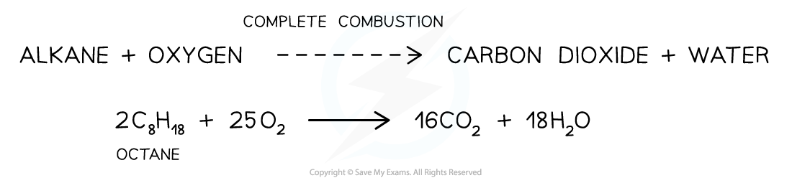
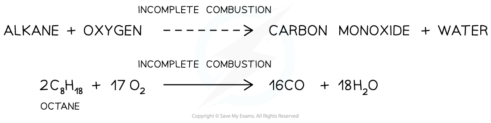

# Combustion & Free Radical Substitution of Alkanes

## Combustion & Free Radical Substitution of Alkanes

> **Spec point** — `spcpt_XrDVCr5BKxW9xv8b`

## Combustion & Free Radical Substitution of Alkanes

- Alkanes are **combusted **(burnt) on a large scale for their use as fuels
- They also react in **free-radical substitution **reactions to form more reactive halogenoalkanes

### Complete combustion

- When alkanes are burnt in **excess **(plenty of) oxygen, **complete combustion **will take place and all carbon and hydrogen will be oxidised to **carbon dioxide **and **water** respectively

  - For example, the complete combustion of octane to carbon dioxide and water

#### The complete combustion of alkanes

*Complete combustion involves a plentiful supply of oxygen*

### Incomplete combustion

- When alkanes are burnt in only a limited supply of oxygen, incomplete combustion will take place and not all the carbon is fully oxidised
- Some carbon is only partially oxidised to form carbon monoxide

  - For example, the incomplete combustion of octane to form carbon monoxide

#### The incomplete combustion of alkanes

*Incomplete combustion involves a limited supply of oxygen*

- Carbon monoxide is a **toxic **gas as it will bind to haemoglobin in blood which can then no longer bind to **oxygen**
- As no oxygen can be transported around the body, victims will feel **dizzy, lose consciousness **and if not removed from the carbon monoxide, they can **die**
- Carbon monoxide is extra dangerous as it is **odourless **(it doesn’t smell) and will not be noticed
- Incomplete combustion often takes place inside a **car engine **due to a limited amount of oxygen present

### Free-radical substitution of alkanes

- Alkanes can undergo **free-radical substitution **in which a hydrogen atom gets **substituted **by a halogen (chlorine/bromine)
- Since alkanes are very unreactive, **ultraviolet **light** (sunlight)** is needed for this substitution reaction to occur
- The free-radical substitution reaction consists of three steps:

  - In the **initiation step**, the halogen bond (Cl-Cl or Br-Br) is broken by UV energy to form two radicals
  - These radicals create further radicals in a chain type reaction called the **propagation step**
  - The reaction is terminated when two radicals collide with each other in a **termination step**
