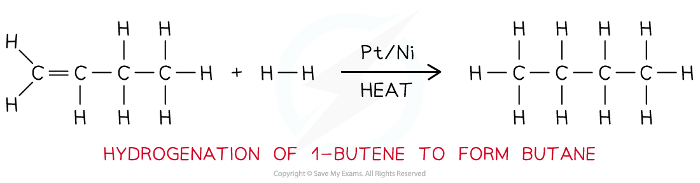

# Producing Alkanes

## Production of Alkanes: Hydrogenation & Cracking

> **Spec point** — `spcpt_2S9yyntc9CGDBHYP`

## Production of Alkanes: Hydrogenation & Cracking

- **Alkanes** are hydrocarbons that can be produced by the **addition** **reaction** of hydrogen to an alkene or by **cracking** of longer alkane chains

### Production of alkanes from addition reactions

- Alkenes are unsaturated organic molecules containing at least one C=C double bond
- Alkenes can be heated with hydrogen gas and a Pt/Ni catalyst

  - The Pt/Ni catalyst is finely divided to increase its surface area
  - This increases the overall rate of reaction
- This is an addition reaction which forms an alkane from an alkene, for example:

**butene + hydrogen **$\overset{\mathrm{Pt}H_{2}}{\rightarrow}$**  butane**

#### The hydrogenation reaction

*Hydrogen gas is added to 1-butene which is then heated and passed over a Pt / Ni catalyst to produce butane*

- The addition reaction of alkenes with hydrogen is called **hydrogenation**
- Hydrogenation is often used in the manufacture of **margarine **from **vegetable oil**

  - Vegetable oil is an unsaturated organic molecule with many C-C double bonds
  - When these are partially hydrogenated, their hydrocarbon chains become straighter
  - This raises the melting point of the oils which is why margarine is a soft solid and vegetable oil a liquid at room temperature

### Production of alkanes from cracking

- In **cracking **large, less useful hydrocarbon molecules found in crude oil are broken down into smaller, more useful molecules
- The large hydrocarbon molecules are fed into a **steel** **chamber**, **heated** to a high temperature and then passed over an **aluminium** **oxide** (Al2O3) catalyst

  - The chamber does not contain any **oxygen** to prevent **combustion** of the hydrocarbon to water and carbon dioxide
- When a large hydrocarbon is cracked, a **smaller** **alkane** and **alkene** molecules are formed

  - E.g. octane and ethene from decane

#### An example of cracking

*Long hydrocarbons are cracked by heating them and using an aluminium oxide catalyst into smaller hydrocarbons and an alkene*

> **Exam Hint**
> Remember that hydrogenation is an **exothermic **reaction and cracking is an **endothermic **reaction
