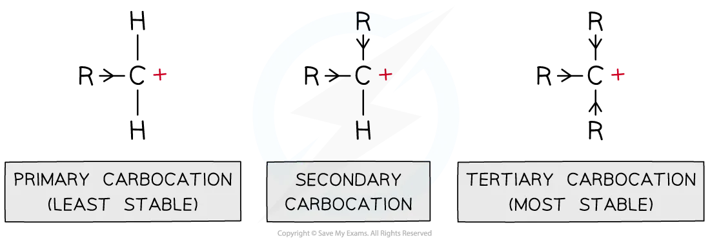
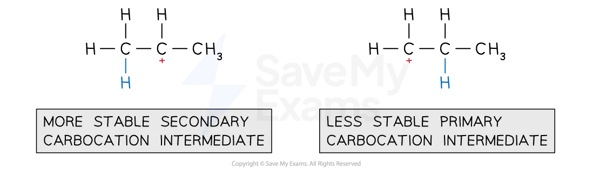
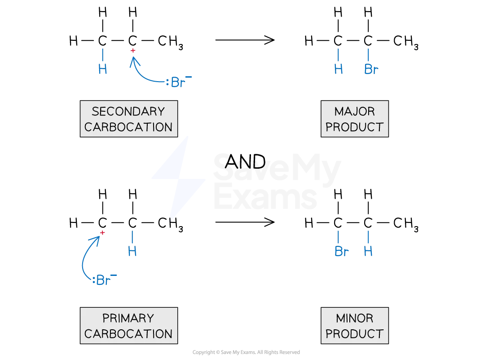
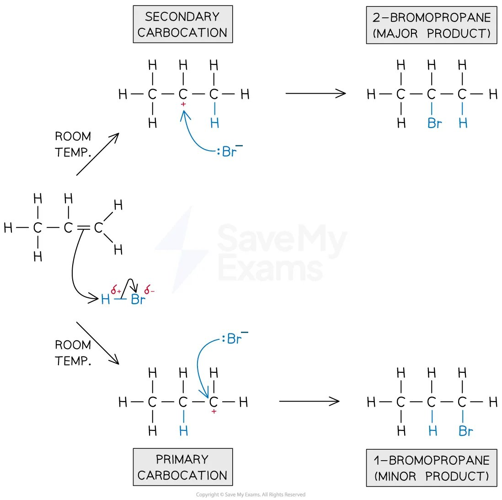

# Markovnikov's Rule

## Alkenes: Stability of Cations & Markovnikov's Rule

> **Spec point** — `spcpt_Zc5TsBxs5ZtdtTPv`

## Alkenes: Stability of Cations & Markovnikov's Rule

- **Carbocations **are positively charged carbon atoms with only three covalent bonds instead of four
- There are three types of carbocations: primary, secondary and tertiary

### Inductive effect

- The alkyl groups attached to the positively charged carbon atoms are ‘electron donating groups’

  - This is also known as the** inductive effect **of alkyl groups
- The inductive effect is illustrated by the use of arrowheads on the bonds to show the alkyl groups pushing electrons towards the positively charged carbon

  - This causes the carbocation to become **less positively charged**
- As a result of this, the charge is spread around the carbocation which makes it **energetically more stable**
- This means that** tertiary carbocations** are the **most stable** as they have three electron-donating alkyl groups which energetically stabilise the carbocation
- Due to the positive charge on the carbon atom, **carbocations are electrophiles**

#### Primary, secondary and tertiary carbocations

*Alkyl groups push electron density towards the carbocation making it energetically more stable; the more alkyl groups the carbocation is bonded to, the more stabilised it is*

### Markovnikov’s rule

- Markovnikov’s rule predicts the outcome of electrophilic addition reactions and states that:

  - In an electrophilic addition reaction of a hydrogen halide (HX) to an alkene, the halogen ends up bonded to the **most substituted carbon atom**
  - In an electrophilic addition reaction of an interhalogen to an alkene, the **most electronegative halogen** ends up bonded to the most substituted carbon atom
- Markovnikov addition applies to electrophilic addition reactions with unsymmetrical alkenes, e.g. propene and but-1-ene

  - Markovnikov addition favours the formation of the **major** product
  - Anti-Markovnikov addition favours the formation of the **minor** product

- In electrophilic addition reactions, an electrophile reacts with the double bond of alkenes (as previously discussed)
- The mechanism for electrophilic addition reactions with unsymmetrical alkenes is slightly different:

  - E.g. propene + hydrogen bromide

#### Step 1 in the electrophilic addition mechanism

*The electrophile reacts with the electron-rich C-C double bond*

- The electrophile can attach in two possible ways:

  1. Breaking the C=C bond and attaching to the least substituted carbon
  
    - This will give the **most** stable carbocation as an intermediate that will form the **major** product
  2. Breaking the C=C bond and attaching to the most substituted carbon
  
    - This will give the **least **stable carbocation as an intermediate that will form the **minor **product

#### Relative stabilities of primary and secondary carbocations

*The major and minor carbocation intermediates formed during the reaction of propene and hydrogen bromide*

- The nucleophile will bond to the **positive carbon atom** of the carbocation

  - The more stable carbocation produces the major product
  - The less stable carbocation produces the minor product

#### Formation of major and minor products

*Formation of the major and minor products of the reaction of propene with hydrogen bromide*

- The mechanism for the electrophilic addition of hydrogen bromide to propene, showing the formation of the major and minor products can be shown as:

#### Electrophilic addition mechanism showing the formation of the major and minor products

*The electrophilic addition reaction mechanism of HBr and propene to form 1-bromopropane and 2-bromopropane*

> **Exam Hint**
> - The stability of the carbocation intermediate is as follows:
> 
> **tertiary > secondary > primary**
> 
> - When more than one carbocation can be formed, the major product of the reaction will be the one that results from the nucleophilic attack of the most stable carbocation.
