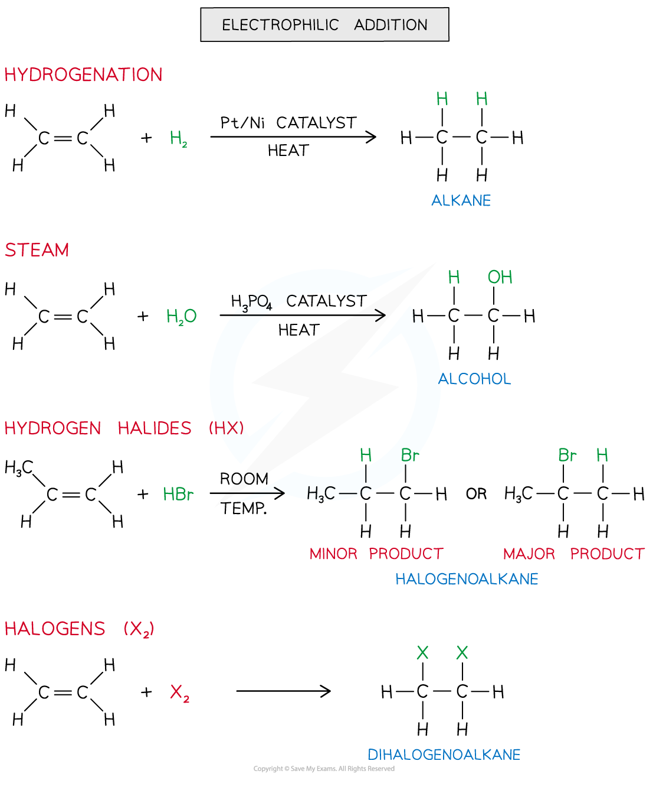
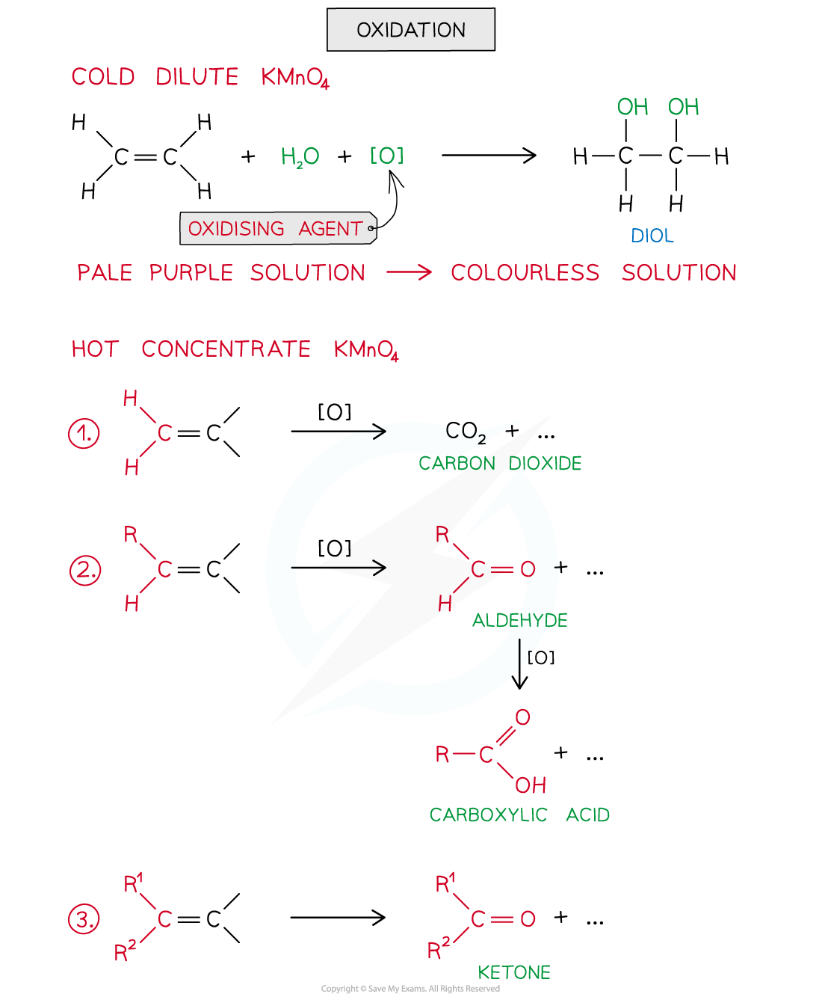
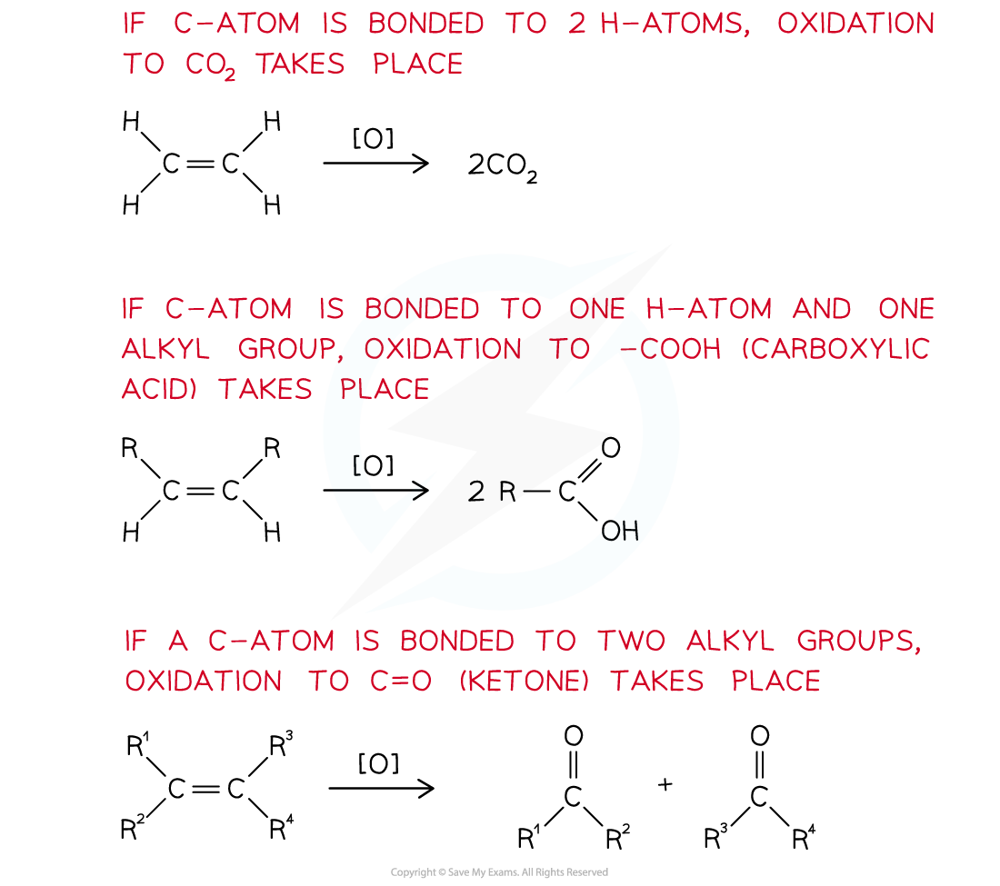
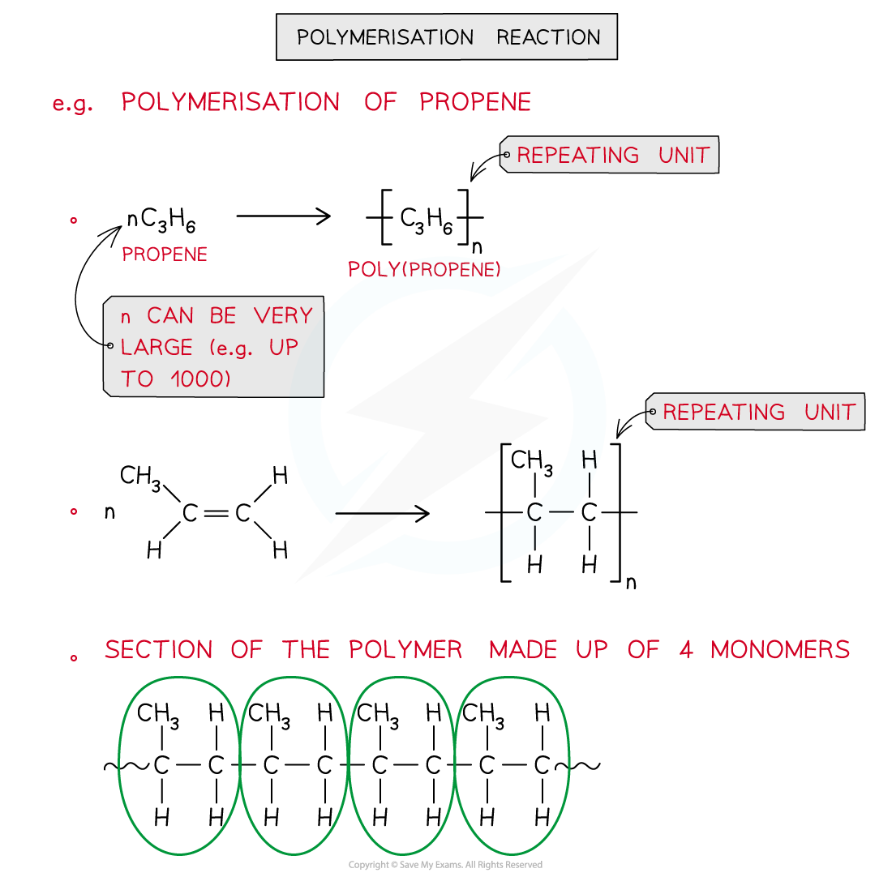
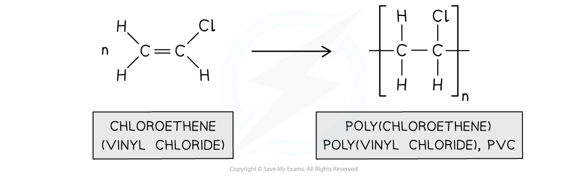

# Reactions of Alkenes

## Reactions of Alkenes

> **Spec point** — `spcpt_ZqhMdzk62nwdGGrr`

## Reactions of Alkenes

- Alkenes are very useful compounds as they can undergo many types of reactions
- They can therefore be used as starting molecules when making new compounds

### Electrophilic addition

- **Electrophilic** **addition** is the addition of an electrophile to a double bond
- The C-C double bond is broken, and a new single bond is formed from each of the two carbon atoms
- Electrophilic addition reactions include the addition of:

  - Hydrogen (also known as **hydrogenation** **reaction**)
  - Steam (H2O (g))
  - Hydrogen halide (HX)
  - Halogen

#### Electrophilic addition reactions of alkenes

### Oxidation

- Alkenes can also be **oxidised **by **acidified potassium manganate(VII) **(KMnO4) which is a very powerful **oxidising agent**
- Alkenes can be oxidised by both **hot** and **cold **KMnO4 which will result in different products being formed

  - When shaken with **cold dilute KMnO****4** the **pale purple **solution turns **colourless **and the product is a **diol**
  - When alkenes are reacted with **hot concentrated KMnO****4** the conditions are harsher causing the C-C double bond to completely break
  - The O-H groups in the diol formed are further oxidised to **ketones**, **aldehydes**, **carboxylic acids **or **carbon dioxide gas**
  - The actual products formed depend on what is bonded to the carbon atoms in the alkene

#### Oxidising alkenes using KMnO4

*Alkenes can be oxidised by cold dilute and hot concentrated KMnO₄ to give different products*

- The reactions of alkenes with hot concentrated KMnO4 can be used to determine the position of the double bond in larger alkenes

#### Predicting the position of double bonds formed

*The above reactions can be used to predict where the double bond in a larger molecule is*

> **Worked Example**
> What are the products of the oxidation of 2-methylprop-1-ene with hot, concentrated acidified KMnO4 (aq)?
> 
> **Answer:**
> 
> The products are propanone (a ketone), carbon dioxide and water
> 
> 

> **Worked Example**
> The oxidation of an alkene produces carbon dioxide gas, water and propanoic acid. Identify the alkene.
> 
> **Answer:**
> 
> The alkene is 1-butene
> 
> 

### Addition polymerisation

- **Addition polymerisation** is the reaction of many monomers containing at least one double C-C bond to form the long-chain polymers as the only product

  - **Monomers** are small, reactive molecules that react together to make the polymer
  - A **polymer** is a long-chain molecule made up of many **monomer** molecules joined together; the section of the chain that repeats is the **repeat unit**
- In an addition polymerisation reaction, the C-C double bond is broken to link together the monomers and form a polymer
- This is a common method of making **plastics**

#### The polymerisation of ethene

*The polymer backbone consists of a carbon chain with monomers that contain 2 carbon atoms*

#### The polymerisation of propene

*The polymer backbone consists of a carbon chain with monomers that contain 2 carbon atoms with the methyl group, from the propene monomer, as a side chain*

- Other alkenes and **substituted **alkenes can also polymerise to make polymers with different **properties**

  - E.g. poly(chloroethene), also known as PVC is the most versatile plastic used

#### The polymerisation of chloroethene

*Poly(chloroethene) is used as plastic*
