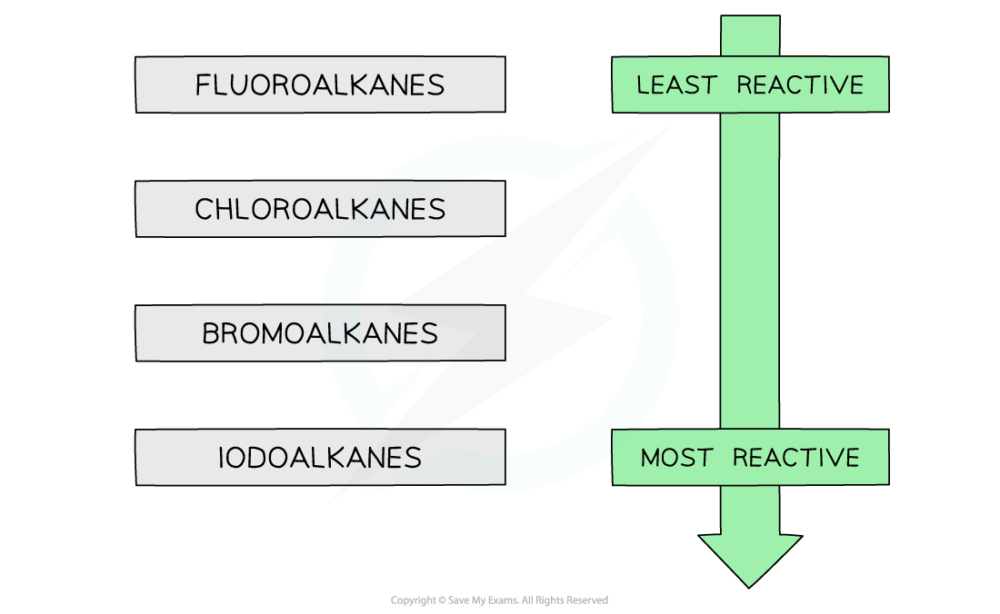

# Reactivity of Halogenoalkanes

## Reactivity of Halogenoalkanes

> **Spec point** — `spcpt_WSGChyvVnBFDWBhq`

## Reactivity of Halogenoalkanes

- The halogenoalkanes have different **rates** of **substitution** **reactions**
- Since substitution reactions involve **breaking** the **carbon-halogen** bond the **bond** **energies** can be used to explain their different reactivities

#### Halogenoalkane bond energy table

| **Bond** | **Bond Energy / kJ mol****–1** |
|---|---|
| C–F | 467 (strongest bond) |
| C–Cl | 346 |
| C–Br | 290 |
| C–I | 228 (weakest bond) |

- The table above shows that the C-I bond requires the least energy to break, and is therefore the **weakest** carbon-halogen bond
- During substitution reactions the C-I bond will therefore **heterolytically** break as follows:

**R****3****C-I + OH****–****→R****3****C-OH + I****–**** **

halogenoalkane **→ **alcohol

- The C-F bond, on the other hand, requires the most energy to break and is, therefore, the **strongest** carbon-halogen bond
- Fluoroalkanes will therefore be less likely to undergo substitution reactions

### Aqueous silver nitrate

- Reacting halogenoalkanes with **aqueous silver nitrate solution** will result in the formation of a **precipitate**
- The **rate of formation** of these precipitates can also be used to determine the reactivity of the halogenoalkanes

#### Halogenoalkane precipitates

- Chlorides

  - White (silver chloride) precipitate
- Bromides

  - Cream (silver bromide)
- Iodides

  - Yellow (silver iodide)
- The formation of the yellow silver iodide is the fastest (fastest **nucleophilic substitution **reaction)
- Fluoroalkanes react the slowest (slowest **nucleophilic substitution **reaction) and give no precipitate, because silver fluoride is soluble
- This confirms that fluoroalkanes are the least reactive and iodoalkanes are the most reactive halogenoalkanes

#### The trend in reactivity of halogenoalkanes

*The halogenoalkanes become more reactive as you move down the group*
