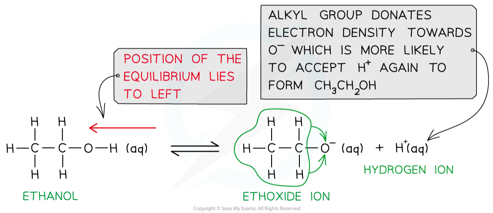

# Acidity of Alcohols

## Acidity of Alcohols

> **Spec point** — `spcpt_tV46RtJmb4cvCkFv`

## Acidity of Alcohols

- Alcohols have a **low degree of dissociation**

  - This means, that when dissolved in water, alcohol molecules do not **dissociate **(split up) to a great extent

ROH (aq) **           **$\rightleftharpoons$**       **RO- (aq) + H+ (aq)

alcohol                               alkoxide ion

- The **position **of the equilibrium lies to the left, meaning that there are far more alcohol molecules than RO- and H+ ions
- When water dissociates, the position of the equilibrium still lies to the **left**, but there are more H+ ions compared to the dissociation of alcohols

H2O (l) $\rightleftharpoons$ OH– (aq) + H+ (aq)

- As alcohols have a lower [H+ (aq)] in solution compared to water, **alcohols are weaker acids than water**

### The inductive effect in alcohols

- **Electron-donating species such as alkyl groups push electrons into a covalent bond and are said to have a positive inductive effect**
- In alcohols, the **oxygen** atom in the **alkoxide ion **is bonded to an **electron-donating **alkyl group
- This means that there is more electron density on the O- atom
- The alkoxide ion is, therefore, more likely to **accept **an H+ ion and form the alcohol again

#### The inductive effect in alcohols

*Alkyl groups in the alkoxide ion donate electron density to the negatively charged oxygen, causing it to more readily accept a proton and form the alcohol again*

- When water dissociates, the **hydroxide ion** only has one other **hydrogen atom**
- There is no extra **electron density **on the oxygen which is less likely to **accept **an H+ ion
- Water is therefore a **stronger **acid than alcohols

#### The equilibrium of water and hydroxide ions

*Water is a stronger acid than alcohols as there are no electron-donating groups in the hydroxide ion, causing the O- to be less likely to accept a proton and reform water*
