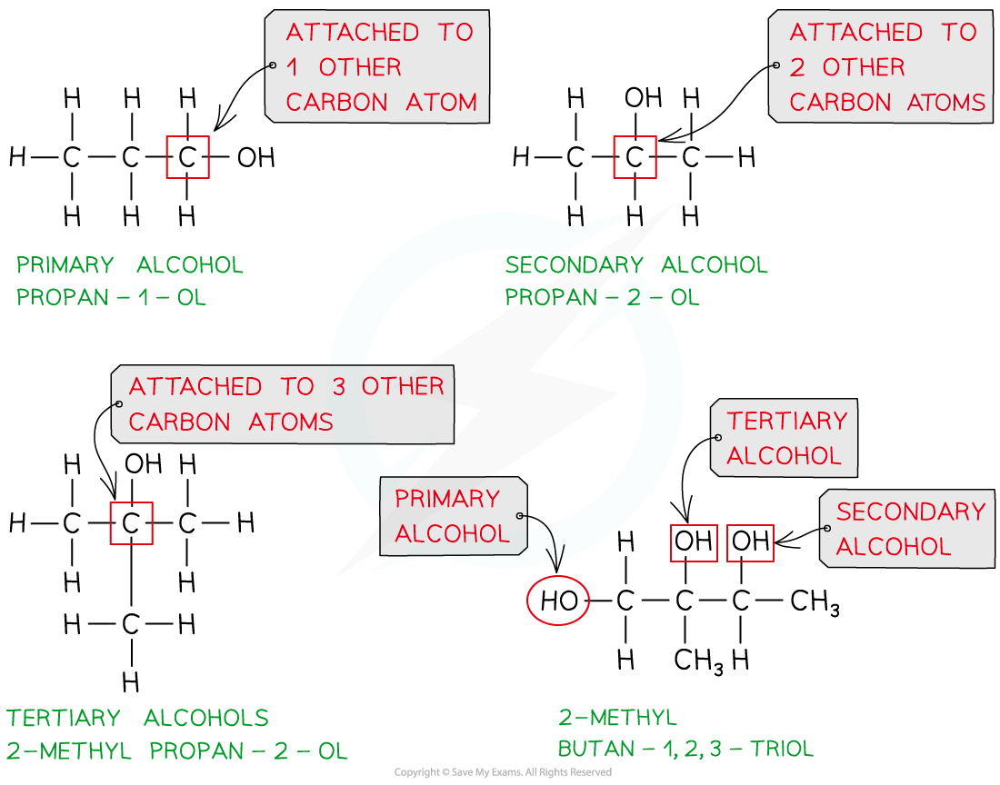
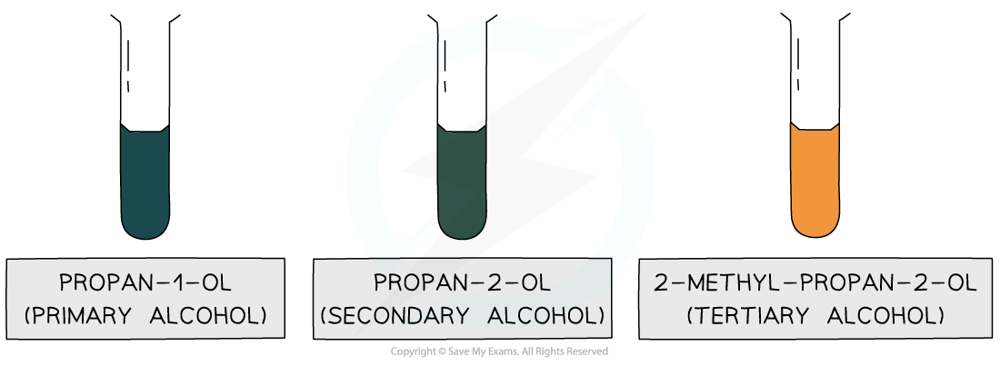
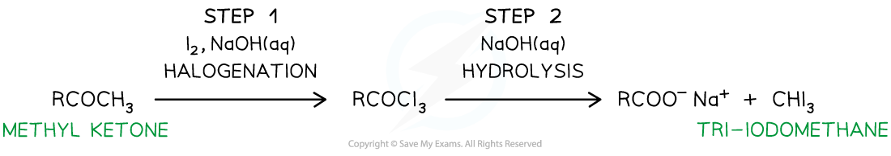
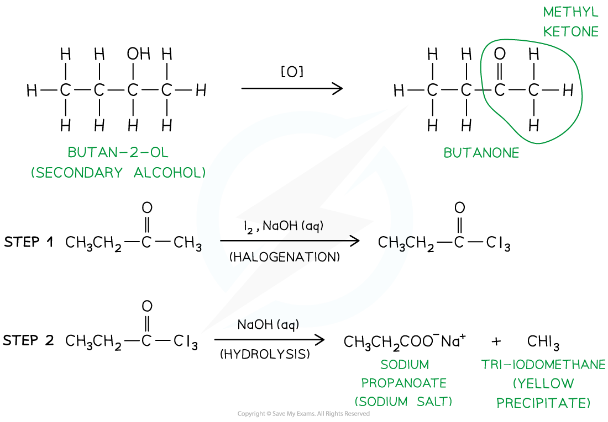

# Classifying & Testing for Alcohols

## Classifying Alcohols

> **Spec point** — `spcpt_RFYvv2MhPKJKmp8d`

## Classifying Alcohols

- **Primary** **alcohols** are alcohols in which the carbon atom bonded to the -OH group is attached to **one** other carbon atom (or alkyl group)
- **Secondary** **alcohols** are alcohols in which the carbon atom bonded to the -OH group is attached to **two** other carbon atoms (or alkyl groups)
- **Tertiary** **alcohols** are alcohols in which the carbon atom bonded to the -OH group is attached to **three** other carbon atoms (or alkyl groups)

#### Primary, secondary and tertiary alcohols

*Classifying primary, secondary and tertiary alcohols and alcohols with more than one alcohol group*

- Only **primary** and **secondary** **alcohols** can get oxidised when **mildly oxidised **with acidified K2Cr2O7

  - Primary alcohols get mildly oxidised to aldehydes
  - Secondary alcohols get mildly oxidized to ketones
- **Tertiary** **alcohols** do **not** undergo oxidation with acidified K2Cr2O7
- Therefore, only the oxidation of primary and secondary alcohols will change the colour of K2Cr2O7 solution as the **orange** Cr2O72- ions are reduced to **green** Cr3+ ions

#### Testing for alcohols

*Only propan-1-ol and propan-2-ol, which are primary and secondary alcohols respectively, can get oxidised, turning the orange solution green; no colour change is observed with 2-methyl-propan-2-ol, which is a tertiary alcohol*

## Test for Alcohols

> **Spec point** — `spcpt_kcCrGQ3ZDytBr2mg`

## Test for Alcohols

- **Tri-iodomethane** (also called **iodoform**) is a **yellow precipitate**
- It is formed from the reaction of** iodine in an alkaline solution **with **methyl ketones**

  - Methyl ketones are compounds that have a CH3CO-group
  - **Ethanal** also contains a CH3CO- group and therefore also forms a yellow precipitate with alkaline iodine
- The reagent is **heated **with an **alkaline **solution of **iodine**
- This reaction involves a **halogenation **and **hydrolysis **step

  - In the **halogenation **step, all three H-atoms in the -CH3 (methyl) group are replaced with iodine atoms, forming a -CI3 group
  - The intermediate compound is hydrolysed by an **alkaline **solution to form a sodium salt (RCO2- Na+) and a yellow precipitate of CHI3

#### The iodoform reaction

*The reaction of methyl ketones with alkaline iodine results in the formation of a yellow CHI3 precipitate*

### Iodoform & alcohols

- The position of a **secondary alcohol group** in a molecule can be identified using the iodoform test with iodine in alkaline solution

  - If the **–OH group** is attached to a carbon atom that is **next to a methyl group**, the alcohol can be **oxidised** by the alkaline iodine to form a **methyl ketone** (RCOCH3)
  - The methyl ketone then undergoes:
  
    - **Halogenation**, where the three hydrogen atoms of the methyl group are replaced by iodine atoms (–CI3), followed by
    - **Hydrolysis**, forming a **sodium carboxylate salt** and a **yellow precipitate of iodoform (CHI****3****)**
- A positive result (yellow precipitate) indicates that the alcohol has the structure CH₃CH(OH)R
- No precipitate means the secondary alcohol is not adjacent to a methyl group and therefore cannot form a methyl ketone intermediate

#### Using the iodoform test

*The secondary alcohol butan-2-ol will firstly get oxidised to the methyl ketone butanone which will form a yellow precipitate when reacted with alkaline  iodine*
