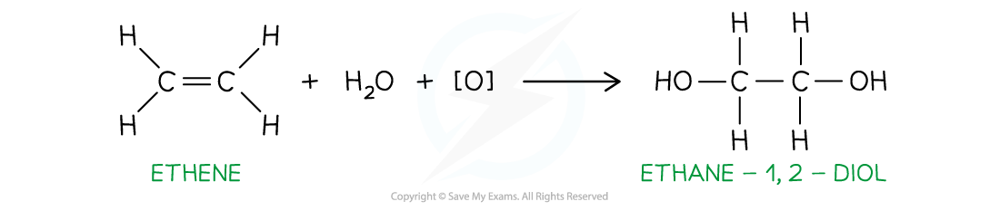
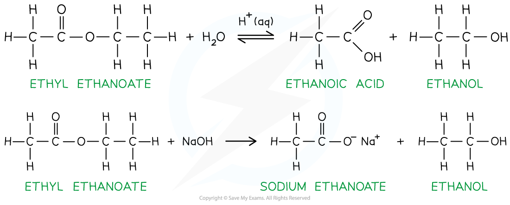

# Producing Alcohols

## Production of Alcohols

> **Spec point** — `spcpt_MhBYBMKn8wCVYzfn`

## Production of Alcohols

- **Alcohols **are compounds that contain at least one **hydroxy **(-OH) group
- The general formula of alcohols is **C****n****H****2n+1****OH**
- Alcohols can be prepared by a wide range of chemical reactions

### Electrophilic addition of alkenes

- When hot steam is reacted with an alkene, using concentrated phosphoric(V) acid (**H****3****PO****4****) **as a catalyst, ***electrophilic addition*** takes place to form an **alcohol**

#### The electrophilic addition of ethene using water

*Electrophilic addition of steam to alkenes forms alcohols*

### Oxidation of alkenes

- Cold, dilute KMnO4 is a **mild oxidising agent** and oxidises **alkenes**
- The C-C double bond is not fully broken and a diol is formed

  - A diol is a compound with two hydroxy, -OH, groups

#### Oxidation of ethene using cold, dilute KMnO4

*The oxidation of alkenes using cold, dilute KMnO4 forms a diol*

### Nucleophilic substitution of halogenoalkanes

- The halide atom in halogenoalkanes can be substituted when heated with aqueous NaOH in a ***nucleophilic substitution*** reaction

#### Nucleophilic substitution of bromoethane using NaOH

![Ethene reacts with water and an oxidising agent, [O], to form ethane-1,2-diol (reaction with cold dilute KMnO4)](../../../assets/f0cbcddd904b-3-4-hydroxy-compounds-nucleophilic-substitution.png)

*The nucleophilic substitution of halogenoalkanes using NaOH forms an alcohol*

### Reduction of aldehyde & ketones

- **Aldehydes **and **ketones **can be reduced by reducing agents such as NaBH4 or LiAlH4

- Aldehydes are reduced to **primary alcohols**

  - The carbon attached to the hydroxy group is bonded to one other alkyl group
- Ketones are reduced to **secondary alcohols**

  - The carbon attached to the hydroxy group is bonded to two other alkyl groups

#### The reduction of ethanal and propanone

*The reduction of aldehydes and ketones forms primary and secondary alcohols respectively*

### Reduction of carboxylic acids

- Similarly, carboxylic acids are reduced by LiAlH4 to primary alcohols
- NaBH4 is not used as it is not a strong enough reducing agent for this reaction

#### The reduction of ethanoic acid

![Ethanoic acid is reduced by 4[H] (from LiAlH4) to ethanol and water](../../../assets/f1557c87e780-ethanoic-acid-reduction-lialh4.png)

*The reduction of carboxylic acids forms primary alcohols*

### Hydrolysis of ester

- Esters are made by a **condensation reaction** between an alcohol and a carboxylic acid
- When an ester is heated with dilute acid or alkali, **hydrolysis** will take place and the carboxylic acid and alcohol will be reformed

#### Acidic and alkaline hydrolysis of ethyl ethanoate

*The hydrolysis of esters forms alcohols*

#### Alcohol production reactions table

| **Reaction Type** | **Reagents** | **Conditions ** | **Product** |
|---|---|---|---|
| Electrophilic addition | Alkene Steam | Heat  H3PO4 catalyst | Alcohol |
| Oxidation | Alkenes Cold, dilute KMnO4 | Shaking of reagents | Diol |
| Nucleophilic substitution | Halogenoalkanes Aqueous NaOH | Heat | Alcohol |
| Reduction | Aldehydes / ketones | LiAlH4 or NaBH4 | Primary / secondary alcohol |
| Reduction | Carboxylic acid | LiAlH4 | Primary alcohol |
| Hydrolysis | Esters | Dilute acid or alkali  Heat | Alcohol |

> **Exam Hint**
> The symbol [O] is used to represent oxygen provided by an oxidising agent
