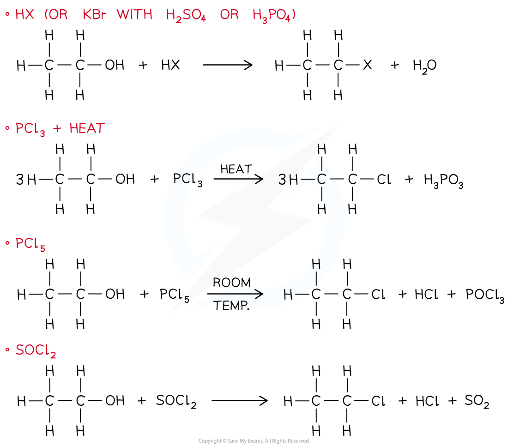
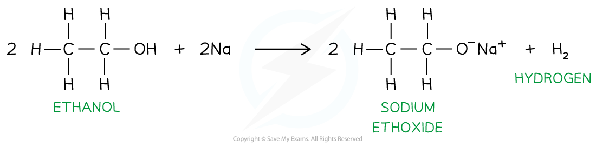
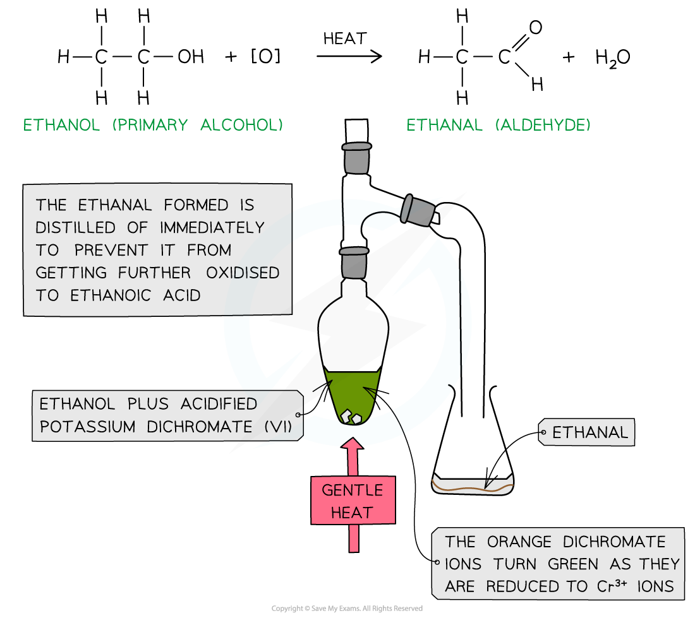
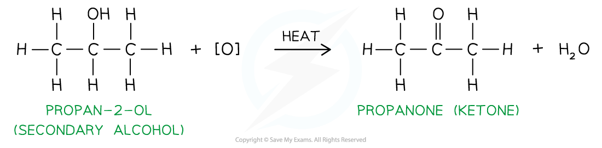
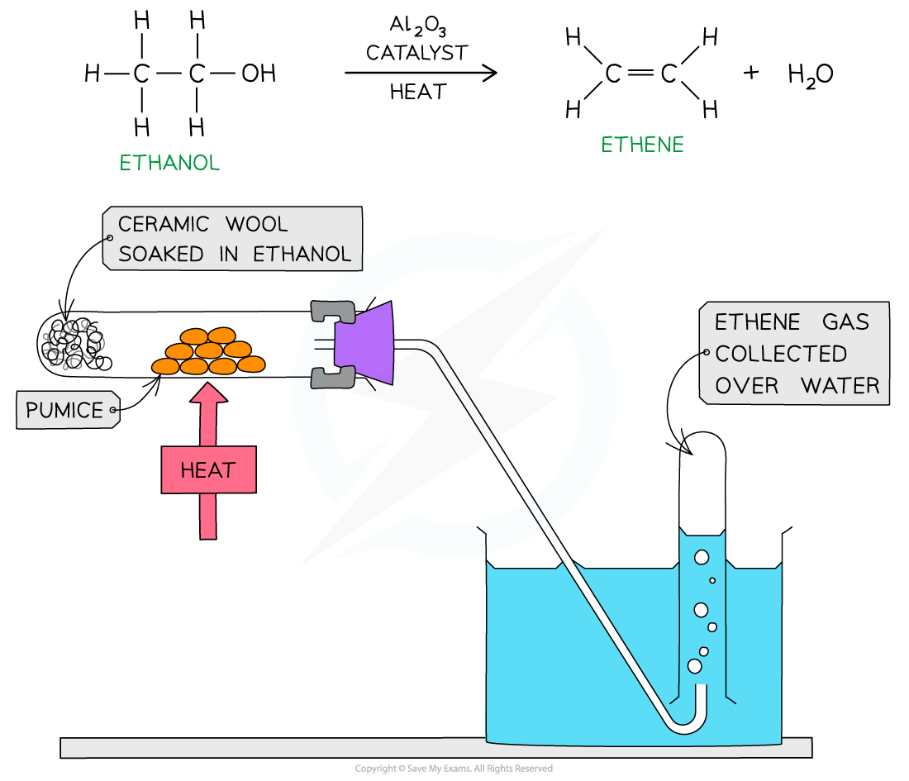
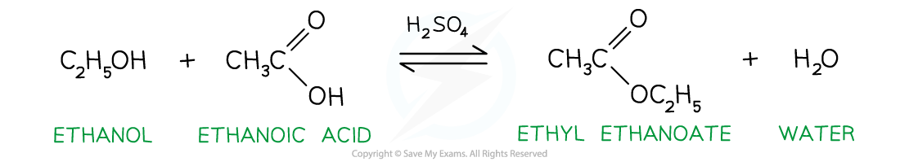

# Reactions of Alcohols

## Reactions of Alcohols

> **Spec point** — `spcpt_qqWktwTJtr7snDF9`

## Reactions of Alcohols

- **Alcohols **are reactive molecules which undergo a wide range of reactions

### Combustion of alcohols

- Alcohols react with oxygen in the air when ignited and undergo **complete combustion **to form carbon dioxide and water

**alcohol + oxygen → carbon dioxide + water**

C2H5OH + 3O2 → 2CO2 + 3H2O

#### The complete combustion of ethanol

*Complete combustion of alcohols produces carbon dioxide and water*

### Substitution of alcohols

- In the **substitution **of alcohols, a hydroxy group (-OH) is replaced by a halogen to form an **halogenoalkane**
- The substitution of the alcohol group for a halogen can be achieved by reacting the alcohol with:

  - **HX** (rather than using HBr, KBr is reacted with concentrated H2SO4 or concentrated H3PO4 to make HBr that will then react with the alcohol)
  - **PCl****3** and heat
  - **PCl****5** at room temperature
  - **SOCl****2**

#### Substitution of alcohols

*The substitution of alcohols produces halogenoalkanes*

### Reaction with Na

- When an alcohol reacts with a **reactive metal **such as sodium (Na), the oxygen-hydrogen bond in the hydroxy group **breaks**
- Though the reaction is less vigorous than sodium reacting with water, **hydrogen gas** is given off and a **basic **compound (**alkoxide**) is formed

  - If the excess ethanol is evaporated off after the reaction a white crystalline solid of **sodium** **alkoxide** is left

**Alcohol + sodium → sodium alkoxide + hydrogen**

- The longer the hydrocarbon chain in the alcohol, the less **vigorous **the reaction becomes
-

#### The reaction of ethanol with sodium metal

*Alcohols react with Na to form a basic sodium alkoxide salt and hydrogen gas*

### Oxidation of alcohols

- Primary alcohols can be oxidised:

  - They form **aldehydes** which can undergo further oxidation to form **carboxylic** **acids**
- Secondary alcohols can be oxidised

  - They form **ketones **only
- Tertiary alcohols do not undergo oxidation

#### Oxidising agents

- The oxidising agents of alcohols include **acidified K****2****Cr****2****O****7** or **acidified KMnO****4**
- **Acidified potassium dichromate(VI)**, K2Cr2O7, is an orange oxidising agent

  - Acidified means that the potassium dichromate(VI) is in a solution of **dilute** **acid** (such as dilute sulfuric acid)
  - For potassium dichromate(VI) to act as an oxidising agent, it itself needs to be reduced
  - This reduction requires hydrogen (H+) ions which are provided by the acidic medium
  
    - When alcohols are **oxidised **the orange dichromate ions (Cr2O72-) are reduced to green Cr3+ ions
- **Acidified potassium manganate(VII)**, KMnO4, is a purple oxidising agent

  - As with acidified K2Cr2O7 the potassium manganate(VII) is in an acidic medium to allow reduction of potassium manganate(VII) to take place
  
    - When alcohols are **oxidised, **the purple manganate ions (MnO4-) are reduced to colourless Mn2+ ions
- When a **warm primary alcohol** is treated with an oxidising agent, it is initially oxidised to an **aldehyde**

  - The aldehyde has a **lower boiling point** than the alcohol, so it can be **distilled off as it forms** to prevent further oxidation
  - If it is **not distilled**, continued heating under **reflux with excess oxidising agent** will convert the aldehyde into a **carboxylic acid**
- In contrast, **secondary alcohols** are oxidised to **ketones**, which **cannot be further oxidised**, so there is **no need to distil them off immediately**

#### The distillation setup to convert an alcohol to an aldehyde

*The oxidation of ethanol by acidified potassium dichromate forms ethanal by distillation and ethanoic acid by refluxing*

#### Oxidation of propan-2-ol by acidified K2Cr2O7

*The oxidation of secondary alcohols by acidified potassium dichromate forms a ketone, under distillation*

### Dehydration of alcohols

- Alcohols can also undergo **dehydration **to form alkenes

  - Dehydration is a reaction in which a water molecule is removed from a larger molecule
  - A dehydration reaction is a type of **elimination **reaction
- Alcohol vapour is passed over a **hot catalyst **of aluminium oxide (**Al****2****O****3**) powder OR pieces of porous pot or pumice as well as concentrated acid can be used as catalysts

#### Dehydration of ethanol

*Dehydration of ethanol using aluminium oxide as a catalyst forms ethene gas, which can be collected over water*

### Esterification of Alcohols

- Esterification is a **condensation **reaction between a carboxylic acid and an alcohol to form an **ester** and a water molecule
- For esterification to take place, the carboxylic acid and alcohol are **heated under reflux **with a **strong acid catalyst **(such as H2SO4 or H3PO4)

**Carboxylic acid + alcohol → ester + water**

- The reaction is reversible so an equilibrium mixture can be established with all the reactants and products
- Esters have **sweet**, **fruity smells**

#### Example esterification reaction

*Esterification of ethanol and ethanoic acid using a strong acid catalyst to form ethyl ethanoate and water*

> **Exam Hint**
> The first part of an ester’s name comes from the alcohol, whereas the second part comes from the carboxylic acid
> 
> So, if ethanol and propanoic acid react together, this will make the ester **ethyl propanoate**
