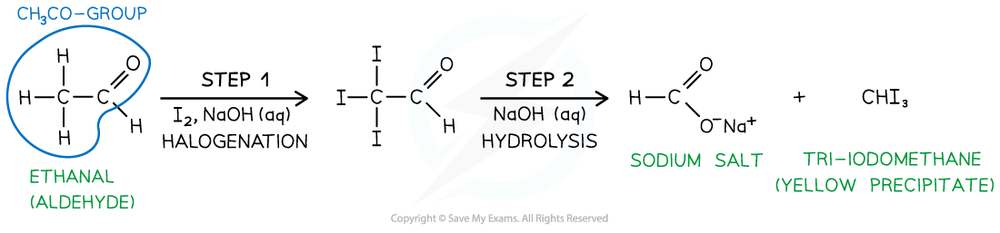

# Iodoform Reaction

## Iodoform Reaction

> **Spec point** — `spcpt_H9Jbcm5Cty6T835Q`

## Iodoform Reaction

- **Tri-iodomethane** (also called **iodoform**) is a **yellow precipitate**
- It is formed from the reaction of** iodine in an alkaline solution **with **methyl ketones**

  - Methyl ketones are compounds that have a CH3CO-group
  - **Ethanal** also contains a CH3CO- group and therefore also forms a yellow precipitate of iodoform (CHI3) when heated with alkaline iodine
- The reagent is **heated **with an **alkaline **solution of **iodine**
- This reaction involves a **halogenation **and **hydrolysis **step

  - In the **halogenation **step, all three H-atoms in the -CH3 (methyl) group are replaced with iodine atoms, forming a -CI3 group
  - The intermediate compound is hydrolysed by an **alkaline **solution to form a sodium salt (RCO2- Na+) and a yellow precipitate of CHI3

#### The iodoform reaction

*The reaction of ethanal with alkaline iodine results in the formation of a yellow precipitate of iodoform*
