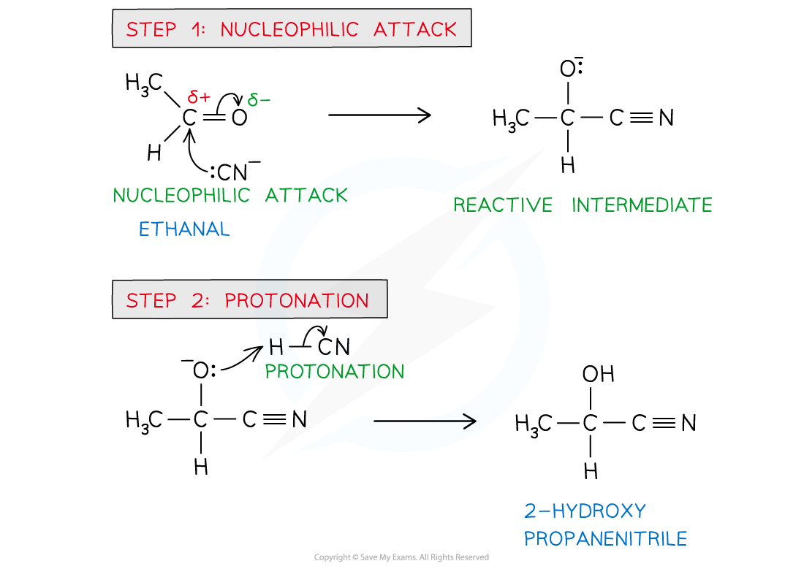

# Reactions of Aldehydes & Ketones with HCN

## Reaction of Hydrogen Cyanide with Aldehydes & Ketones

> **Spec point** — `spcpt_cG2ndgB7GyZG8n2C`

## Reaction of Hydrogen Cyanide with Aldehydes & Ketones

- The carbonyl group -C=O, in aldehydes and ketones is** polarised**
- The oxygen atom is more **electronegative **than carbon drawing electron density towards itself
- This leaves the carbon atom **slightly** **positively** **charged** and the oxygen atom **slightly** **negatively** **charged**
- The carbonyl carbon is therefore susceptible to attack by a **nucleophile**, such as the cyanide ion

### Nucleophilic addition

- The nucleophilic addition of hydrogen cyanide to carbonyl compounds is a two-step process
- In **step 1** the cyanide ion attacks the carbonyl carbon to form a negatively charged intermediate
- In **step 2** the negatively charged oxygen atom in the reactive intermediate quickly reacts with aqueous H+ (either from HCN, water or dilute acid) to form 2-hydroxynitrile

#### The nucleophilic addition of HCN mechanism

*The cyanide ion attacks the carbonyl carbon to form a negatively charged intermediate which quickly reacts with a proton to form a 2-hydroxynitrile compound*

> **Exam Hint**
> The actual negative charge on the cyanide ion is on the **carbon atom **and not on the **nitrogen atom**
