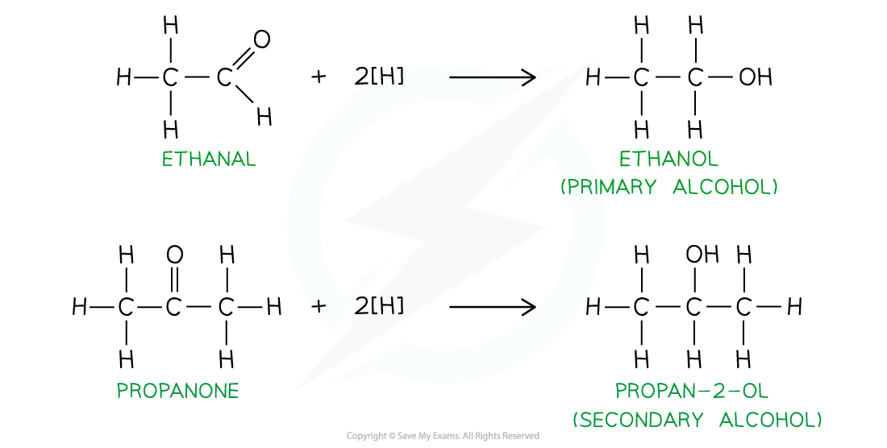
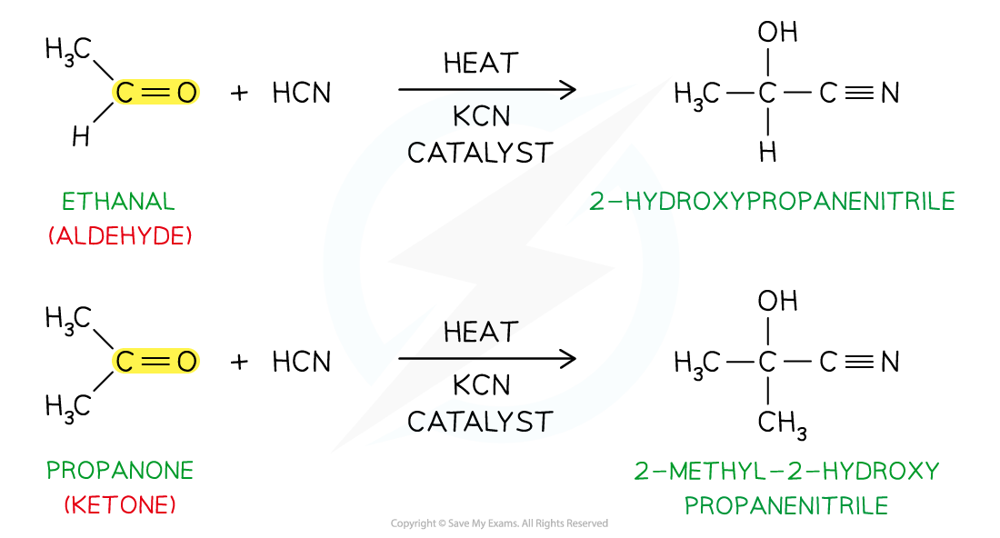

# Reactions of Aldehydes & Ketones

## Reactions of Aldehydes & Ketones

> **Spec point** — `spcpt_mvpMD8Jbcbhfj4Qv`

## Reactions of Aldehydes & Ketones

### Reduction of aldehyde & ketones

- **Aldehydes **and **ketones **can be reduced by reducing agents such as NaBH4 or LiAlH4
- Aldehydes are reduced to **primary alcohols**
- Ketones are reduced to **secondary alcohols**

#### Reduction of ethanal and propanone

*Aldehydes are reduced to form primary alcohols, while ketones are reduced to to form secondary alcohols*

### Nucleophilic addition with HCN

- Aldehydes and ketones can undergo **nucleophilic addition **with **hydrogen** **cyanide**, HCN
- The cyanide ion, CN-, acts as a nucleophile and adds across the C=O bond
- Aldehydes and ketones react with HCN, KCN as catalyst and heat to produce **hydroxynitriles**

  - Hydroxynitriles are nitriles containing a hydroxy, -OH, group

#### Nucleophilic addition of HCN to ethanal and propanone

*The nucleophilic addition of HCN to aldehydes other than methanal forms a chiral hydroxy nitrile compound, while the nucleophilic addition of HCN to ketones may form a chiral hydroxy nitrile compound*

> **Exam Hint**
> Catalytic hydrogenation (using H2/Pt/Ni) is indeed a powerful method that **can **reduce aldehydes and ketones to alcohols. However, this reaction often requires different (sometimes harsher) conditions than the hydrogenation of an alkene. This is not in the specification
> 
> The nucleophilic addition of HCN to an aldehyde or ketone increases the length of the carbon chain by one carbon atom!
