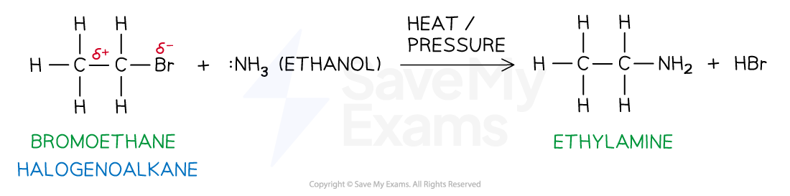

# Making Amines

## Production of Amines

> **Spec point** — `spcpt_5mhSzRMKWCJhpkgz`

## Production of Amines

- **Amines **are compounds with the amine (-NH2) functional group
- They can be produced as a result of **nucleophilic substitution **reactions of halogenoalkanes when they are heated under pressure with ethanolic ammonia (NH3 in ethanol)
- The halogen atom in halogenoalkanes is **more electronegative **than the carbon atom it is bonded to
- The halogen, therefore, draws **electron density **from the C-X bond (where X is the halogen) towards itself
- The carbon, therefore, has a **partial positive charge **and the halogen itself has a **partial negative charge **
- The lone pair of electrons on the nitrogen atom (in NH3) acts as a **nucleophile** and attacks the partial positively charged carbon
- As a result of this nucleophilic attack, the C-X bond is broken and the halogen is substituted by an amine group

#### Example nucleophilic substitution of a halogenoalkane

*Ammonia or amines replace the halogen in halogenoalkanes in a nucleophilic substitution reaction*
