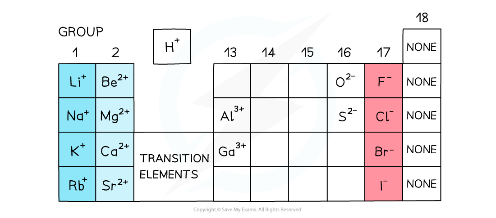

# Formulae

## Formulae of Ionic Compounds

> **Spec point** — `spcpt_jHXFWjBrkFcCCgVD`

## Formulae of Ionic Compounds

- **Ionic** **compounds** are formed from a **metal** and a **non-metal** bonded together
- Ionic compounds are electrically neutral; the positive charges equal the negative charges

### Charges on positive ions

- All metals form **positive** ions

  - There are some non-metal positive ions such as ammonium, NH4+, and hydrogen, H+
- The **metals** in Group 1, Group 2 and Group 13 have a charge of 1+ and 2+ and 3+ respectively
- The charge on the ions of the **transition elements can vary** which is why **Roman numerals **are often used to indicate their charge
- **Roman** **numerals** are used in some compounds formed from transition elements to show the **charge** (or **oxidation** **state**) of metal ions

  - E.g. in copper(I) oxide, the copper ion has a charge of 1+ whereas in copper(II) oxide, the copper ion has a charge of 2+

### Non-metal ions

- The **non-metals** in Group 15 to 17 have a negative charge and have the suffix ‘**ide**’

  - E.g. nitride, chloride, bromide, iodide
- Elements in Group 17 gain 1 electron so have a 1- charge, eg. Br-
- Elements in Group 16 gain 2 electrons so have a 2- charge, eg. O2-
- Elements in Group 15 gain 3 electrons so have a 3- charge, eg. N3-
- There are also more **compound** negative ions, which are negative ions made up of more than one type of atom

#### Periodic table outlining common ion charges

*The charges of simple ions depend on their position in the Periodic Table*

#### Formulae of ions

- Silver(I); Ag+
- Ammonium: NH4+
- Zinc(II): Zn2+
- Hydroxide: OH–
- Nitrate: NO3–
- Sulfate: SO42–
- Carbonate: CO32–
- Hydrogen carbonate: HCO3–
- Phosphate: PO43–

> **Worked Example**
> Determine the formulae of the following ionic compounds:
> 
> - Magnesium chloride
> - Iron(III) oxide
> - Aluminium nitrate
> 
> **Answer 1: Magnesium chloride**
> 
> - Magnesium is in Group 2 so has a charge of 2+
> - Chlorine is in Group 17 so has a charge of 1-
> - Magnesium needs two chlorine atoms for each magnesium atom to be balanced so the formula is **MgCl****2**
> 
> **Answer 2: Iron(III) oxide**
> 
> - The Roman numeral states that iron has a charge of 3+
> - Oxygen is in Group 16 so has a charge of 2-
> - The charges need to be equal so 2 iron to 3 oxygen atoms will balance electrically, so the formula is **Fe****2****O****3**
> 
> **Answer 3: Aluminium nitrate**
> 
> - Aluminium is in Group 13 so has a charge of 3+
> - Nitrate is a **compound ion** and has a charge of 1-
> - The compound ion needs to be placed in a bracket if more than 1 is needed
> - The formula of aluminium nitrate is **Al(NO****3****)****3**

> **Exam Hint**
> Remember:** Compound ions **are ions that contain more than one type of element, such as OH–
