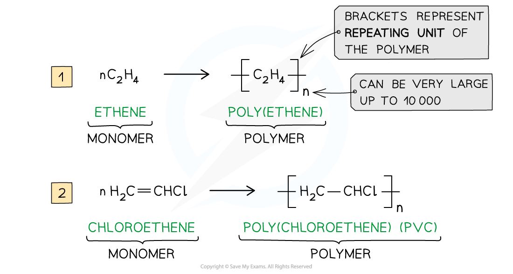
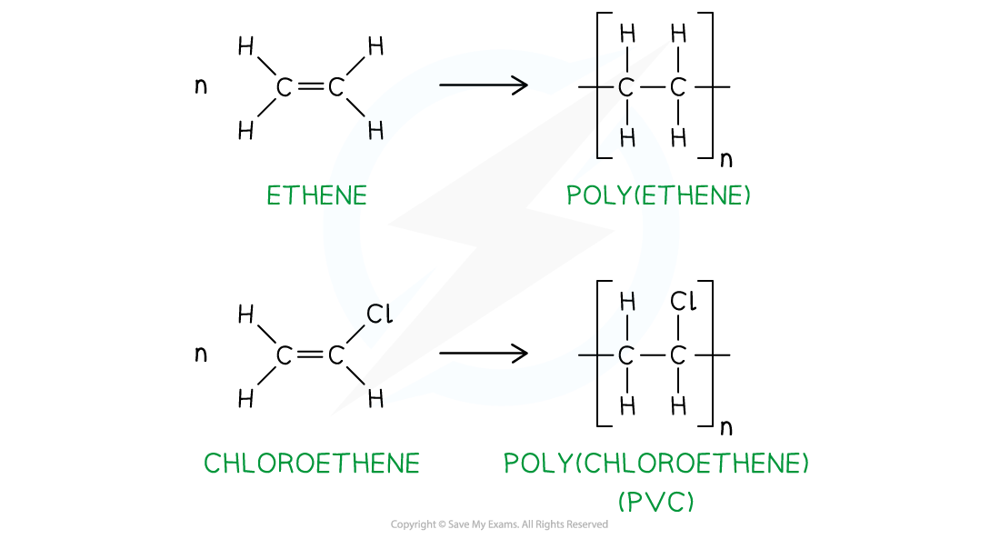
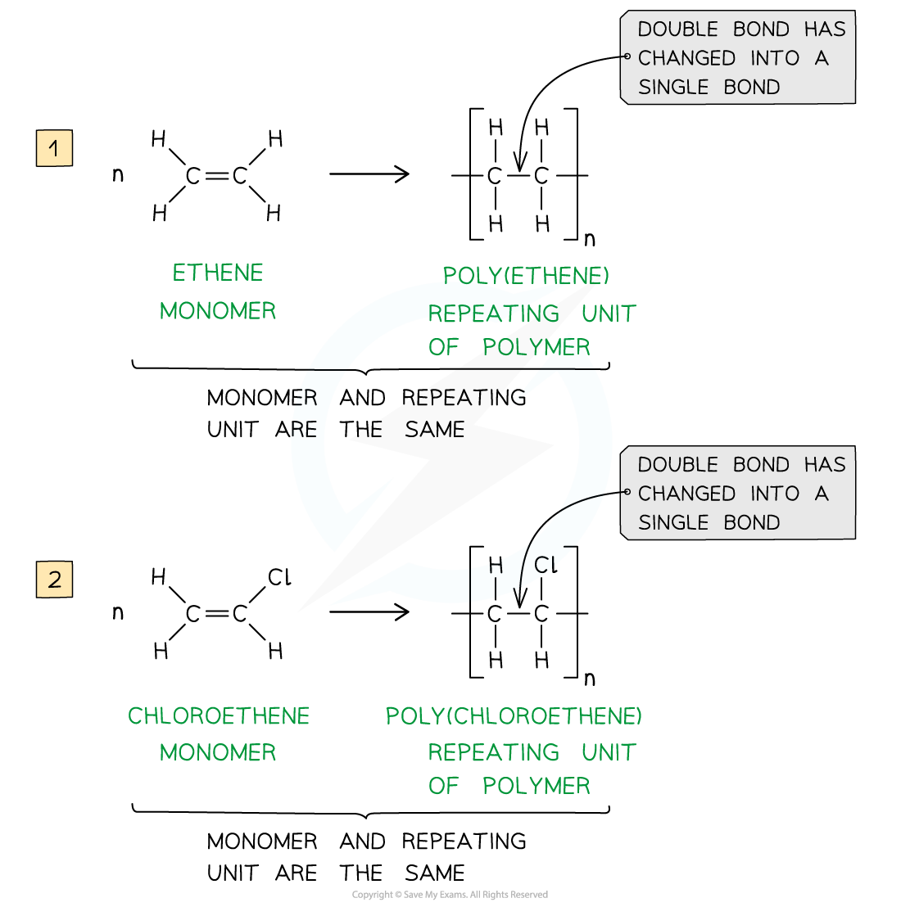

# Addition Polymerisation

## Addition Polymerisation: Polythene & PVC

> **Spec point** — `spcpt_DPwmzhM5Sk4TDQht`

## Addition Polymerisation: Polythene & PVC

### Addition polymerisation

- **Addition polymerisation **is one of the most important addition reactions of alkenes which form the basis of the plastic industry
- Addition polymerisation is the reaction in which many **monomers** containing at least one C-C double bond form long chains of **polymers** as the only product

  - Just like in other addition reactions of alkenes, the π-bond in each C=C double bond breaks and then the monomers link together to form new C-C single bonds
- A **polymer **is a long-chain molecule that is made up of many repeating units
- The small, reactive molecules that react together to form the polymer are called **monomers**
- A polymerisation reaction can be represented by a **general formula **or by using **displayed formulae**

  - E.g. poly(ethene) and poly(chloroethene) (also known as **PVC**) are polymers made up of the ethene and chloroethene monomers respectively and are commonly used in making plastics

#### General formula addition polymerisation

*The general formulae of the addition polymerisation of ethene (1) and chloroethene (2)*

#### Displayed formula addition polymerisation

*The displayed formulae of the addition polymerisation of ethene (1) and chloroethene (2)*

- Just like any other **addition **reaction of alkenes, addition polymerisation gives only **one **product

### Deducing repeat units

- A **repeat unit **is the smallest group of atoms that when connected one after the other make up the polymer chain

  - It is represented by **square brackets **in the displayed and general formula
- In **poly(alkenes) **(such as poly(ethene)) and **substituted poly(alkenes) **(such as PVC) made of **one type of monomer **the repeat unit is the same as the monomer except that the C=C double bond is changed to a C-C single bond

***  ***

#### Repeat units in polymers

*The repeating units of poly(ethene) and poly(chloroethene) are similar to their monomer except that the C=C bond has changed into a C-C bond*

> **Worked Example**
> Identify the monomers present in the given sections of addition polymer molecules:
> 
> 
> 
> **Answer 1:**
> 
> - When ethenol (CH(OH)=CH2) is polymerised, the C-C double bond opens to produce a repeating unit of CH(OH)-CH2.
> - This gives the polymer poly(ethenol)
> 
> 
> 
> **Answer 2:**
> 
> - To find the monomer, first the repeating unit should be deduced
> - Repeating units have only 2 carbons in the polymer main chain 
> 
> - Since the repeating unit is now found, it can be concluded that the monomer is prop-2-enoic acid 
> 
> **Answer 3:**
> 
> - Again, the repeating unit only has 2 carbons in the polymer chain which in this case are two carbon atoms that each contain one OH group
> - Thus, when ethene-1,2-diol (CH(OH)=CH(OH)) is polymerised, the C-C double bond opens to produce a repeating unit of CH(OH)-CH(OH) which gives the polymer poly(ethene-1,2-diol)
> 
> 

> **Exam Hint**
> The section of the polymer chain shown inside the square brackets by the structural or displayed formula is the **repeat unit **and** not** the monomer
> 
> The monomer is the same as the repeat unit except for that it has C=C bonds instead of C-C bonds
