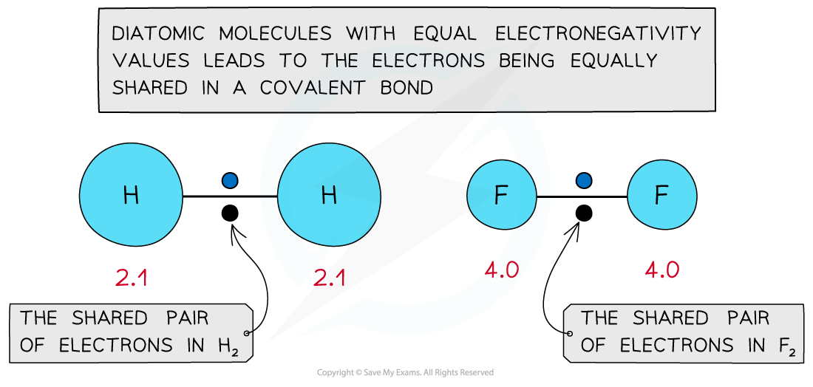
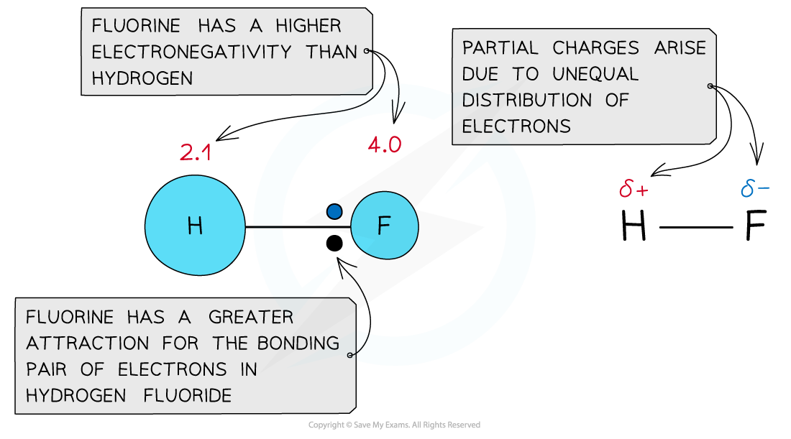
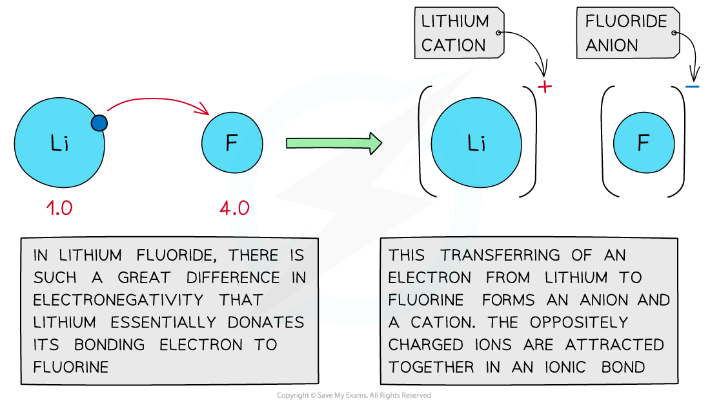

# Electronegativity & Bonding

## Using Electronegativity to Predict Bond Formation

> **Spec point** — `spcpt_W79MQwTT3nRz5Dzw`

## Using Electronegativity to Predict Bond Formation

- The differences in Pauling electronegativity values can be used to predict whether a bond is **covalent **or **ionic **in character

### Electronegativity & covalent bonds

- Single **covalent** **bonds** are formed by **sharing** a pair of electrons between two atoms
- In **diatomic** **molecules,** the electron density is shared equally between the two atoms

  - Eg. H2, O2 and Cl2
- Both atoms will have the same electronegativity value and have an **equal** **attraction** for the bonding pair of electrons leading to the formation of a **covalent **bond
- The equal distribution leads to a **non-polar molecule**

#### Electronegativity and non-polar molecules

*The electronegativity values are equal resulting in the formation of a nonpolar covalent bond*

### Electronegativity & polar covalent bonds

- When atoms of **different** electronegativities form a molecule, the shared electrons are not equally distributed in the bond
- The **more electronegative** atom (the atom with the higher value on the Pauling scale) will draw the bonding pair of electrons towards itself
- A molecule with partial charges forms as a result
- The **more electronegative** atom will have a **partial negative **charge (delta negative, **δ****-**)
- The **less electronegative **atom will have a partial positive charge (delta positive, **δ****+**)
- This leads to a **polar covalent molecule**

#### Electronegativity and polar covalent molecules

*The electronegativity values are not equal so a polar bond forms*

- If there is a **large** difference in electronegativity of the two atoms in a molecule, the least electronegative atom’s electron will **transfer** to the other atom
- This in turn leads to an **ionic bond** – one atom transfers its electron and the other gains that electron

  - The **cation **is a **positively charged species **which has **lost **(an) electron(s)
  - The **anion** is a **negatively charged species **which has **gained **(an) electron(s)

### Electronegativity and ionic bonding

*Large differences in electronegativity values lead to the formation of ionic bonds*

> **Exam Hint**
> Electronegativity difference (Δ*EN*) gives a guide to how polar a bond is (it’s a continuum, not a strict rule):
> 
> - Δ*EN* ≈ 0.0–0.4 means non-polar covalent
> - Δ*EN* ≈ 0.4–1.7 means polar covalent
> - Δ*EN* ≳ 1.7 means mostly ionic
> 
> Remember: a polar* *bond* *doesn’t always mean a polar molecule, the shape of the molecule determines whether bond dipoles cancel out.
