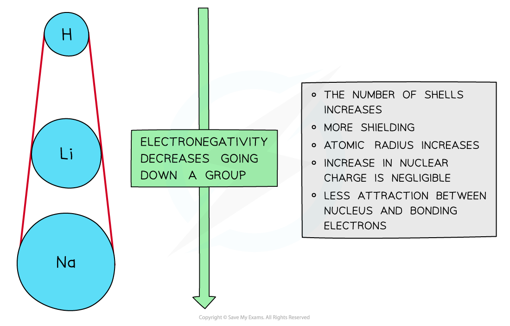
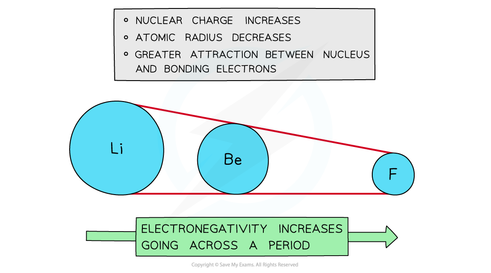

# Trends in Electronegativity

## Trends in Electronegativity

> **Spec point** — `spcpt_45K6F3xzDKJt8C25`

## Trends in Electronegativity

- **Electronegativity** varies across **Periods** and down the Groups of the Periodic Table

### Down a group

- There is a **decrease** in **electronegativity** going down the Group
- The **nuclear charge increases** as more protons are being added to the nucleus
- However, each element has an extra filled electron shell, which increases the **shielding**
- The addition of the extra shells increases the distance between the nucleus and the outer electrons resulting in **larger** **atomic radii**
- Overall, there is a decrease in attraction between the nucleus and outer bonding electrons

#### Why electronegativity decreases down a group

*Electronegativity decreases going down the groups of the Periodic Table*

### Across a period

- Electronegativity **increases** across a Period
- The **nuclear charge increases** with the addition of protons to the nucleus
- **Shielding** remains reasonably the **same** across the Period as no new shells are being added to the atoms
- The nucleus has an increasingly strong attraction for the bonding pair of electrons of atoms across the Period of the Periodic Table
- This results in **smaller atomic radii**

#### Why electronegativity increases across a period

*Electronegativity increases going across the periods of the Periodic Table*

### Trends down a group & across a period

- **Nuclear charge**

  - Increases down a group
  - Increases across a period
- **Shielding**

  - Increases down a group
  - Reasonably constant across a period
- **Atomic radius**

  - Increases down a group
  - Decreases across a period
- **Electronegativity**

  - Decreases down a group
  - Increases across a period

> **Exam Hint**
> - Remember the general trend is an **increase** in electronegativity towards the top right of the Periodic Table.
> - Fluorine is the most electronegative element in the Periodic Table.
