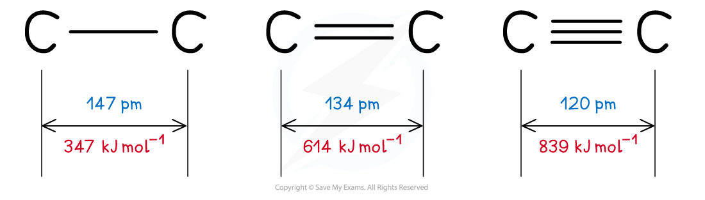

# Bond Energy & Length

## Energy & Length of Covalent Bonds

> **Spec point** — `spcpt_tCRzWvJsYwc8Wf2y`

## Energy & Length of Covalent Bonds

### Bond energy

- The **bond energy **is the energy required to **break **one mole of a particular covalent bond in the gaseous state

  - Bond energy has units of kJ mol-1
- The **larger **the bond energy, the **stronger **the covalent bond is

### Bond length

- The **bond length **is **internuclear distance of two covalently bonded atoms**

  - It is the distance from the nucleus of one atom to another atom which forms the covalent bond
- The **greater **the forces of attraction between electrons and nuclei, the more the atoms are pulled closer to each other
- This **decreases **the **bond** **length** of a molecule and **increases **the **strength** of the covalent bond
- **Triple bonds **are the **shortest** and **strongest** covalent bonds due to the large electron density between the nuclei of the two atoms
- This increases the forces of attraction between the electrons and nuclei of the atoms
- As a result of this, the atoms are pulled closer together causing a shorter bond length
- The increased forces of attraction also mean that the covalent bond is **stronger**

#### Comparing the length of carbon-carbon covalent bonds

*Triple bonds are the shortest covalent bonds and therefore the strongest ones*

### Reactivity of covalent molecules

- The **reactivity **of a covalent bond is greatly influenced by:

  - The bond **polarity**
  - The bond **strength**
  - The bond **type **(σ/π)

> **Worked Example**
> **Bond lengths & bond energies**
> 
> Bond lengths and bond energy for various hydrogen halides is shown in the table below.
> 
> | **Hydrogen halide** | **Bond length (nm)** | **Bond energy (kJ mol****-1****)** |
> |---|---|---|
> | **HCl** | 0.127 | 431 |
> | **HBr** | 0.141 | 366 |
> | **HI** | 0.161 | 299 |
> 
> 1. Suggest why the bond energy values of hydrogen halides decrease in the order HCl > HBr > HI.
> 2. Suggest a value for the bond length in HF.
> 3. Suggest which hydrogen halide is the most reactive.
> 
> **Answer 1:**
> 
> - Going down the halogen group, the atoms are bigger
> - This means that the attractive force between the bonding electrons and the nucleus gets smaller
> - So, less energy is needed to break the bond
> 
> **Answer 2:**
> 
> - Going down the group the increase in bond length is approximately 0.014 - 0.020 nm
> - Fluorine is smaller than chlorine, so a value between 0.09 and 0.11 nm is acceptable for the bond length
> 
> **Answer 3:**
> 
> - The hydrogen halide with the longest bond length and therefore smallest bond energy is the most reactive, as it takes the least energy to break the bond between the hydrogen and halide atoms
> - Therefore, HI is the most reactive hydrogen halide
